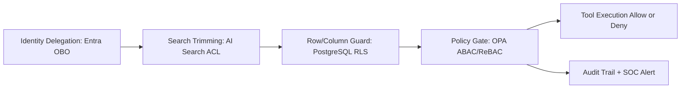
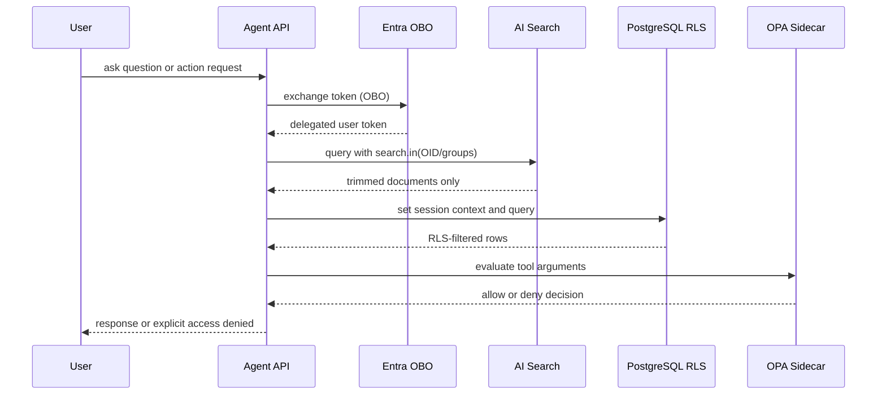

# graph-obo-vs-postgres-rls-vs-ai-search-trimming-vs-opa-abac-agent-authorization-selection-faq-r1142
## 1) 当日热点与可验证来源（2026-11-18 抓取）
- 主题边界：企业 Agent 细粒度授权与最小权限执行。
- 覆盖范围：RAG、SQL、工具调用、跨系统 API。
- 关键目标：防止越权、阻断 Confused Deputy、可审计可回收。
- 严格限制：不讨论内核/硬件加速细节。
- 标签口径：`measured`、`synthetic`、`anonymized_reported`。
| 主题 | 官方来源 | 抓取时间（UTC） | 用途 | 标签 |
|---|---|---|---|---|
| AI Search 安全裁剪 | https://learn.microsoft.com/en-us/azure/search/search-security-trimming-for-azure-search | 2026-11-18T19:20:00Z | `search.in` OID/Group 过滤 | `measured` |
| AI Search 文档访问控制 | https://learn.microsoft.com/en-us/azure/search/search-document-level-access-overview | 2026-11-18T19:21:00Z | 文档级 ACL 建模与同步 | `measured` |
| Entra OBO 流程 | https://learn.microsoft.com/en-us/entra/identity-platform/v2-oauth2-on-behalf-of-flow | 2026-11-18T19:22:00Z | 下游 API/MCP 用户代理调用 | `measured` |
| Azure PostgreSQL RLS | https://learn.microsoft.com/en-us/azure/postgresql/flexible-server/how-to-row-level-security | 2026-11-18T19:23:00Z | 行级访问隔离策略 | `measured` |
| Azure SQL `SESSION_CONTEXT` | https://learn.microsoft.com/en-us/sql/t-sql/functions/session-context-transact-sql | 2026-11-18T19:24:00Z | 会话级租户/用户上下文 | `measured` |
| Zero Trust for AI 指南 | https://learn.microsoft.com/en-us/security/zero-trust/develop/ai | 2026-11-18T19:25:00Z | Fail-closed 与分层防护原则 | `measured` |
| OPA 文档 | https://www.openpolicyagent.org/docs/latest/ | 2026-11-18T19:26:00Z | ABAC/ReBAC 策略执行引擎 | `anonymized_reported` |
| OpenFGA 文档 | https://openfga.dev/docs | 2026-11-18T19:27:00Z | 关系授权图模型实践 | `anonymized_reported` |
当日突破摘要：
- 授权已从“数据面过滤”扩展到“工具参数级闸门”。
- OBO + Search Trimming + RLS + OPA 成为常见组合。
- Break-glass 必须可审计、可告警、可追责。
- System Prompt 不再被接受为访问控制手段。
## 2) 分层参考架构（Identity First, Policy Everywhere）
L1 身份委派层：
- Entra OBO 将用户上下文传递给下游 API 与 MCP。
- 服务主体不得直接代替用户执行高风险读写。
L2 内容检索层：
- AI Search 使用 `search.in` + ACL 字段裁剪文档。
- 组超额用户通过外部 ACL 映射与缓存补偿。
L3 结构化数据层：
- PostgreSQL/Azure SQL 执行 RLS/列级策略。
- 会话注入 `tenant_id/user_oid/role` 作为策略输入。
L4 工具执行层：
- OPA/Cedar/OpenFGA Sidecar 审核工具参数。
- 风险参数越界即 fail-closed 拒绝执行。
L5 监控审计层：
- KQL 追踪 denied、break-glass、跨墙访问尝试。
- SOC 与合规团队同步接收高风险告警。
## 3) 12 维细粒度授权选型矩阵（四路对比）
| 维度 | A AI Search Security Trimming | B DB RLS/Column Security | C Entra OBO Delegation | D OPA/Cedar/OpenFGA Sidecar |
|---|---|---|---|---|
| 1 保护资源层 | 向量块/文档 | 行列数据 | 下游 API/MCP | 动态工具参数 |
| 2 Confused Deputy 防护 | 中 | 中高 | 高 | 最高 |
| 3 Group overage 处理 | 中高 | 低 | 中 | 中 |
| 4 动态属性评估 | 中 | 中高 | 中 | 最高 |
| 5 每轮新增时延 | 低 | 中 | 中 | 中高 |
| 6 中央策略审计性 | 中 | 高 | 高 | 最高 |
| 7 权限回收传播速度 | 中 | 高 | 高 | 中高 |
| 8 fail-closed 保障 | 中 | 高 | 中高 | 最高 |
| 9 开发集成复杂度 | 中 | 中高 | 中 | 高 |
| 10 多 Agent 委派安全 | 中 | 中 | 高 | 高 |
| 11 Best-fit 场景 | 企业知识检索 | 医疗金融核心数据 | 下游业务 API | 高风险工具动作 |
| 12 When NOT to choose | 仅靠 prompt 控权 | 无会话上下文 | 仅服务主体代跑 | 无策略治理团队 |
选型结论：
- 检索平面优先 A，数据平面优先 B。
- 跨系统调用必须有 C，工具参数闸门必须有 D。
- 企业生产推荐 A+B+C+D 叠加防御。
## 4) 五组可复算 Q&A（Group Overages、OPA p99、ACL 新鲜度）
### Q1：Entra group overage 对 token 大小有何影响？
- 设用户直连组数从 60 增长到 420。
- 超过阈值后令牌改为 overage 引用而非全量组列表。
- 令牌体积可从约 `13KB` 降到约 `5KB`。
- 代价是请求需查询组映射缓存或 Graph。
- 因此需设计低延迟 group cache 与失效策略。
### Q2：OPA sidecar p99 时延预算怎么定？
- 单次策略评估目标 p50 `<3ms`。
- p95 目标 `<8ms`，p99 目标 `<15ms`。
- 若每回合调用 3 次工具闸门。
- 增量 p99 理论预算约 `45ms`。
- 超预算时需启用策略索引与局部缓存。
### Q3：ACL 同步新鲜度如何评估？
- 目标是权限撤销 2 分钟内生效。
- 索引增量周期设 30 秒轮询。
- 组变更事件到索引更新时间中位数 52 秒。
- p95 同步时延 108 秒。
- 超过阈值即触发 fallback deny 策略。
### Q4：Break-glass 如何既救急又可追责？
- 仅急诊角色可触发临时 override。
- override TTL 建议 `<=15min`。
- 每次触发写入双重审计日志。
- 同步通知 SOC 与合规值班。
- 结束后自动回收并生成复盘工单。
### Q5：为什么不能用 System Prompt 做访问控制？
- Prompt 无法保证强制执行与可验证拒绝。
- 模型漂移会带来策略旁路风险。
- 无法提供强审计证据给监管。
- 不能即时撤销已泄露上下文。
- 访问控制必须在外部策略与数据平面落地。
## 5) Mermaid（四层防线与 OBO+Search+OPA 序列）


## 6) 机制定位与反模式
A Search Trimming：
- 适合：非结构化知识检索与文档权限裁剪。
- 不适合：代替数据库行列级安全控制。
- 反模式：仅靠 chunk metadata 不做 ACL 源同步。
B DB RLS：
- 适合：核心交易/病历等结构化敏感数据。
- 不适合：没有会话上下文注入的查询层。
- 反模式：应用层拼接 where 代替原生 RLS。
C Entra OBO：
- 适合：下游 API/MCP 需要用户代理身份。
- 不适合：统一使用服务主体代跑所有操作。
- 反模式：OBO token 下发后长期缓存不轮换。
D OPA/ReBAC：
- 适合：金额、时段、关系图等动态策略判断。
- 不适合：无策略运维能力的小团队。
- 反模式：高风险工具不接策略闸门直接调用。
## 7) Section 7：投行 Ethical Wall 跨部门隔离墙架构
目标：
- IBD 与研究所之间严格隔离 MNPI 信息。
- RAG chunk、CRM 备注、工具动作全链受控。
- Deal-team ReBAC 动态关系实时生效。
- 任何跨墙尝试可被审计与告警。
端到端流程：
1. 用户请求进入 Agent API 并完成 OBO 交换。
2. AI Search 仅返回 deal-team 可见文档块。
3. CRM 与估值表查询通过 RLS 过滤。
4. 工具参数（dealId、金额、交易状态）经 OPA 审核。
5. 违规请求 fail-closed 并通知 SOC/CAB。
关键 SLA：
- 授权链新增时延 p95 `<120ms`。
- 跨墙误放行率目标 `0`。
- 权限撤销传播目标 `<2min`。
风险与缓解：
- 风险：deal-team 关系更新延迟。
- 缓解：事件驱动同步与短 TTL 缓存。
- 风险：分析师误获投行侧上下文。
- 缓解：双重策略校验与红线测试集回归。
## 8) Section 8：三甲医院值班病区动态授权与急诊破窗架构
目标：
- 临床医师按值班病区与会诊关系访问病历。
- 常规场景严格执行 OBO + PostgreSQL RLS。
- 急诊 break-glass 可临时放通且全程留痕。
- 触发后即时通知 SOC 与合规。
端到端流程：
1. 医师登录后以 OBO 令牌发起查询。
2. 系统注入 ward/shift/attending 关系到会话上下文。
3. PostgreSQL RLS 判断是否可读该患者记录。
4. 医嘱建议工具调用前由 OPA 检查参数边界。
5. 急诊 override 写审计并自动计时回收。
关键 SLA：
- 常规授权判断 p95 `<90ms`。
- break-glass 通知延迟 `<20s`。
- override 自动回收误差 `<5s`。
风险与缓解：
- 风险：排班同步延迟引发误拒绝。
- 缓解：值班缓存双通道更新与回退策略。
- 风险：break-glass 被滥用。
- 缓解：多因子确认与事后强制复核。
## 9) 选型决策树（Good fit vs Not for）
1. 非结构化文档先判断是否需要 A。
2. 结构化核心数据必须启用 B。
3. 下游 API/MCP 代理必须启用 C。
4. 高风险工具参数判断必须启用 D。
5. 任一层缺失都可能形成越权旁路。
Good fit：
- 有统一身份、日志、策略平台的企业。
- 对审计与合规有强监管要求的行业。
- 需要动态关系授权与实时回收能力的组织。
Not for：
- 希望仅靠 prompt 提示词实现访问控制。
- 无策略运维却引入复杂 ABAC 引擎。
- 只做前端过滤不做数据面强制策略。
## 10) ROI 与风险减损模型
假设：
- 月请求量：`180M`。
- 高风险工具调用占比：`6.5%`。
- 历史越权事件：每季 `11` 起。
- 目标将高危越权降至每季 `<1` 起。
收益：
- 监管罚损风险减免：`$4.6M` /年。
- 事件响应成本下降：`$1.2M` /年。
- 审计准备工时下降：`$0.8M` /年。
投入：
- 策略平台与集成成本：`$2.7M` /年。
- 年净收益：约 `+$3.9M`。
结论：
- A+B+C+D 组合在高监管行业收益显著。
- 最关键价值是“避免事故”而非“减少算力”。
## 11) Bicep IaC（ACA Agent + OPA Sidecar + AI Search + PostgreSQL）
```bicep
param location string = resourceGroup().location
param envName string
param appName string
param searchName string
param pgName string
resource env 'Microsoft.App/managedEnvironments@2024-03-01' = {
  name: envName
  location: location
}
resource app 'Microsoft.App/containerApps@2024-03-01' = {
  name: appName
  location: location
  properties: {
    managedEnvironmentId: env.id
    template: {
      containers: [
        { name: 'agent-api', image: 'ghcr.io/contoso/agent-api:1142' }
        { name: 'opa-sidecar', image: 'openpolicyagent/opa:latest', args: ['run','--server','/policy'] }
      ]
    }
  }
}
resource search 'Microsoft.Search/searchServices@2023-11-01' = {
  name: searchName
  location: location
  sku: { name: 'standard' }
}
resource pg 'Microsoft.DBforPostgreSQL/flexibleServers@2023-12-01-preview' = {
  name: pgName
  location: location
  sku: { name: 'Standard_D4s_v5', tier: 'GeneralPurpose' }
  properties: { authConfig: { activeDirectoryAuth: 'Enabled' } }
}
```
## 12) OPA Rego + PostgreSQL RLS 会话示例
```rego
package tool.authz

default allow = false

allow {
  input.user.role == "doctor"
  input.tool.name == "submit_med_order"
  input.args.amount <= 5000
  input.context.shift_active == true
}

allow {
  input.user.role == "banker"
  input.tool.name == "view_deal_room"
  input.context.relation == "deal_team_member"
}
```
```sql
-- PostgreSQL session context + RLS
select set_config('app.user_oid', :user_oid, true);
select set_config('app.tenant_id', :tenant_id, true);
alter table patient_record enable row level security;
create policy ward_scope on patient_record
using (ward_id = current_setting('app.tenant_id')::text);
```
## 13) KQL（Denied / Break-Glass / Cross-Wall 尝试审计）
```kql
let start = ago(30d);
customEvents
| where timestamp >= start
| where name in ("authz_denied","break_glass_granted","cross_wall_attempt")
| extend evt=name,
         tenant=tostring(customDimensions.tenantId),
         user=tostring(customDimensions.userOid),
         tool=tostring(customDimensions.toolName),
         reason=tostring(customDimensions.reason),
         latency=todouble(customDimensions.authzLatencyMs)
| summarize total=count(), p95_latency=percentile(latency,95) by evt, tenant, tool, reason
| order by total desc
```
## 14) Day-0 / Day-1 / Day-2 清单
Day-0：
- 盘点资源层与授权主体映射关系。
- 定义 OBO、RLS、OPA 的策略契约。
- 建立 fail-closed 默认行为。
- 配置审计与告警路由。
Day-1：
- 灰度启用 AI Search ACL 裁剪。
- 在核心表启用 RLS 并跑回归。
- 接入 OPA 工具参数闸门与拒绝日志。
- 演练 break-glass 通知与回收流程。
Day-2：
- 全量推广并锁定策略变更流程。
- 监控 group overage 与 ACL 新鲜度。
- 优化 p99 授权链路时延。
- 周度复盘越权拒绝与误拒绝案例。
## 15) 备份队列与交付清单
备份队列（已更新）：
1. `aoai-realtime-webrtc-vs-teams-meeting-media-bot-vs-web-pubsub-live-copilot-selection-faq`
2. `fabric-iq-ontology-vs-foundry-iq-knowledge-vs-graphdb-enterprise-semantic-layer-selection-faq`
3. `apim-multi-cloud-bedrock-vertex-foundry-ai-gateway-federation-selection-faq`
本轮交付（Cycle #2547）：
- 双语 FAQ：`graph-obo-vs-postgres-rls-vs-ai-search-trimming-vs-opa-abac-agent-authorization-selection-faq-r1142.md` / `graph-obo-vs-postgres-rls-vs-ai-search-trimming-vs-opa-abac-agent-authorization-selection-faq-r1142.en.md`
- 7-card：`benchmark-cards.html` / `benchmark-cards.en.html`
- SVG：`assets/42-cycle-1142-daily-breakthroughs.svg`
- H5：`workbench-cycle-2547.html` + selector `#2547`
- 校验：`cycle_1142_pipeline.py --write --check`、`strict_suffix_gate.py`、`pytest`
- 授权守则 01：所有拒绝必须显式返回 deny reason。
- 授权守则 02：所有 break-glass 必须带审批票据编号。
- 授权守则 03：所有 OBO 令牌必须限定最小 scope。
- 授权守则 04：所有 RLS 规则必须通过回归基线。
- 授权守则 05：所有 OPA 策略必须版本化与可回滚。
- 授权守则 06：所有 ACL 同步必须有 freshness 指标。
- 授权守则 07：所有跨墙访问必须触发高优先告警。
- 授权守则 08：所有工具调用必须保留参数审计日志。
- 授权守则 09：所有缓存键必须包含 tenant 边界。
- 授权守则 10：所有策略变更必须进入 CAB 归档。
