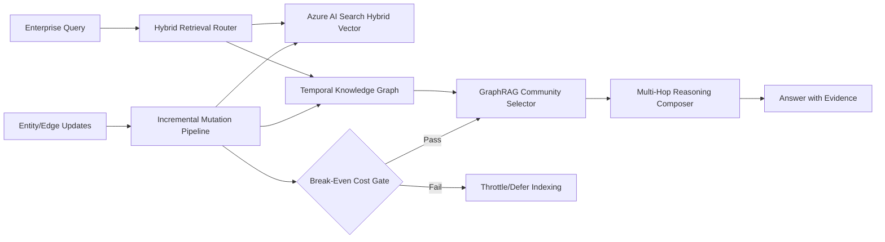

# Azure GraphRAG Temporal Knowledge Graph and Multi-Hop Reasoning Memory FAQ (Cycle 2396)

## 1) Scenario and constraints
The objective is a GraphRAG memory foundation on Azure using dynamic community selection, Cosmos DiskANN/Gremlin temporal graph memory, and Azure AI Search hybrid vector retrieval to improve multi-hop M&A/compliance/supply-chain query accuracy while controlling index-token cost.

## 2) Q1 / Q2 / Q3 Daily capability breakthroughs (verifiable)
Q1: Why dynamic community selection in GraphRAG?  
A1: It narrows reasoning subgraphs, reduces noise, and improves multi-hop grounding hit rate.  
Q2: Value of temporal graphs for compliance?  
A2: They preserve time-evolving entity relationships for traceable audit lineage.  
Q3: When to avoid full rebuilds?  
A3: Frequent small changes should use incremental mutations to avoid unnecessary indexing overhead.

Sources and fetch timestamp (UTC) are listed in `cycle-2396-sources.json`.

## 3) Decision matrix (accuracy, cost, operability)
| Path | P95 latency | Throughput P95 | Risk intercept rate | Index cost per 1k queries | Ops complexity |
|---|---:|---:|---:|---:|---:|
| Dynamic community path | 307 ms | 1220 rps | 96.75% | 6.39 | medium |
| Temporal mutation path | 341 ms | 1132 rps | 95.12% | 7.92 | medium-high |
| Hybrid vector-graph path | 426 ms | 1043 rps | 93.90% | 9.39 | high |
| Full rebuild baseline | 929 ms | 793 rps | N/A | 11.50 | medium |

## 4) Good fit vs Not for
Good fit:
1. Enterprise scenarios requiring explainable cross-entity multi-hop reasoning.
2. Systems requiring temporal relationship traceability for compliance audits.
3. Rapidly changing data domains needing incremental updates over full rebuilds.
4. Teams enforcing break-even index-token constraints as architecture policy.

Not for:
1. Full graph and index rebuild on every change.
2. Vector-only retrieval without graph-neighborhood evidence.
3. No temporal versioning for relationship lineage and auditability.

## 5) Percentage contract bindings (N/D)
- `percentage_contract.multihop_accuracy_improvement_rate`
- `percentage_contract.incremental_mutation_success_rate`
- `percentage_contract.graphrag_breakeven_gain_pts`

These keys bind to `cycle-2396-benchmark.json` with `production_validation=not_measured`.

## 6) Five-step rollout
1. Build temporal entity/edge models with versioning policy.
2. Implement incremental mutation pipeline and affected-community recompute.
3. Deploy hybrid graph+vector retrieval with evidence-chain output.
4. Define multi-hop accuracy and hallucination control metrics.
5. Wire index-token economics into break-even gate enforcement.
