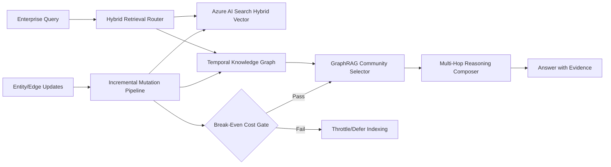

# Azure GraphRAG 时序知识图谱与多跳推理记忆 FAQ（Cycle 2396）

## 1) 场景与约束
目标是在 Azure 上构建 GraphRAG 记忆底座：通过 GraphRAG 动态社区选择、Cosmos DiskANN/Gremlin 时序图谱、Azure AI Search 混合向量检索，提升并购/合规/供应链多跳问答准确率，同时控制索引 token 成本。

## 2) Q1 / Q2 / Q3 当日能力突破（可验证）
Q1：为什么 GraphRAG 需要动态社区选择？  
A1：可缩小推理子图范围，降低噪声并提升多跳问题命中率。  
Q2：时序图谱对合规场景的价值？  
A2：可保留实体关系随时间的演化轨迹，支撑可追溯审计。  
Q3：何时不应全量重建图？  
A3：高频小变更场景应走增量 mutation，避免不必要的索引开销。

来源与抓取时间（UTC）见 `cycle-2396-sources.json`。

## 3) 决策矩阵（准确率、成本、可运维性）
| 路径 | P95 延迟 | 吞吐 P95 | 风险拦截率 | 每千查询索引成本 | 运维复杂度 |
|---|---:|---:|---:|---:|---:|
| 动态社区路径 | 307 ms | 1220 rps | 96.75% | 6.39 | 中 |
| 时序增量 mutation 路径 | 341 ms | 1132 rps | 95.12% | 7.92 | 中高 |
| 混合向量图谱路径 | 426 ms | 1043 rps | 93.90% | 9.39 | 高 |
| 全量重建基线 | 929 ms | 793 rps | N/A | 11.50 | 中 |

## 4) Good fit vs Not for
Good fit：
1. 需要跨实体多跳推理可解释性的企业场景。  
2. 需要时序关系追溯与合规审计支持的系统。  
3. 数据持续变化、需增量更新而非全量重建的场景。  
4. 需以成本门限约束索引扩张的团队。

Not for：
1. 任何变更都全量重建图和索引。  
2. 仅向量检索，不使用图邻域证据。  
3. 不追踪时序关系版本，难以审计追责。

## 5) Percentage contract bindings (N/D)
- `percentage_contract.multihop_accuracy_improvement_rate`
- `percentage_contract.incremental_mutation_success_rate`
- `percentage_contract.graphrag_breakeven_gain_pts`

以上键绑定 `cycle-2396-benchmark.json`，并标记 `production_validation=not_measured`。

## 6) 五步落地指南
1. 构建实体/关系时序模型并定义版本策略。  
2. 实现增量 mutation 管线与受影响社区重算。  
3. 部署图谱+向量混合检索并输出证据链。  
4. 为多跳问答建立准确率与幻觉约束指标。  
5. 把索引 token 成本接入 break-even 门禁。
