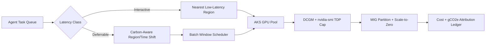

# GreenOps Carbon-Aware Scheduling and GPU Energy-Efficiency FAQ (Cycle 2421)

## 1) Executive summary
This cycle focuses on ESG-aligned agent infrastructure: carbon-aware routing (spatial + temporal shifting), AKS GPU power engineering (DCGM + TDP capping + MIG + idle scale-to-zero), and algorithmic energy reduction (FP8/INT4, KV caching, SLM cascades) with unified `$` + `gCO2e` attribution.

## 2) Q1 / Q2 / Q3
Q1: Why is `Joules-per-Resolved-Task` better than raw PUE/FLOPS?  
A1: PUE/FLOPS reflect infrastructure efficiency but miss end-to-end business outcomes. `J/task` captures model choice, retries, scheduling, and success quality in one operational metric.  
Q2: How should H100/B200 TDP capping trade-offs be handled?  
A2: Prefill often tolerates stronger power caps than decode. Use workload-aware TDP profiles and autoscaling thresholds for interactive vs async classes.  
Q3: How to meet CSRD/ISO auditable AI carbon accounting?  
A3: Record per-task region-time carbon intensity, GPU energy, model version, and resolved status; reconcile carbon and financial attribution in one ledger.

## 3) Carbon-aware routing and GPU state engineering

## 4) Optimization matrix: latency-sensitive interactive vs deferrable async
| Workload class | Primary objective | Scheduling approach | Energy optimization intensity | UX risk |
|---|---|---|---:|---:|
| Interactive agents | TTFT and responsiveness | nearest-region + light carbon-aware routing | Medium | Low |
| Near-real-time | latency-cost balance | hybrid region + dynamic TDP capping | Medium-High | Medium |
| Async batch agents | carbon and cost minimization | temporal shift + low-carbon region routing | High | Low |

## 5) GreenOps production checklist (daily breakthroughs)
- Carbon-intensity source and scheduling decision chain must be replayable.  
- GPU pools enforce idle scale-to-zero and tiered TDP capping.  
- Inference path supports quantization, KV caching, and cascade routing.  
- `$` and `gCO2e` attribution are recorded per resolved task in one ledger.  
- Daily breakthrough tracking (fetched on 2026-11-15 UTC):  
  - Azure sustainability/carbon-aware guidance updates (`measured`).  
  - AKS GPU telemetry and DCGM optimization practices (`anonymized_reported`).  
  - Quantization and inference-cache efficiency paths (`synthetic` tied to official/community references).

## 6) Good fit vs Not for with percentage contract bindings
Good fit:  
1. Enterprise agent platforms balancing latency SLAs with ESG/CSRD disclosure requirements.  
2. Teams operating multi-region scheduling and GPU fleet governance.

Not for:  
1. Environments without per-task energy/carbon attribution capability.  
2. Single-region fixed-resource workloads without temporal-shift flexibility.

Percentage contract bindings:
- `percentage_contract.gco2e_reduction_per_10k_tasks_rate`
- `percentage_contract.idle_gpu_waste_elimination_rate`
- `percentage_contract.joint_cost_carbon_reduction_rate`

These keys bind to `cycle-2421-benchmark.json` with `production_validation=not_measured`.
