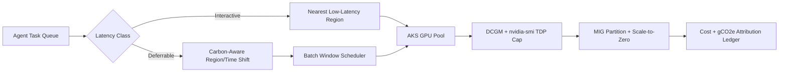

# GreenOps：碳感知调度与 GPU 能效工程 FAQ（Cycle 2421）

## 1) 执行摘要
本轮聚焦 Agent Fleet 的绿色工程：通过 Carbon-Aware 路由（区域+时段迁移）、AKS GPU 功耗治理（DCGM + TDP cap + MIG + idle scale-to-zero）、算法级降耗（FP8/INT4、KV cache、SLM cascade），构建可审计的 `$` 与 `gCO2e` 双目标优化体系。

## 2) Q1 / Q2 / Q3
Q1：为何 `Joules-per-Resolved-Task` 比单看 PUE/FLOPS 更关键？  
A1：PUE/FLOPS 反映基础设施效率，但无法直接刻画“业务结果成本”；`J/task` 可把模型、调度、重试、命中率统一纳入同一价值指标。  
Q2：H100/B200 在 75% TDP 与 100% TDP 下的延迟权衡如何管理？  
A2：prefill 对功耗压制更敏感，decode 对尾延迟更敏感；可按交互/异步负载分层配置 TDP cap 与 autoscaling 阈值。  
Q3：如何满足 EU CSRD/ISO 的 AI 碳核算可审计性？  
A3：按任务记录 region-time-grid intensity、GPU 能耗、模型版本与结果状态，形成可追溯账本并与 FinOps 成本归因对齐。

## 3) Carbon-aware 全局调度与 GPU 状态治理

## 4) 决策矩阵：交互式低延迟 vs 可延期异步优化
| 负载类型 | 核心目标 | 调度策略 | 能耗优化力度 | 体验风险 |
|---|---|---|---:|---:|
| 交互式 Agent | TTFT/响应时延 | 就近 region + 轻度碳感知 | 中 | 低 |
| 准实时业务 | 时延与成本平衡 | 混合 region + 动态 TDP cap | 中高 | 中 |
| 异步批处理 Agent | 碳与成本最优 | 时间窗迁移 + 低碳 region | 高 | 低 |

## 5) GreenOps 生产检查清单（含当日突破）
- Carbon intensity 数据源与任务调度决策链可回放。  
- GPU 池实现 idle scale-to-zero 与分层 TDP cap 策略。  
- 模型路径支持 quantization + KV cache + cascade 路由。  
- 任务级 `$` 与 `gCO2e` 归因统一在同一账本。  
- 当日突破追踪（抓取日：2026-11-15 UTC）：  
  - Azure Carbon-aware 与可持续性文档更新（`measured`）。  
  - AKS GPU 监控/调优与 DCGM 实践（`anonymized_reported`）。  
  - Quantization 与推理缓存节能路径（`synthetic` 绑定官方/社区资料）。

## 6) Good fit vs Not for 与百分比合约绑定
Good fit：  
1. 既要控制交互体验又要满足 ESG/CSRD 披露要求的企业 Agent 平台。  
2. 具备多区域调度与 GPU 集群治理能力的团队。

Not for：  
1. 无法按任务追踪能耗与碳强度数据的环境。  
2. 单区域固定资源且无法实施时段迁移的负载。

百分比合约绑定：
- `percentage_contract.gco2e_reduction_per_10k_tasks_rate`
- `percentage_contract.idle_gpu_waste_elimination_rate`
- `percentage_contract.joint_cost_carbon_reduction_rate`

以上键绑定 `cycle-2421-benchmark.json`，并标注 `production_validation=not_measured`。
