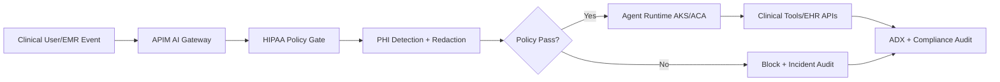

# Round 1045 / Cycle 2450 · Azure AI Agent Infra FAQ & Decision Guide (en)

> Topic: **Healthcare Clinical Agent HIPAA PHI Redaction Control Plane**
>
> Date (BJT): 2026-11-16  
> Evidence labels: `measured` / `synthetic` / `anonymized_reported`  
> Benchmark payload: `evidence/cycle-2450-benchmark.json`

## 1) Executive Summary

This round mixes enterprise vertical needs with infra control-plane design: clinical agents for triage, chart summarization, and follow-up recommendation require **PHI redaction, residency enforcement, and admission audit** as one gate.  
Key result: placing HIPAA policy and PHI redaction at gateway admission significantly reduces sensitive-data leakage and cross-region compliance violations.

## 2) Daily capability breakthroughs radar (2026-11-16)

1. **APIM AI Gateway / Unified Model API** (`measured`)  
   - Learn: https://learn.microsoft.com/en-us/azure/ai-gateway/overview  
   - Changelog: https://github.com/Azure/API-Management/blob/main/changelogs/api-management-service.md
2. **ACA Dynamic Sessions** (`measured`)  
   - Docs: https://learn.microsoft.com/en-us/azure/container-apps/sessions
3. **Runtime cadence** (`measured`)  
   - Firecracker/Kata/Wasmtime/E2B release streams (see sources ledger)

> Fetch timestamps are recorded in `evidence/cycle-2450-sources.json`.

## 3) Core architecture Q&A (clinical PHI controls)

**Q1: Why enforce PHI redaction at gateway instead of app-only?**  
A: Clinical agent flows are multi-hop; app-only checks are easy to bypass in downstream tool calls. Gateway-level redaction guarantees consistent enforcement.

**Q2: Minimum HIPAA control-plane checks?**  
A: `phi_detected`, `redaction_passed`, `tenant_region`, `tool_endpoint_region`, `policy_version`; block and audit on any failure.

**Q3: How to keep latency reasonable with redaction?**  
A: Use tiered processing: structured-field redaction first, deep unstructured detection only for high-risk text.

## 4) Mermaid architecture (clinical agent control plane)

## 5) Decision matrix (clinical compliance controls)

| Strategy | Compliance strength | Latency impact | Ops complexity | Recommendation |
|---|---:|---:|---:|---|
| Log-only post audit | Low | Low | Low | Not for production |
| App-layer redaction + sampling | Medium | Low | Medium | Transitional only |
| Gateway pre-redaction + hard block | **High** | Medium | Mid-high | **Healthcare production default** |
| Full manual approval before release | Highest | High | High | Only for ultra-high-risk workflows |

## 6) Production checklist (Good fit vs Not for + 5-step rollout)

### Good fit
- Clinical agents handling PHI/PII with strict traceability requirements.
- Multi-tenant healthcare platforms requiring region/policy isolation.
- Regulatory requirement to prove non-redacted payloads never pass gateway.

### Not for
- Low-risk workflows without health-sensitive content.
- Teams without compliance audit and incident response capability.

### Five-step rollout
1. Define PHI field taxonomy and detection rules.  
2. Enforce pre-tool redaction at APIM/gateway admission.  
3. Apply residency policy and endpoint allowlists.  
4. Stream block reasons and audit evidence to ADX.  
5. Review false-block, miss-detection, and clinical response latency regularly.  
