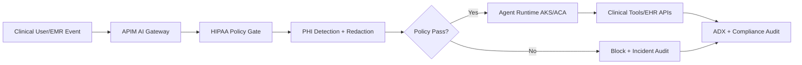

# Round 1045 / Cycle 2450 · Azure AI Agent Infra FAQ & 决策指南（zh-CN）

> Topic: **Healthcare Clinical Agent HIPAA PHI Redaction Control Plane**
>
> Date (BJT): 2026-11-16  
> Evidence labels: `measured` / `synthetic` / `anonymized_reported`  
> Benchmark payload: `evidence/cycle-2450-benchmark.json`

## 1) Executive Summary

本轮将行业场景与 infra 控制面融合：针对医疗临床 Agent（分诊、病历摘要、随访建议）构建 **PHI 脱敏 + 地域驻留 + 准入审计** 一体化门禁。  
核心结论：在 APIM/Gateway 引入 HIPAA 策略层并将 PHI redaction 前置到工具调用前，可显著降低敏感信息外泄与跨区违规风险。

## 2) Daily capability breakthroughs radar（2026-11-16）

1. **APIM AI Gateway / Unified Model API**（`measured`）  
   - Learn: https://learn.microsoft.com/en-us/azure/ai-gateway/overview  
   - Changelog: https://github.com/Azure/API-Management/blob/main/changelogs/api-management-service.md
2. **ACA Dynamic Sessions**（`measured`）  
   - Docs: https://learn.microsoft.com/en-us/azure/container-apps/sessions
3. **Runtime cadence**（`measured`）  
   - Firecracker/Kata/Wasmtime/E2B release streams（见 sources ledger）

> 抓取时间见 `evidence/cycle-2450-sources.json`。

## 3) Core architecture Q&A（医疗 PHI 控制）

**Q1: 为什么要在网关层做 PHI 脱敏，而不是仅靠应用层？**  
A: 医疗 Agent 常有多跳工具调用，应用层漏检会在下游放大。网关层统一脱敏可确保所有路径一致执行。

**Q2: HIPAA 控制面最小必需检查项？**  
A: `phi_detected`, `redaction_passed`, `tenant_region`, `tool_endpoint_region`, `policy_version`。任一失败即阻断并审计。

**Q3: 脱敏对时延影响如何可控？**  
A: 采用分级策略：结构化字段先脱敏 + 高风险自由文本再深度检测，兼顾合规与性能。

## 4) Mermaid architecture（临床 Agent 控制面）

## 5) Decision matrix（医疗 Agent 合规策略）

| 策略 | 合规强度 | 延迟影响 | 运维复杂度 | 推荐 |
|---|---:|---:|---:|---|
| 仅日志后审计 | 低 | 低 | 低 | 不建议生产 |
| 应用层脱敏 + 抽查 | 中 | 低 | 中 | 过渡方案 |
| 网关前置脱敏 + 硬阻断 | **高** | 中 | 中高 | **医疗生产推荐** |
| 全量人工审核后放行 | 最高 | 高 | 高 | 仅极高风险流程 |

## 6) Production checklist（Good fit vs Not for + 五步落地）

### Good fit
- 临床 Agent 涉及 PHI/PII，需强合规与追溯。  
- 多租户医疗平台，需区域与策略隔离。  
- 监管要求可证明“未脱敏数据不出网关”。

### Not for
- 不涉及个人敏感健康信息的低风险场景。  
- 缺少合规审计流程与响应机制的团队。

### 五步落地
1. 定义 PHI 字段清单与检测规则。  
2. 在 APIM/Gateway 落地 redaction 前置门禁。  
3. 配置地域驻留策略与工具端点白名单。  
4. 将阻断原因与审计证据写入 ADX。  
5. 周期复盘误拦截率、漏检率与临床响应延迟。  
