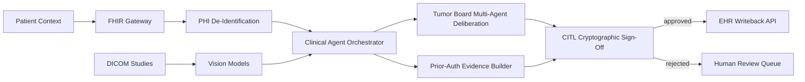

# Healthcare Clinical FHIR and Multimodal Agent Infrastructure FAQ (Cycle 2413)

## 1) Executive summary
This round focuses on HIPAA/HITRUST/FDA SaMD-aware clinical multi-agent architecture with Azure Health Data Services (FHIR R4 + DICOM), SMART-on-FHIR Entra OBO authorization, Azure Health De-Identification Service (PHI redaction before LLM egress), healthcare foundation models (MedImageInsight / MedImageParse / CXRReportGen), and mandatory clinician-in-the-loop (CITL) cryptographic sign-off before EHR writeback.

## 2) Core architecture Q and A
Q1: How do we enforce PHI boundaries before model calls?  
A1: Validate resource-level access at FHIR boundary, run de-identification (Safe Harbor + surrogate replacement), and only forward de-identified payloads to model runtime.  
Q2: How do we prevent FHIR version conflicts during writeback?  
A2: Enforce If-Match/versionId checks on write paths; any conflict goes to human review and cannot be auto-overwritten by agents.  
Q3: How is CITL "sign-before-write" guaranteed?  
A3: Require cryptographic clinician attestation (clinician key + time-bounded token); reject and audit every writeback request without valid sign-off.

## 3) Tumor-board / prior-auth collaboration and writeback flow

## 4) Clinical workload vs runtime/compliance decision matrix
| Tier | PHI de-id precision | FHIR grounding accuracy | Tumor-board latency P95 | Unapproved writeback block rate | Cost index | Best fit |
|---|---:|---:|---:|---:|---:|---|
| Research pilot | 93.4% | 91.2% | 3.8 s | 97.6% | 0.88x | single-site pilot |
| Hospital network | 96.1% | 94.0% | 2.6 s | 99.1% | 1.24x | regional care network |
| Regulated enterprise | 97.2% | 95.8% | 1.86 s | 99.7% | 1.62x | cross-region production |
| Manual baseline | 88.0% | 86.9% | 9.4 s | 92.3% | 1.00x | manual-only operations |

## 5) HIPAA/HITRUST production readiness checklist with daily breakthroughs
- Enforce least-privilege Patient/Practitioner scopes with Entra OBO audit trails.
- Gate every model egress with PHI de-identification.
- Require CITL cryptographic attestation before EHR writeback.
- Drill FHIR version conflicts, tumor-board replay, and prior-auth rejection paths.
- Daily breakthrough tracking (fetched: 2026-11-15 UTC):
  - AHDS FHIR/DICOM official capability page (`measured`).
  - Azure Health De-Identification Service docs (`measured`).
  - SMART-on-FHIR + OBO authorization docs (`anonymized_reported`).
  - Healthcare multimodal models pages for MedImageInsight/MedImageParse/CXRReportGen (`synthetic` with official references).

## 6) Good fit vs Not for and percentage contract bindings
Good fit:
1. Clinical platforms that need multi-agent collaboration with strict PHI and EHR writeback controls.  
2. Healthcare programs that must keep tumor-board and prior-auth workflows under auditable governance.

Not for:
1. Teams without clinician attestation accountability or HIPAA/HITRUST audit operations.  
2. Workloads that require fully autonomous EHR writeback without human gate.

Percentage contract bindings:
- `percentage_contract.phi_deidentification_precision_rate`
- `percentage_contract.fhir_bundle_grounding_accuracy_rate`
- `percentage_contract.unapproved_ehr_writeback_block_rate`

These keys are bound to `cycle-2413-benchmark.json` with `production_validation=not_measured`.
