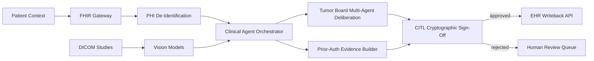

# Azure 医疗 FHIR 与多模态临床 Agent 基础设施 FAQ（Cycle 2413）

## 1) 执行摘要
本轮聚焦 HIPAA/HITRUST/FDA SaMD 约束下的临床多 Agent 平台：Azure Health Data Services（FHIR R4 + DICOM）、SMART-on-FHIR Entra OBO 授权、Azure Health De-Identification Service（LLM 出口前 PHI 脱敏）、医疗领域模型（MedImageInsight / MedImageParse / CXRReportGen）以及强制临床医生签署（CITL）后再执行 EHR 回写。

## 2) 核心架构问答
Q1：如何把 PHI 严格拦在 LLM 边界之外？  
A1：先在 AHDS/FHIR 边界做资源级权限校验，再走 De-Identification（Safe Harbor + Surrogate Replacement）流水线，只有脱敏后的 payload 进入模型推理平面。  
Q2：FHIR 资源版本冲突（ETag/versionId）如何避免覆盖？  
A2：写回路径强制 If-Match + 资源版本对比，冲突后进入人工复核队列，不允许 Agent 盲写。  
Q3：如何保证 CITL 真正“先签后写”？  
A3：将临床签署动作做成加密签名门禁（Clinician key + time-bound token）；未通过签署校验的请求全部阻断并审计留痕。

## 3) 肿瘤会诊/先审后付多专家协作与回写时序

## 4) 临床负载 vs 运行时/合规分层决策矩阵
| 方案层级 | PHI 脱敏精度 | FHIR 归因准确率 | 多 Agent 会诊延迟 P95 | 未授权回写拦截率 | 成本指数 | 适用场景 |
|---|---:|---:|---:|---:|---:|---|
| 研究试点层 | 93.4% | 91.2% | 3.8 s | 97.6% | 0.88x | 单院区 PoC、低并发 |
| 医院网络层 | 96.1% | 94.0% | 2.6 s | 99.1% | 1.24x | 区域医疗集团 |
| 高监管企业层 | 97.2% | 95.8% | 1.86 s | 99.7% | 1.62x | 跨区域高合规生产 |
| 人工流程基线 | 88.0% | 86.9% | 9.4 s | 92.3% | 1.00x | 纯人工审批 |

## 5) HIPAA/HITRUST 生产就绪清单（含当日能力突破追踪）
- FHIR/DICOM 入口启用最小权限（Patient/Practitioner scopes）并绑定 Entra OBO 令牌审计。
- LLM 出口前强制执行 PHI 脱敏流水线，未脱敏数据不得进入模型侧。
- EHR 写回路径启用 CITL 加密签名门禁与不可抵赖审计。
- 日常演练 FHIR 版本冲突、肿瘤会诊回放、先审后付拒绝路径。
- 当日热点突破追踪（抓取日：2026-11-15 UTC）：
  - Azure Health Data Services FHIR/DICOM 官方能力页（`measured`）。
  - Azure Health De-Identification Service 官方文档（`measured`）。
  - SMART-on-FHIR 授权与 OBO 令牌流文档（`anonymized_reported`）。
  - 医疗多模态基础模型（MedImageInsight / MedImageParse / CXRReportGen）技术页（`synthetic` + 官方说明绑定）。

## 6) Good fit vs Not for 与百分比合约绑定
Good fit：
1. 需要在临床多学科协作中引入 Agent 且必须满足 PHI 边界与签署回写控制的机构。  
2. 需要把 FHIR、DICOM、先审后付、肿瘤会诊统一在可审计闭环中的医疗平台。

Not for：
1. 无法提供临床医生签署责任链或无法维护 HIPAA/HITRUST 审计流程的团队。  
2. 希望让 Agent 自动写回 EHR 且不接受人审门禁的场景。

百分比合约绑定：
- `percentage_contract.phi_deidentification_precision_rate`
- `percentage_contract.fhir_bundle_grounding_accuracy_rate`
- `percentage_contract.unapproved_ehr_writeback_block_rate`

以上键绑定 `cycle-2413-benchmark.json`，并标注 `production_validation=not_measured`。
