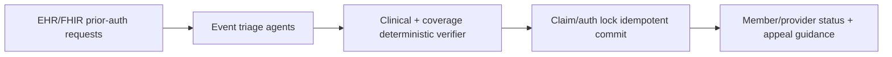

# Healthcare Prior-Auth, FHIR Claims & Compliance Agent Infra FAQ (Round 1036 / Cycle 2441)

## 1) Executive Summary
This cycle addresses high-volume prior-authorization and claims coordination with deterministic compliance guarantees. The architecture uses event-driven FHIR ingestion, agent triage, hard clinical-policy verification, claim-lock idempotent commit, and omnichannel status updates.

## 2) Q1 / Q2 / Q3
Q1: Why does pure LLM triage fail clinical prior-auth production?  
A1: Medical necessity and coverage constraints are high-stakes and must be verified deterministically to prevent unsafe or non-covered recommendations.

Q2: How to preserve consistency under provider-side burst submissions?  
A2: Use optimistic concurrency and idempotent lock keys for claim/auth commits, with replay-safe event lineage.

Q3: How to reduce appeal-cycle cost and delay?  
A3: Provide deterministic denial/approval rationale with policy evidence and consistent member/provider status channels.

## 3) End-to-end architecture flow

## 4) Decision matrix
| Option | Turnaround speed | Compliance confidence | Burst resilience | Ops complexity | Best use |
|---|---:|---:|---:|---:|---|
| Legacy manual review chain | Low | Medium | Low | Medium | Low-volume workflows |
| Pure LLM advisory triage | Medium | Low | Medium | Low | Advisory-only pre-screening |
| Hybrid agent + deterministic verifier | High | High | High | High | Production prior-auth + claims coordination |

## 5) Production checklist
- Ingest FHIR requests and claims events with replay-capable lineage.
- Enforce clinical-guideline and coverage constraints as non-bypassable rules.
- Implement claim/auth lock idempotency with optimistic concurrency.
- Apply PHI/consent scope checks before any cross-party data exposure.
- Provide omnichannel status and appeal guidance with SLA dashboards.
- Monitor turnaround, compliance, SLA, and appeal-cost metrics continuously.

## 6) Good fit vs Not for and percentage contract binding
Good fit: payer/provider ecosystems requiring compliant and explainable prior-auth automation at scale.  
Not for: advisory-only systems without deterministic compliance and consent boundaries.

Percentage-contract keys (bound to `evidence/cycle-2441-benchmark.json`, `production_validation=not_measured`):
- `percentage_contract.prior_auth_turnaround_improvement_rate`
- `percentage_contract.clinical_policy_compliance_rate`
- `percentage_contract.member_self_service_status_sla_rate`
- `percentage_contract.appeal_cycle_cost_reduction_rate`
