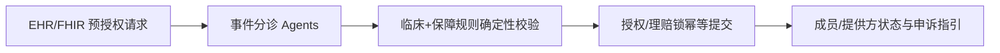

# 医疗预授权、FHIR 理赔与合规 Agent 基础设施 FAQ（Round 1036 / Cycle 2441）

## 1) 执行摘要
本轮面向高并发预授权与理赔协同：通过事件驱动 FHIR 接入、Agent 分诊、确定性临床/保障规则校验、理赔锁幂等提交与全渠道状态通知，实现可扩展且可审计的合规自动化。

## 2) Q1 / Q2 / Q3
Q1：为什么纯 LLM 分诊难以直接用于医疗预授权生产？  
A1：医疗必要性与保障规则属于高风险约束，必须经确定性校验，避免不安全或不合规建议。

Q2：如何在提供方突发提交下保持一致性？  
A2：采用乐观并发 + 幂等锁键提交授权/理赔，并保留可回放事件链路。

Q3：如何降低申诉周期成本与时延？  
A3：输出可追溯的审批/拒赔理由证据，并保持成员与提供方状态通道一致。

## 3) 端到端流程

## 4) 决策矩阵
| 方案 | 处理速度 | 合规可信度 | 突发韧性 | 运维复杂度 | 适配场景 |
|---|---:|---:|---:|---:|---|
| 传统人工串行审核 | 低 | 中 | 低 | 中 | 低并发流程 |
| 纯 LLM 建议分诊 | 中 | 低 | 中 | 低 | 仅预筛建议 |
| 混合 Agent + 确定性校验 | 高 | 高 | 高 | 高 | 生产级预授权与理赔协同 |

## 5) 生产清单
- FHIR 请求与理赔事件需可重放与可追溯。
- 临床指南与保障规则必须为不可绕过硬约束。
- 授权/理赔提交采用乐观并发与幂等锁机制。
- PHI 与同意边界检查前置于任何跨方数据暴露。
- 成员/提供方状态与申诉指引要有 SLA 可观测性。
- 持续监控处理时效、合规率、状态 SLA、申诉成本指标。

## 6) Good fit vs Not for 与百分比合约绑定
Good fit：需要规模化、可解释、可审计预授权自动化的支付方/提供方体系。  
Not for：缺少确定性合规与同意边界控制的建议型系统。

百分比合约键（绑定 `evidence/cycle-2441-benchmark.json`，并声明 `production_validation=not_measured`）：
- `percentage_contract.prior_auth_turnaround_improvement_rate`
- `percentage_contract.clinical_policy_compliance_rate`
- `percentage_contract.member_self_service_status_sla_rate`
- `percentage_contract.appeal_cycle_cost_reduction_rate`
