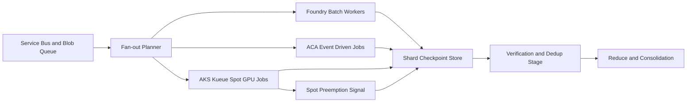

# High-Throughput Batch and Offline Sweeping Agent Swarms on Azure FAQ (Cycle 2410)

## 1) Executive summary
This round targets overnight, cost-optimal sweeping workloads: 10M+ document migration, 50K repo CVE remediation sweeps, and historical ticket backfill. The reference architecture combines Foundry Global Batch API, ACA event-driven jobs, AKS+Kueue spot fleets, and idempotent shard checkpoint recovery.

## 2) Core architecture Q and A
Q1: How to choose Foundry Batch API vs spot vLLM clusters?  
A1: Use Foundry Batch when SLA tolerance and discount economics dominate; use spot vLLM when custom model/runtime control and low queue latency are required.
Q2: How should KEDA queue-depth backpressure be applied?  
A2: Drive ACA jobs from queue depth plus per-tenant token budgets, and clamp fan-out when verification backlog exceeds guardrail.
Q3: How to survive spot preemption without duplicate side effects?  
A3: Use shard-level idempotency keys and checkpoint leasing so retries resume exact shard offsets instead of replaying committed output.

## 3) Fan-out map-reduce and preemption checkpoint flow

## 4) Throughput cost and SLA selection matrix
| Path | Completion time for 10M items | Cost per 1M items (USD) | Spot/preemption overhead | Verification accuracy | SLA profile |
|---|---:|---:|---:|---:|---|
| Foundry Batch primary + realtime spillover | 5.6 h | 184.00 | 2.3% | 99.20% | 24h batch SLA with controlled spillover |
| AKS Kueue spot vLLM primary | 4.9 h | 141.00 | 11.8% | 98.60% | best-effort with retry buffers |
| ACA Jobs queue-driven CPU/GPU blend | 6.4 h | 168.00 | 4.5% | 98.90% | high elastic operational simplicity |
| Legacy fixed worker baseline | 11.8 h | 262.00 | 0.7% | 96.10% | predictable but slow and expensive |

## 5) Percentage contract bindings (N/D)
- `percentage_contract.batch_verification_accuracy_rate`
- `percentage_contract.preemption_recovery_success_rate`
- `percentage_contract.overnight_completion_sla_meet_rate`

These keys are bound to `cycle-2410-benchmark.json` and tagged with `production_validation=not_measured`.

## 6) Overnight 10M-item readiness checklist and decision guide
- Establish shard cardinality, idempotency keys, and dedup sink constraints.
- Configure Foundry Batch quota windows and spillover guardrails.
- Bind KEDA scaling to queue depth, token budget, and verifier lag.
- Run spot-chaos drills for preemption and checkpoint lease recovery.
- Promote only when throughput, cost, verification accuracy, and SLA contracts all pass.
