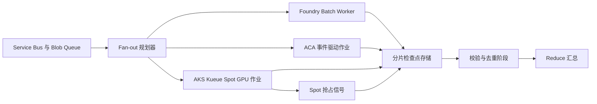

# Azure 高吞吐离线批处理扫库 Agent Swarm FAQ（Cycle 2410）

## 1) 执行摘要
本轮面向夜间低成本高并发扫库任务：千万级文档迁移、5 万仓 CVE 扫描修复、历史工单批量回填。参考架构整合 Foundry Global Batch API、ACA 事件驱动作业、AKS+Kueue Spot 集群与分片幂等检查点恢复。

## 2) 核心架构问答
Q1：何时选 Foundry Batch API，何时选 Spot vLLM？  
A1：若更看重折扣与批处理 SLA，优先 Foundry Batch；若更看重自定义模型与低队列时延，可选 spot vLLM。
Q2：KEDA 队列深度回压如何设置？  
A2：以队列深度+租户 token 预算驱动作业扩缩容，当校验队列积压超阈值时限制 fan-out。
Q3：Spot 抢占如何避免重复副作用？  
A3：使用分片幂等键与检查点租约，重试从精确 offset 恢复，不重放已提交结果。

## 3) Fan-out map-reduce 与抢占检查点流程

## 4) 吞吐/成本/SLA 选型矩阵
| 路径 | 千万条完成时长 | 每百万条成本（USD） | 抢占开销 | 校验准确率 | SLA 画像 |
|---|---:|---:|---:|---:|---|
| Foundry Batch 主路径 + 实时溢出 | 5.6 h | 184.00 | 2.3% | 99.20% | 24h 批处理 SLA + 受控溢出 |
| AKS Kueue spot vLLM 主路径 | 4.9 h | 141.00 | 11.8% | 98.60% | best-effort + 重试缓冲 |
| ACA Jobs 队列驱动混合路径 | 6.4 h | 168.00 | 4.5% | 98.90% | 弹性高、运维相对简化 |
| 传统固定 worker 基线 | 11.8 h | 262.00 | 0.7% | 96.10% | 可预测但慢且贵 |

## 5) Percentage contract bindings (N/D)
- `percentage_contract.batch_verification_accuracy_rate`
- `percentage_contract.preemption_recovery_success_rate`
- `percentage_contract.overnight_completion_sla_meet_rate`

以上键绑定 `cycle-2410-benchmark.json`，并标注 `production_validation=not_measured`。

## 6) 夜间千万条扫库就绪清单与决策指南
- 明确分片粒度、幂等键与去重汇聚约束。
- 配置 Foundry Batch 配额窗口与实时溢出门禁。
- 将 KEDA 缩放绑定队列深度、token 预算与校验积压。
- 进行 Spot 抢占混沌演练与检查点租约恢复验证。
- 吞吐、成本、准确率、SLA 同时达标后再推广。
