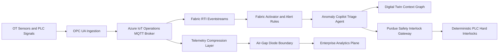

# Azure Industrial IoT Digital Twin and OT-Safe Agent Infrastructure FAQ (Cycle 2404)

## 1) Scenario and constraints
We need industrial AI agents that can triage anomalies in sub-second telemetry streams while respecting deterministic OT safety boundaries. The target architecture combines Azure IoT Operations MQTT Broker, OPC UA integration, Fabric Real-Time Intelligence Eventstreams and Activator, and Purdue-model safety interlocks with air-gap diode boundaries.

## 2) Q1 / Q2 / Q3 daily breakthroughs (verifiable)
Q1: Why split anomaly copilot triage and PLC hard interlock actions?  
A1: Copilot can assist triage and recommendations, but deterministic hard interlocks must remain in OT-safe control paths.  
Q2: Why use Eventstreams plus Activator for industrial agents?  
A2: Eventstreams handles high-rate telemetry ingestion and Activator triggers low-latency rule-to-action pipelines.  
Q3: Why enforce air-gap diode and compression jointly?  
A3: Diode boundaries prevent reverse command paths while compression reduces bandwidth pressure for one-way observability export.

Source URLs and fetch timestamps are listed in `cycle-2404-sources.json`.

## 3) Decision matrix (latency, throughput, cost, operability)
| Path | P95 triage latency | Throughput P95 | Policy intercept rate | Cost per 1k telemetry decisions (USD) | Ops complexity |
|---|---:|---:|---:|---:|---:|
| MQTT + Eventstreams + Activator target | 688 ms | 2634 events/s | 98.60% | 5.72 | High |
| Eventstreams without OT interlock split | 742 ms | 2481 events/s | 92.40% | 5.11 | Medium-high |
| OPC UA direct cloud relay path | 981 ms | 1836 events/s | 90.70% | 6.48 | Medium |
| Legacy historian polling baseline | 1864 ms | 904 events/s | 84.30% | 9.92 | Medium |

## 4) Good fit vs Not for
Good fit:
1. Industrial environments requiring strict OT safety separation plus AI-assisted anomaly triage.  
2. Plants needing high-frequency telemetry with policy-governed one-way export boundaries.  
3. Teams operating digital twin context for maintenance and incident diagnostics.

Not for:
1. Scenarios where AI is expected to directly override deterministic PLC safety controls.  
2. Deployments lacking OT/IT boundary governance or diode boundary operations.  
3. Low-frequency workloads where event streaming and activation overhead is unnecessary.

## 5) Percentage contract bindings (N/D)
- `percentage_contract.ot_safety_interlock_compliance_rate`
- `percentage_contract.subsecond_anomaly_triage_meet_rate`
- `percentage_contract.telemetry_compression_efficiency_gain_rate`

These keys are bound to `cycle-2404-benchmark.json` and tagged with `production_validation=not_measured`.

## 6) Five-step rollout guide
1. Separate AI triage and deterministic OT control actions in architecture policy.  
2. Deploy MQTT + OPC UA ingestion with strict topic and namespace governance.  
3. Implement Eventstreams/Activator triggers and map to digital twin context enrichment.  
4. Enforce Purdue interlocks and air-gap diode one-way telemetry export.  
5. Gate rollout on safety compliance, triage latency, and compression efficiency KPIs.
