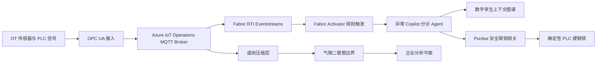

# Azure 工业物联网数字孪生与 OT 安全 Agent 基础设施 FAQ（Cycle 2404）

## 1) 场景与约束
目标是在工业场景实现亚秒级异常 Copilot 分诊，同时严格遵守 OT 确定性安全边界。方案采用 Azure IoT Operations MQTT Broker、OPC UA、Fabric Real-Time Intelligence Eventstreams/Activator，并结合 Purdue 模型安全联锁与气隙单向二极管边界。

## 2) Q1 / Q2 / Q3 当日能力突破（可验证）
Q1：为什么要拆分 Copilot 分诊与 PLC 硬联锁动作？  
A1：Copilot 适合做辅助分诊与建议，确定性硬联锁必须留在 OT 安全控制路径。  
Q2：为什么要用 Eventstreams + Activator？  
A2：Eventstreams 处理高频遥测流，Activator 负责低时延规则触发到动作链路。  
Q3：为什么压缩与气隙二极管要一起做？  
A3：二极管阻断反向控制通道，压缩降低单向观测导出带宽压力。

来源与抓取时间见 `cycle-2404-sources.json`。

## 3) 决策矩阵（时延、吞吐、成本、可运维性）
| 路径 | P95 分诊时延 | 吞吐 P95 | 策略拦截率 | 每千遥测决策成本（USD） | 运维复杂度 |
|---|---:|---:|---:|---:|---:|
| MQTT+Eventstreams+Activator 目标路径 | 688 ms | 2634 events/s | 98.60% | 5.72 | 高 |
| 无 OT 联锁拆分路径 | 742 ms | 2481 events/s | 92.40% | 5.11 | 中高 |
| OPC UA 直连云路径 | 981 ms | 1836 events/s | 90.70% | 6.48 | 中 |
| 传统 Historian 轮询基线 | 1864 ms | 904 events/s | 84.30% | 9.92 | 中 |

## 4) Good fit vs Not for
Good fit：
1. 需要 OT 安全隔离且希望 AI 辅助异常分诊的工业场景。  
2. 需要高频遥测与策略化单向导出的工厂网络。  
3. 已建设数字孪生上下文用于运维与故障诊断的团队。

Not for：
1. 期望 AI 直接覆盖 PLC 确定性安全控制的场景。  
2. 缺乏 OT/IT 边界治理与气隙边界运维能力的部署。  
3. 低频数据场景，不需要事件流+触发编排的复杂性。

## 5) Percentage contract bindings (N/D)
- `percentage_contract.ot_safety_interlock_compliance_rate`
- `percentage_contract.subsecond_anomaly_triage_meet_rate`
- `percentage_contract.telemetry_compression_efficiency_gain_rate`

以上键绑定 `cycle-2404-benchmark.json`，并标注 `production_validation=not_measured`。

## 6) 五步落地指南
1. 在架构策略中明确 AI 分诊与 OT 控制动作边界。  
2. 部署 MQTT + OPC UA 接入并治理 topic/namespace。  
3. 建立 Eventstreams/Activator 触发链并接入数字孪生增强。  
4. 执行 Purdue 联锁与气隙单向导出策略。  
5. 以安全合规率、分诊时延、压缩效率作为上线门禁。
