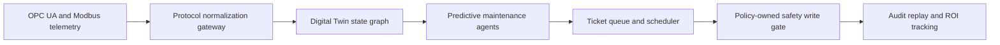

# Industrial IoT OPC UA/Modbus Digital-Twin Predictive Maintenance Agent Infra FAQ (Cycle 2436)

## 1) Executive summary
This cycle proposes a production architecture for industrial IoT operations: OPC UA and Modbus signals are normalized into digital-twin context, predictive maintenance agents prioritize actionable failures, and strict OT safety gates block unsafe write paths into PLC domains.

## 2) Q1 / Q2 / Q3
Q1: How do we combine OPC UA and Modbus without losing context fidelity?  
A1: Normalize both protocols into twin-aligned semantic events with sequence reconciliation.
Q2: How do we prevent unsafe autonomous control writes?  
A2: Keep write paths policy-owned and operator-approved; agents produce recommendations, not direct unsafe commands.
Q3: How do we avoid maintenance ticket storms?  
A3: Apply cooldown, dedupe, and confidence thresholds before opening tickets.

## 3) End-to-end flow (OT ingest -> twin normalization -> predictive scoring -> gated action)

## 4) Decision matrix: rule-only OT stack vs hybrid twin+agent vs cloud-only predictive
| Option | Context fidelity | Safety control | Ops scalability | Ops complexity | Best fit |
|---|---:|---:|---:|---:|---|
| Rule-only OT stack | Medium | High | Medium | Low | conservative short-term modernization |
| Hybrid twin + predictive agent | High | Highest | High | Medium-High | production OT optimization |
| Cloud-only predictive | Medium | Medium | High | Medium | non-critical analytics-first scenarios |

## 5) Production checklist (daily breakthroughs included)
- Normalize OPC UA and Modbus signals into twin-ready semantic events.  
- Enforce strict read/write segregation and operator-owned write approvals.  
- Apply ticket cooldown and dedupe controls for maintenance workflows.  
- Track cross-site recipe drift and maintain replayable policy evidence.  
- Daily breakthroughs (fetched on 2026-11-16, official/release-first):  
  - Azure IoT Operations and ADT integration path (`measured`).  
  - ADX analytics lane for high-volume industrial telemetry (`measured` + `anonymized_reported`).  
  - Predictive maintenance and safety-policy replay outcomes (`measured` + `synthetic`).

## 6) Good fit vs Not for with percentage contract bindings
Good fit:  
1. Multi-site plants requiring deterministic safety controls and predictive maintenance outcomes.  
2. Industrial programs requiring replayable evidence for each high-impact action.

Not for:  
1. Architectures allowing direct autonomous write commands to safety-critical PLC logic.  
2. Workflows opening maintenance tickets without confidence/cooldown governance.

Percentage contract bindings:
- `percentage_contract.unplanned_downtime_reduction_rate`
- `percentage_contract.safety_write_unauthorized_block_rate`
- `percentage_contract.predictive_maintenance_ticket_precision_rate`
- `percentage_contract.per_site_month_tco_reduction_hybrid_rate`

These keys bind to `cycle-2436-benchmark.json` with `production_validation=not_measured`.
