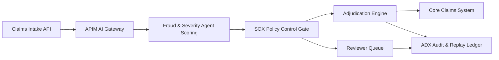

# Round 1048 / Cycle 2453 · Azure AI Agent Infra FAQ & Decision Guide (en)

> Topic: **Insurance Claims Adjudication Fraud + SOX Control Agent Gateway**
>
> Date (BJT): 2026-11-16  
> Evidence labels: `measured` / `synthetic` / `anonymized_reported`  
> Benchmark payload: `evidence/cycle-2453-benchmark.json`

## 1) Executive Summary

This round focuses on insurance claims automation: balancing high-throughput adjudication with strict **SOX internal-control traceability**.  
Key result: layered design (agent scoring + policy control gateway + replayable approvals) reduces fraud leakage and payout errors without sacrificing SLA.

## 2) Daily capability breakthroughs radar (2026-11-16)

1. **APIM AI Gateway / Unified Model API** (`measured`)  
   - Learn: https://learn.microsoft.com/en-us/azure/api-management/ai-gateway-overview  
   - Changelog: https://github.com/Azure/API-Management/blob/main/changelogs/api-management-service.md
2. **ACA Dynamic Sessions** (`measured`)  
   - Docs: https://learn.microsoft.com/en-us/azure/container-apps/sessions
3. **Sandbox/runtime upstream releases** (`measured`)  
   - Firecracker/Kata/Wasmtime/E2B releases (captured in `evidence/cycle-2453-sources.json`)

## 3) Core architecture Q&A (claims-control boundary)

**Q1: Why not let the model directly finalize claim outcomes?**  
A: Claims adjudication must be replayable, approvable, and attributable. Model output is evidence input, not the final control decision.

**Q2: How is SOX implemented in an agent pipeline?**  
A: version-locked policy bundles, dual-control thresholds, complete decision lineage, and deterministic rollback.

**Q3: How to avoid fast-but-wrong adjudication?**  
A: route high-risk claims to reviewer queues while low-risk claims follow controlled auto-approval paths with full evidence logs.

## 4) Mermaid architecture (Claims + Fraud + SOX)

## 5) Decision matrix (claims automation architecture)

| Path | Auditability/compliance | Turnaround speed | Cost | Ops complexity | Recommendation |
|---|---:|---:|---:|---:|---|
| Fully manual adjudication | High | Low | High | Medium | Conservative high-risk books |
| Rules-only auto-adjudication | Medium | High | Medium | Medium | Simple product lines |
| Agent scoring + SOX control gateway | **High** | **High** | Medium-high | Medium-high | **Recommended for production insurance** |
| Pure model auto-adjudication | Low | High | Low | Low | Not recommended |

## 6) Good fit vs Not for + five-step rollout

### Good fit
- Large claim volumes with fraud volatility and strict SLA targets.
- Compliance/audit teams capable of owning policy lifecycles.
- Hybrid automation + human-review operations.

### Not for
- Teams without audit and approval operating model.
- Environments requiring opaque fully autonomous payouts.

### Five-step rollout
1. Define claim risk buckets and threshold matrix.
2. Implement `audit-policy-version` publish/rollback process.
3. Configure reviewer loop for high-risk claims.
4. Wire ADX replay/audit and anomaly alerts.
5. Review false payout, fraud intercept, and cost metrics weekly.
