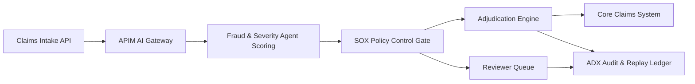

# Round 1048 / Cycle 2453 · Azure AI Agent Infra FAQ & 决策指南（zh-CN）

> Topic: **Insurance Claims Adjudication Fraud + SOX Control Agent Gateway**
>
> Date (BJT): 2026-11-16  
> Evidence labels: `measured` / `synthetic` / `anonymized_reported`  
> Benchmark payload: `evidence/cycle-2453-benchmark.json`

## 1) Executive Summary

本轮聚焦保险理赔：在自动化核赔与反欺诈中，Agent 需要兼顾 **理赔时效** 与 **SOX/审计内控完整性**。  
核心结论：采用“模型评分 + 审计策略网关 + 可追溯审批”分层模式，可在高吞吐核赔场景中控制误赔与合规风险。

## 2) Daily capability breakthroughs radar（2026-11-16）

1. **APIM AI Gateway / Unified Model API**（`measured`）  
   - Learn: https://learn.microsoft.com/en-us/azure/api-management/ai-gateway-overview  
   - Changelog: https://github.com/Azure/API-Management/blob/main/changelogs/api-management-service.md
2. **ACA Dynamic Sessions**（`measured`）  
   - Docs: https://learn.microsoft.com/en-us/azure/container-apps/sessions
3. **Sandbox/runtime upstream releases**（`measured`）  
   - Firecracker/Kata/Wasmtime/E2B releases（见 `evidence/cycle-2453-sources.json`）

## 3) Core architecture Q&A（理赔 Agent 内控）

**Q1: 为何不能让 Agent 直接写理赔结果？**  
A: 自动核赔必须可回放、可审批、可追责。模型输出应作为证据输入而不是最终结论。

**Q2: SOX 控制在 Agent 流程中如何落地？**  
A: 关键控制点包括策略版本锁定、双人审批阈值、操作审计链与异常回滚。

**Q3: 如何降低“快但错”的核赔风险？**  
A: 高风险 claim 进入人工复核池；低风险 claim 执行自动放行并记录全链路证据。

## 4) Mermaid architecture（Claims + Fraud + SOX）

## 5) Decision matrix（核赔自动化架构）

| 路径 | 合规可审计 | 处理时效 | 成本 | 运维复杂度 | 推荐 |
|---|---:|---:|---:|---:|---|
| 全人工核赔 | 高 | 低 | 高 | 中 | 高风险保守场景 |
| 纯规则自动核赔 | 中 | 高 | 中 | 中 | 简单产品线 |
| Agent 评分 + SOX 控制网关 | **高** | **高** | 中高 | 中高 | **保险生产推荐** |
| 纯模型自动核赔 | 低 | 高 | 低 | 低 | 不建议 |

## 6) Good fit vs Not for + 五步落地

### Good fit
- 大规模理赔、欺诈率波动大、需要实时风控分流的保险平台。  
- 已有合规/审计团队，可维护策略生命周期。  
- 需要将自动化与人工复核协同。

### Not for
- 无法承接审计链路和审批制度的团队。  
- 希望“全自动核赔且不留证据”的场景。

### 五步落地
1. 建立 claim 风险分层与阈值矩阵。  
2. 设计 `audit-policy-version` 发布与回滚机制。  
3. 配置高风险理赔人工复核回路。  
4. 接入 ADX 审计/回放与异常告警。  
5. 周期复盘误赔率、欺诈拦截率、单案成本。  
