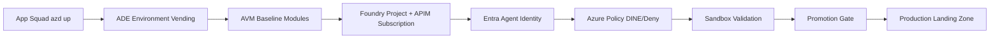

# Internal Developer Platform Golden Paths Agent Vending FAQ (Cycle 2418)

## 1) Executive summary
This cycle focuses on an Internal Developer Platform (IDP) "AI Agent vending machine": ADE + Dev Box for isolated environments, AVM + azd templates for paved roads, and self-service provisioning of Foundry Project/APIM Subscription/Entra Agent Identity with Azure Policy DINE/Deny guardrails for no-public-endpoint, mandatory content safety, and FinOps tagging.

## 2) Q1 / Q2 / Q3
Q1: How should ownership split between Platform CoE and app squads in a hub-spoke AI landing zone?  
A1: Platform CoE owns landing-zone baseline, templates, and policy guardrails; app squads consume approved templates and build within constrained, auditable boundaries.  
Q2: How to enforce sandbox-to-prod promotion gates?  
A2: Promotion gates include policy compliance, budget tag checks, private-network checks, APIM quota wiring, and audit controls; failing any gate blocks promotion.  
Q3: How to stop shadow AI sprawl without killing velocity?  
A3: Make the golden path fastest and easiest, while deviations go through exception workflows with explicit risk ownership.

## 3) Self-service onboarding flow

## 4) Ticket ops vs modules vs full IDP decision matrix
| Operating mode | Time to compliant env | Drift block rate | Platform leverage (squads/engineer) | Orphan sandbox TTL savings | Ops complexity |
|---|---:|---:|---:|---:|---:|
| Ticket-driven | 15 days | 71.2% | 4 | 21.0% | Low |
| Module-first (AVM + manual flow) | 2.5 days | 91.8% | 11 | 58.3% | Medium |
| Full IDP vending machine | 27 minutes | 98.7% | 26 | 82.4% | Medium-High |

## 5) Platform CoE golden-path readiness checklist (daily breakthroughs)
- ADE + Dev Box for reproducible, isolated team environments.  
- AVM Bicep/Terraform + azd templates for repeatable platform onboarding.  
- Foundry/APIM/Entra self-service vending with quota and identity defaults.  
- Azure Policy DINE/Deny guardrails for no-public-endpoint, content safety, and FinOps tags.  
- Daily breakthrough tracking (fetched on 2026-11-15 UTC):  
  - ADE and Dev Box official documentation updates (`measured`).  
  - AVM module ecosystem growth (`anonymized_reported`, official repo).  
  - azd template and platform-engineering guidance (`measured`).

## 6) Good fit vs Not for with percentage contract bindings
Good fit:  
1. Enterprises with 50+ product squads and constrained central platform engineering.  
2. Organizations that need compliant environments in minutes, not weeks.

Not for:  
1. Teams unwilling to adopt policy-as-code and reusable templates.  
2. Organizations dependent on manual, ungoverned environment provisioning.

Percentage contract bindings:
- `percentage_contract.compliant_provisioning_under_30min_rate`
- `percentage_contract.policy_non_compliant_block_rate`
- `percentage_contract.orphaned_sandbox_ttl_savings_rate`

These keys bind to `cycle-2418-benchmark.json` with `production_validation=not_measured`.
