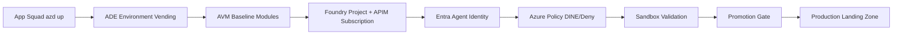

# Azure 内部开发平台 Golden Path Agent Vending FAQ（Cycle 2418）

## 1) 执行摘要
本轮聚焦“AI Agent 售货机（Vending Machine）”型 Internal Developer Platform（IDP）：使用 ADE + Dev Box 提供隔离环境，AVM + azd 模板固化可复用铺装道路，自动开通 Foundry Project/APIM Subscription/Entra Agent Identity，并由 Azure Policy DINE/Deny 强制零公网端点、Content Safety 与 FinOps 标签。目标是让 Platform CoE 从工单瓶颈转向产品化平台运营。

## 2) Q1 / Q2 / Q3
Q1：Platform CoE 与业务团队在 Hub-Spoke AI Landing Zone 如何分工？  
A1：Platform CoE 维护 Landing Zone、模板和策略基线（AVM + Policy），业务团队在隔离的项目空间通过 azd 模板自助创建 Agent 工作负载，仅可在 guardrail 允许范围内扩展。  
Q2：如何实现 Sandbox 到 Prod 的 promotion gate？  
A2：在 ADE 环境提升链路上叠加策略评估、预算标签校验、私网连通性校验、APIM 配额开通和审计基线检查；未通过即阻断。  
Q3：如何抑制 Shadow AI 扩散但不牺牲速度？  
A3：提供“默认可用”的黄金路径（模板 + 额度 + 身份 + 安全基线），并让偏离路径的请求进入例外审批，形成快路径与例外路径并存机制。

## 3) 自助开通到合规上线流程

## 4) Ticket 模式 vs 模块化 vs 全自动 IDP 决策矩阵
| 模式 | 合规环境开通时间 | 策略漂移阻断率 | 平台工程师杠杆（每人支持 squad） | 孤儿沙箱 TTL 节省 | 运维复杂度 |
|---|---:|---:|---:|---:|---:|
| 工单驱动 | 15 天 | 71.2% | 4 | 21.0% | 低 |
| 模块化（AVM + 手工流程） | 2.5 天 | 91.8% | 11 | 58.3% | 中 |
| 全自动 IDP 售货机 | 27 分钟 | 98.7% | 26 | 82.4% | 中高 |

## 5) Platform CoE Golden Path 就绪清单（含当日突破）
- ADE + Dev Box 形成开发隔离与可重复环境开通。  
- AVM Bicep/Terraform 与 azd 模板统一项目脚手架。  
- Foundry/APIM/Entra identity 自助开通并自动绑定配额与审计。  
- Azure Policy DINE/Deny 固化零公网端点、Content Safety、FinOps 标签。  
- 当日能力突破追踪（抓取日：2026-11-15 UTC）：  
  - ADE 文档与 Dev Box 文档更新（`measured`，官方）。  
  - AVM 模块生态持续扩展（`anonymized_reported`，官方仓库）。  
  - azd 模板与平台工程实践沉淀（`measured`，官方文档）。

## 6) Good fit vs Not for 与百分比合约绑定
Good fit：  
1. 50+ 业务团队并行、平台团队人力有限且必须合规先行。  
2. 需要把 Agent 环境开通标准化为“分钟级自助”。

Not for：  
1. 组织无法接受策略即代码（Policy as Code）与模板治理。  
2. 团队仍坚持手工变更且缺少环境生命周期治理。

百分比合约绑定：
- `percentage_contract.compliant_provisioning_under_30min_rate`
- `percentage_contract.policy_non_compliant_block_rate`
- `percentage_contract.orphaned_sandbox_ttl_savings_rate`

以上键绑定 `cycle-2418-benchmark.json`，并标注 `production_validation=not_measured`。
