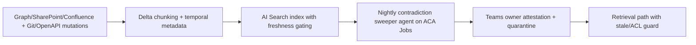

# Enterprise Knowledge Lifecycle, Stale-Doc Decay Detection & Self-Healing RAG Corpus Governance FAQ (Round 1033 / Cycle 2438)

## 1) Executive Summary
This cycle addresses month-6 enterprise RAG failure: stale, conflicting, and orphaned content silently degrades answer quality. The production path uses event-driven delta sync, temporal validity metadata, contradiction quarantine, and owner attestation loops.

## 2) Q1 / Q2 / Q3
Q1: Why does naive chunk re-indexing still return stale answers?  
A1: Cosine similarity can rank old chunks high when superseded content does not carry temporal validity and supersession edges.

Q2: How to detect semantic contradictions at 500k+ docs scale?  
A2: Run nightly NLI + graph sweeper jobs; quarantine high-confidence conflicts and require owner attestation.

Q3: How to guarantee zero-gap ACL revoke behavior?  
A3: Treat revoke events as hard tombstone triggers with `<60s` purge SLO and alert escalation.

## 3) End-to-end architecture flow

## 4) Decision matrix
| Option | Stale-answer control | Revoke SLA | Cost profile | Ops complexity | Best use |
|---|---:|---:|---:|---:|---|
| Naive periodic re-crawl | Low | Weak | High | Low | Small static corpus |
| Event-driven delta + temporal metadata | High | Strong | Best | Medium | Enterprise policy/docs corpus |
| Self-healing graph governance | Highest | Strong | Medium | High | Regulated, high-churn corpus |

## 5) Production checklist
- Wire change-notification webhooks and durable delta queue contracts.
- Persist `effective_from`, `effective_until`, `supersedes_doc_id`, and `freshness_boost`.
- Enforce ACL tombstone purge as non-bypassable policy gate.
- Run contradiction sweeper nightly and quarantine high-confidence conflicts.
- Keep owner attestation SLA dashboards and escalation paths.
- Validate retrieval on current, superseded, revoked, and conflicting document test sets.

## 6) Good fit vs Not for and percentage contract binding
Good fit: large enterprise corpus with frequent policy/SOP/API updates and strict access controls.  
Not for: static corpus with minimal change and no owner-governance model.

Percentage-contract keys (bound to `evidence/cycle-2438-benchmark.json`, `production_validation=not_measured`):
- `percentage_contract.outdated_answer_hallucination_reduction_rate`
- `percentage_contract.acl_revocation_to_purge_sla_rate`
- `percentage_contract.contradiction_detection_precision_rate`
- `percentage_contract.delta_indexing_cost_reduction_rate`
