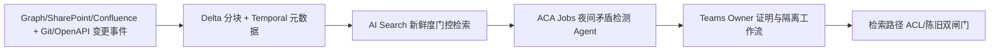

# 企业知识生命周期、陈旧文档衰减检测与自愈 RAG 语料治理 FAQ（Round 1033 / Cycle 2438）

## 1) 执行摘要
本轮聚焦企业 RAG 在上线 6 个月后的核心失效：知识静默腐化、SOP 冲突版本并存、孤儿 Wiki 页面误召回。方案采用事件驱动增量同步、时间有效性元数据、矛盾隔离与文档 Owner 证明闭环。

## 2) Q1 / Q2 / Q3
Q1：为什么只做 chunk 重建索引仍会召回陈旧答案？  
A1：仅靠向量相似度会让旧版本高分召回；若缺少 supersedes 关系和时间有效窗口，旧内容仍可能压过新政策。

Q2：在 50 万+ 文档规模如何检测语义冲突？  
A2：夜间运行 NLI + 图谱扫冲突任务，对高置信冲突先隔离，再由 Owner 进行证明或回滚。

Q3：如何保证 ACL 撤权后零缝隙生效？  
A3：把撤权事件作为强制 tombstone 触发器，建立 `<60s` 清理 SLA 与告警升级链路。

## 3) 端到端流程

## 4) 决策矩阵
| 方案 | 陈旧答案治理 | 撤权 SLA | 成本 | 运维复杂度 | 适配场景 |
|---|---:|---:|---:|---:|---|
| 周期性全量重爬 | 低 | 弱 | 高 | 低 | 小规模静态语料 |
| 事件驱动 Delta + 时间元数据 | 高 | 强 | 最优 | 中 | 企业政策/流程知识库 |
| 自愈图谱治理（含隔离） | 最高 | 强 | 中 | 高 | 高合规高变更语料 |

## 5) 生产清单
- 接入变更通知 Webhook，并保证 Delta 队列可重放。
- 索引写入 `effective_from`、`effective_until`、`supersedes_doc_id`、`freshness_boost`。
- ACL 撤权触发 tombstone 清理，且禁止绕过。
- 夜间运行矛盾扫描并对高置信冲突执行隔离。
- Teams Adaptive Card 驱动 Owner 证明与超时升级。
- 回归验证覆盖：当前版、被替代版、撤权版、冲突版。

## 6) Good fit vs Not for 与百分比合约绑定
Good fit：政策/SOP/API 高频更新且权限边界严格的大型企业知识库。  
Not for：低变更静态语料且无文档 Owner 治理场景。

百分比合约键（绑定 `evidence/cycle-2438-benchmark.json`，并声明 `production_validation=not_measured`）：
- `percentage_contract.outdated_answer_hallucination_reduction_rate`
- `percentage_contract.acl_revocation_to_purge_sla_rate`
- `percentage_contract.contradiction_detection_precision_rate`
- `percentage_contract.delta_indexing_cost_reduction_rate`
