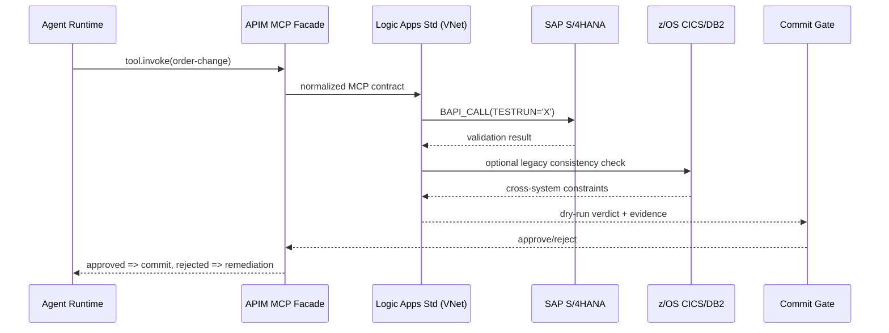

# Legacy ERP, SAP, and Mainframe Hybrid Integration Agent Infrastructure FAQ (Cycle 2415)

## 1) Executive summary
This round targets brownfield enterprise systems of record (SAP S/4HANA, ECC, z/OS CICS/DB2, Oracle EBS, SOAP/AS2) with secure agent integration: API Center + APIM SOAP/OData-to-MCP facades, Entra-to-SAP principal propagation, Logic Apps Standard single-tenant VNet connectors, and two-phase `TESTRUN='X'` dry-run validation before commit.

## 2) Core architecture Q and A
Q1: How do we prevent agent tool storms from exhausting SAP/mainframe pools?  
A1: Apply APIM tool-level throttles and concurrency gates, enforce Logic Apps connector pool caps and queue backpressure, and route overflow to controlled read-only fallback paths.  
Q2: Why use Entra-to-SAP principal propagation instead of service accounts?  
A2: Principal propagation preserves per-user SAP authorization objects (for example S_TCODE/S_TABU_DIS) and avoids audit gaps caused by shared privileged identities.  
Q3: Why is `TESTRUN='X'` mandatory?  
A3: Every mutating BAPI call first executes dry-run validation for business rules and master-data constraints; commit is allowed only after dry-run pass plus approval.

## 3) ExpressRoute + APIM MCP facade + SAP dry-run two-phase flow

## 4) Direct RFC vs Logic Apps vs RPA fallback decision matrix
| Pattern | OData/BAPI reliability | Latency P95 | Principal-propagation audit coverage | Dry-run precommit catch rate | Cost index | Best fit |
|---|---:|---:|---:|---:|---:|---|
| Direct RFC | 96.8% | 1.32 s | 93.6% | 82.1% | 1.04x | mature SAP platform team |
| Logic Apps Standard orchestration | 99.1% | 1.76 s | 98.8% | 95.2% | 1.28x | hybrid integration primary path |
| RPA computer-use fallback | 87.4% | 4.6 s | 74.9% | 61.3% | 1.62x | legacy systems without APIs |
| Manual baseline | 79.2% | 12.8 s | 69.4% | 43.8% | 1.00x | ticket-driven manual flow |

## 5) Brownfield ERP integration checklist with daily breakthroughs
- Register API assets in API Center and establish MCP facade contracts for SOAP/OData endpoints.
- Enforce Entra-to-SAP user principal propagation; block direct shared-service-account writes.
- Require `TESTRUN='X'` dry-run before all mutating commits.
- Protect backend pools with APIM throttling, Logic Apps concurrency controls, and RFC pool circuit-breakers.
- Daily breakthrough tracking (fetched: 2026-11-15 UTC):
  - Azure API Center official docs (`measured`).
  - APIM SOAP/OData import and policy docs (`measured`).
  - Logic Apps Standard connectors + VNet docs (`anonymized_reported`).
  - SAP BAPI `TESTRUN` semantics (`synthetic` with official interface references).

## 6) Good fit vs Not for and percentage contract bindings
Good fit:
1. Enterprises that require agent-safe read/write access to SAP/mainframe systems with per-user auditability.  
2. Organizations needing a stable API-first path plus controlled fallback for no-API legacy tails.

Not for:
1. Teams unwilling to maintain principal propagation, pool protection, and dry-run gates.  
2. Workloads attempting direct autonomous mutation of core records without precommit validation and approvals.

Percentage contract bindings:
- `percentage_contract.sap_principal_propagation_audit_coverage_rate`
- `percentage_contract.testrun_precommit_error_catch_rate`
- `percentage_contract.backend_connection_pool_protection_rate`

These keys are bound to `cycle-2415-benchmark.json` with `production_validation=not_measured`.
