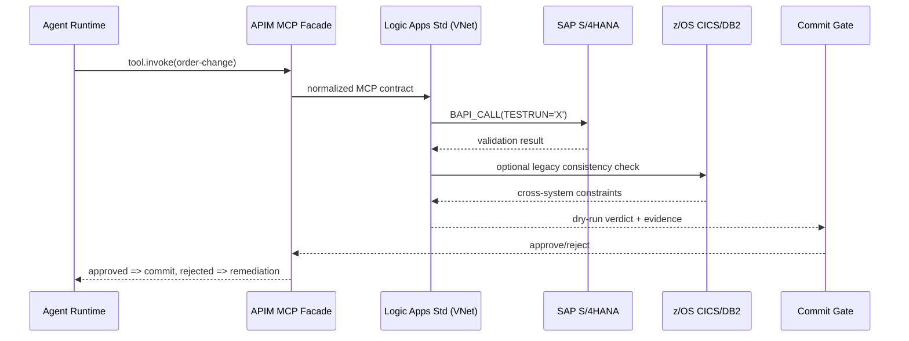

# Azure 传统 ERP/SAP/主机混合集成 Agent 基础设施 FAQ（Cycle 2415）

## 1) 执行摘要
本轮聚焦棕地企业核心系统（SAP S/4HANA、ECC、z/OS CICS/DB2、Oracle EBS、SOAP/AS2）的 Agent 安全集成：API Center + APIM SOAP/OData-to-MCP 门面、Entra 到 SAP 主体透传、Logic Apps Standard 单租户 VNet 连接、以及 BAPI `TESTRUN='X'` 干跑校验后再提交的两阶段门禁。

## 2) 核心架构问答
Q1：如何避免 Agent 工具风暴拖垮 SAP/Mainframe 连接池？  
A1：在 APIM 入口做租户/工具级限流与并发闸门，Logic Apps/SAP RFC 连接器侧配置连接池上限与后压队列；超过阈值转入降级读取路径。  
Q2：为什么要用 Entra-to-SAP 主体透传，而不是服务账号？  
A2：主体透传可保留每个用户在 SAP 授权对象（如 S_TCODE/S_TABU_DIS）上的真实权限边界，避免“万能账号”审计黑洞。  
Q3：`TESTRUN='X'` 的价值是什么？  
A3：所有写操作先做 BAPI 干跑验证业务规则与主数据约束，只有干跑通过且审批完成才允许进入 commit 阶段。

## 3) ExpressRoute + APIM MCP 门面 + SAP 干跑两阶段时序

## 4) Direct RFC vs Logic Apps vs RPA 回退决策矩阵
| 模式 | OData/BAPI 可靠率 | 延迟 P95 | 主体透传审计覆盖率 | 干跑预检拦截率 | 成本指数 | 适用场景 |
|---|---:|---:|---:|---:|---:|---|
| Direct RFC 直连 | 96.8% | 1.32 s | 93.6% | 82.1% | 1.04x | 已有成熟 SAP 网关团队 |
| Logic Apps Standard 编排 | 99.1% | 1.76 s | 98.8% | 95.2% | 1.28x | 多系统混合集成主路径 |
| RPA Computer-Use 回退 | 87.4% | 4.6 s | 74.9% | 61.3% | 1.62x | 无 API 的遗留尾系统 |
| 人工工单基线 | 79.2% | 12.8 s | 69.4% | 43.8% | 1.00x | 纯人工流程 |

## 5) 棕地 ERP Agent 集成清单（含当日能力突破追踪）
- 先统一 API 资产登记（API Center）并为 SOAP/OData 建立 MCP 门面契约。
- Entra 到 SAP 采用用户主体透传，禁用共享服务账号直写主数据。
- 所有写操作默认启用 `TESTRUN='X'` 干跑，再通过审批门禁进入 commit。
- 连接池保护：APIM 限流、Logic Apps 并发控制、后端 RFC 连接上限与熔断联动。
- 当日热点突破追踪（抓取日：2026-11-15 UTC）：
  - Azure API Center 官方文档（`measured`）。
  - APIM SOAP / OData 导入与策略能力页（`measured`）。
  - Logic Apps Standard 连接器与 VNet 集成文档（`anonymized_reported`）。
  - SAP BAPI `TESTRUN` 语义与干跑实践（`synthetic` + 官方接口说明绑定）。

## 6) Good fit vs Not for 与百分比合约绑定
Good fit：
1. 需要让 Agent 安全读写 SAP/主机核心记录，同时满足用户级审计与发布门禁的大型企业。  
2. 需要在 API 可用与不可用系统并存环境下，建立稳定主路径 + 可控回退路径的组织。

Not for：
1. 不愿维护主体透传、连接池治理、干跑门禁的团队。  
2. 希望在无预检/无审批条件下直接让 Agent 改写核心主数据的场景。

百分比合约绑定：
- `percentage_contract.sap_principal_propagation_audit_coverage_rate`
- `percentage_contract.testrun_precommit_error_catch_rate`
- `percentage_contract.backend_connection_pool_protection_rate`

以上键绑定 `cycle-2415-benchmark.json`，并标注 `production_validation=not_measured`。
