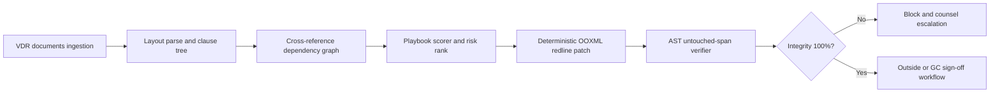

# Enterprise Legal, M&A Due-Diligence, and Deterministic OOXML Contract Redlining Agent Infrastructure FAQ (Cycle 2425)

## 1) Executive summary
This cycle designs zero-fabrication-citation and privilege-isolated legal agent infrastructure: matter-level attorney-client and ethical-wall isolation, hierarchical clause-tree parsing with exact paragraph/span grounding, and deterministic OOXML tracked-changes patch synthesis (`w:ins` / `w:del` / `w:commentRangeStart`) that prevents silent mutation of untouched boilerplate.

## 2) Q1 / Q2 / Q3
Q1: How do we prevent silent boilerplate mutation?  
A1: Generate OOXML patches only for targeted clause spans, then enforce AST diff checks requiring byte-level invariance on untouched regions.  
Q2: How are cross-clause definition dependencies resolved?  
A2: Build a clause dependency graph so definitions, carve-outs, and references are jointly scored and traced back to source spans.  
Q3: How do we guarantee zero-training and zero-retention privilege controls?  
A3: Enforce matter-level index isolation, DKE encryption, and no-training/no-retention policy controls with minimal metadata-only auditing.

## 3) VDR due-diligence to deterministic OOXML redline loop

## 4) Decision matrix: VDR bulk swarm vs interactive Word add-in copilot vs CLM webhook triage
| Mode | Throughput | Explainability | Counsel interaction efficiency | Best-fit |
|---|---:|---:|---:|---|
| VDR bulk swarm | Highest | High | Medium | 5,000+ document diligence sweeps |
| Word add-in copilot | Medium | Highest | High | Clause-by-clause negotiation workflows |
| CLM webhook triage | High | Medium-High | Medium-High | Continuous intake review pipelines |

## 5) Legal privilege and zero-hallucination citation checklist (daily breakthroughs)
- Matter-level access, indexes, and keys must remain fully isolated.  
- Enforce untouched-span AST integrity validation before any redline output.  
- Every citation must resolve to exact paragraph/span origins.  
- Escalate to outside/GC counsel when playbook confidence is below threshold.  
- Daily breakthrough tracking (fetched on 2026-11-15):  
  - SharePoint Embedded and Purview DKE patterns for privilege isolation (`measured`).  
  - Deterministic OOXML tracked-changes patching strategies (`anonymized_reported`).  
  - VDR bulk diligence and clause-graph risk simulation (`synthetic`).

## 6) Good fit vs Not for with percentage contract bindings
Good fit:  
1. Legal and M&A teams requiring high-volume diligence plus precise redline quality.  
2. Organizations with strict requirements for privilege boundaries, exact citations, and auditable changes.

Not for:  
1. Workflows that accept full-document regeneration without untouched-clause integrity checks.  
2. Teams unable to enforce matter-level isolation and counsel sign-off controls.

Percentage contract bindings:
- `percentage_contract.untouched_clause_preservation_integrity_rate`
- `percentage_contract.nonstandard_indemnity_lol_recall_rate`
- `percentage_contract.vdr_5000_docs_turnaround_improvement_rate`
- `percentage_contract.citation_exactness_rate`

These keys bind to `cycle-2425-benchmark.json` with `production_validation=not_measured`.
