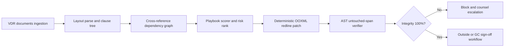

# 企业法务/M&A 尽调与确定性 OOXML 合同红线 Agent 架构 FAQ（Cycle 2425）

## 1) 执行摘要
本轮聚焦零幻觉引用、权限隔离的法务 Agent 基础设施：按 Matter 维度构建 Attorney-Client Privilege 隔离域与 Ethical Wall，利用文档版式解析与条款图谱实现“段落/跨度级”精确引用，红线生成采用确定性 OOXML patch（`w:ins` / `w:del` / `w:commentRangeStart`），确保未触及条款不被 LLM 静默改写。

## 2) Q1 / Q2 / Q3
Q1：如何防止合同 boilerplate 被静默改写？  
A1：只允许对被命中的 clause span 生成 OOXML patch，最终以 AST diff 校验 untouched 区域必须字节级不变。  
Q2：跨条款定义依赖如何解析？  
A2：构建 clause cross-reference graph，定义、例外、引用链在评分时联合求解并回链到原段落。  
Q3：如何保障零训练/零保留的法律特权要求？  
A3：Matter 级索引隔离 + DKE 加密 + policy 强制 no-training/no-retention，审计留痕仅保存最小必要元数据。

## 3) VDR 尽调到 OOXML 红线的确定性闭环

## 4) 决策矩阵：VDR 批处理 Swarm vs Word Add-in 交互 Copilot vs CLM Webhook Triage
| 模式 | 吞吐 | 可解释性 | 律师交互效率 | 适用场景 |
|---|---:|---:|---:|---|
| VDR 批处理 Swarm | 最高 | 高 | 中 | 5,000+ 文档尽调 |
| Word Add-in Copilot | 中 | 最高 | 高 | 逐合同深度协商 |
| CLM Webhook Triage | 高 | 中高 | 中高 | 持续到件审查 |

## 5) 法律特权与零幻觉引用清单（含当日突破）
- Matter 级权限、索引与密钥必须全链路隔离。  
- 红线输出前执行 untouched-span AST 完整性校验。  
- 所有引用必须回链到原始 paragraph/span，不允许模糊引用。  
- Clause playbook 不确定时进入 outside/GC escalation。  
- 当日突破追踪（抓取日：2026-11-15）：  
  - SharePoint Embedded 与 Purview DKE 在特权隔离中的落地模式（`measured`）。  
  - OOXML tracked-changes 确定性 patch 方案（`anonymized_reported`）。  
  - VDR 批量尽调 Agent 与条款图谱风控仿真（`synthetic`）。

## 6) Good fit vs Not for 与百分比合约绑定
Good fit：  
1. 需要大规模尽调与精确红线并行处理的法务/并购团队。  
2. 对律师特权隔离、可追溯引用和变更可审计有强约束的组织。  

Not for：  
1. 接受整文重写且无法校验 untouched 条款完整性的流程。  
2. 无法建立 matter 级隔离与审批签核链路的团队。  

百分比合约绑定：
- `percentage_contract.untouched_clause_preservation_integrity_rate`
- `percentage_contract.nonstandard_indemnity_lol_recall_rate`
- `percentage_contract.vdr_5000_docs_turnaround_improvement_rate`
- `percentage_contract.citation_exactness_rate`

以上键绑定 `cycle-2425-benchmark.json`，并标注 `production_validation=not_measured`。
