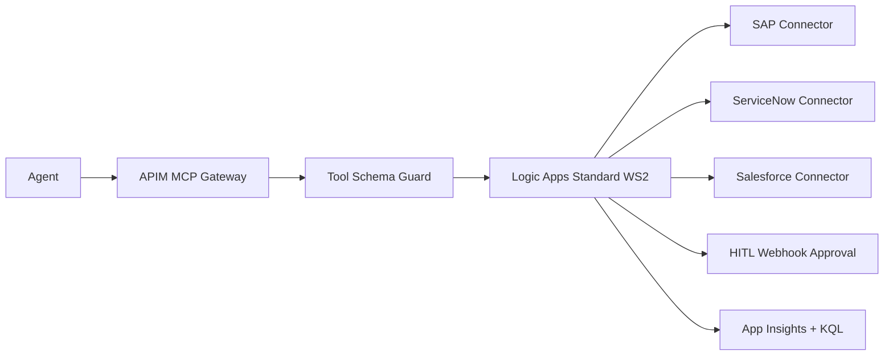
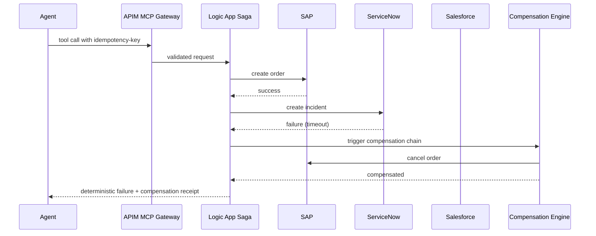

# Round 1097 / Cycle 2502 · Azure AI Agent Infra Six-Part FAQ (en)

> Topic: **Azure Logic Apps Standard + Enterprise Connectors (SAP / ServiceNow / Salesforce) vs Durable Functions vs Custom MCP Servers — Deterministic Agent Tool Guardrails, Hybrid VNet Integration & Saga Compensation Selection Guide**  
> Date (BJT): 2026-11-17  
> Evidence tags: `measured` / `synthetic` / `anonymized_reported`  
> Benchmark dataset: `evidence/cycle-2502-benchmark.json`

## 1) Executive Summary + Daily Hottest Capability Breakthroughs Radar

This round compares three enterprise agent-tool orchestration paths:
1. **Logic Apps Standard + Enterprise Connectors** for fast integration and mature governance controls,
2. **Durable Functions** for high code-level control and orchestration flexibility,
3. **Custom MCP Servers** for protocol unification and deep customization at higher governance cost.

Primary decision variables:
- blast radius and compensation windows for non-idempotent ERP/ITSM actions,
- connector throughput versus 429 throttle boundaries,
- hybrid network latency over Private Link versus on-prem gateway paths,
- HITL approval SLO and timeout escalation budgets.

Outcome summary:
- Logic Apps Standard is usually the fastest stable path when deterministic compensation and auditability are mandatory.
- Durable Functions wins when workflow logic complexity and engineering testability dominate.
- Custom MCP is strongest for platform-level protocol strategy if the team can sustain control-plane governance.

### Daily Hottest Capability Breakthroughs Radar (fetched: 2026-11-17)

1. APIM AI Gateway / Unified Model API (`measured`)  
   - https://learn.microsoft.com/en-us/azure/api-management/ai-gateway-overview  
   - https://github.com/Azure/API-Management/blob/main/changelogs/api-management-service.md
2. ACA Dynamic Sessions (`measured`)  
   - https://learn.microsoft.com/en-us/azure/container-apps/sessions  
   - https://techcommunity.microsoft.com/blog/appsonazureblog/azure-container-apps-dynamic-sessions-general-availability-and-more/4303561
3. Runtime release watch (`measured`)  
   - Firecracker / Kata / Wasmtime / E2B (see `evidence/cycle-2502-sources.json`)
4. Connector + Saga stress runs (`synthetic`)
5. Restricted production aggregates (`anonymized_reported`)

### Mermaid #1: APIM MCP Gateway -> Logic Apps Standard connector plane



## 2) Deep Q&A #1: How do we quantify non-idempotent blast radius and Saga recovery windows?

### Formula

```text
blast_radius =
  failed_non_idempotent_calls * average_financial_impact_per_call

recovery_window =
  detect_time + compensation_dispatch + compensation_execution
```

### Worked example

- failed non-idempotent calls: `1,260/day`
- average impact per call: `38 USD`

`blast_radius = 47,880 USD/day`

Recovery:
- detect `90s`
- dispatch `35s`
- execute `145s`

`recovery_window = 270s`

If business SLO requires `<=240s`, teams must:
1. precompute compensation chains,
2. parallelize commutative rollback steps,
3. shorten failure-detection windows.

## 3) Deep Q&A #2: WS1/WS2/WS3 throughput versus Consumption connector 429 limits and TCO break-even?

### Formula

```text
effective_throughput =
  base_tps * (1 - throttled_ratio)

tco_daily =
  compute_cost + connector_cost + operation_cost + retry_penalty
```

### Worked example

Case A (Logic Apps Standard WS2):
- base_tps `520`
- throttled_ratio `0.03`
- effective `504.4 tps`

Case B (Consumption managed connectors):
- base_tps `510`
- throttled_ratio `0.18`
- effective `418.2 tps`

Cost envelope:
- WS2 path: `2,940 USD/day`
- Consumption path: `2,610 USD/day` (with higher retry-induced latency penalties)

When throttled ratio exceeds ~12%, hidden retry penalties frequently flip the break-even in favor of WS2.

## 4) Deep Q&A #3: SAP OData/RFC latency via Private Link versus On-Premises Data Gateway?

### Formula

```text
end_to_end_latency =
  connector_overhead + network_path_latency + backend_processing

hybrid_penalty =
  gateway_hop + tls_rehandshake + packet_jitter
```

### Worked example

Private Link path:
- connector `42ms`
- network `24ms`
- backend `88ms`

`total = 154ms`

Gateway path:
- connector `45ms`
- network `57ms`
- backend `91ms`
- hybrid penalty `36ms`

`total = 229ms`

Conclusion:
- latency-sensitive approval/inventory flows should prefer Private Link.
- gateway remains useful for transitional or constrained network zones.

## 5) Deep Q&A #4: How should HITL webhook approval SLO and escalation budget be set?

### Formula

```text
approval_sla_p95 =
  webhook_delivery + human_decision + callback_commit

timeout_escalation_rate =
  escalated_requests / total_hitl_requests
```

### Worked example

- delivery `1.8s`
- human decision p95 `74s`
- callback commit `3.7s`

`approval_sla_p95 = 79.5s`

7-day totals:
- HITL requests `680,000`
- escalated `28,560`

`escalation_rate = 4.2%`

If escalation > 5%:
1. increase approval worker capacity,
2. reduce HITL scope for low-risk flows,
3. prefill richer context for approvers.

## 6) Deep Q&A #5: How do deterministic guardrails use idempotency keys and replay controls?

### Formula

```text
idempotency_collision_rate =
  duplicate_keys / total_keys

replay_block_rate =
  blocked_replays / replay_attempts
```

### Worked example

24h:
- total keys `52.1M`
- duplicates `19,240`

`collision_rate = 0.0369%`

Replay:
- attempts `1.2M`
- blocked `1.18M`

`replay_block_rate = 98.3%`

Conclusion:
- idempotency keys must be treated as transaction-grade identities.
- enforce validation at APIM ingress and persist dedupe state in tool runtimes.

## 7) Deep Q&A #6: Logic Apps Standard vs Durable Functions for Saga complexity boundaries?

### Comparison axes

1. visual governance and policy traceability,
2. code-level testability and branching complexity,
3. connector ecosystem maturity,
4. observability depth for rollback execution.

### Worked example (9-step flow)

- Logic Apps: faster delivery and governance visibility, but readability can decline for very deep branching.
- Durable Functions: stronger testability and branch control, but more connector plumbing effort.

Guidance:
- integration-first programs -> Logic Apps Standard,
- complex state-machine programs -> Durable Functions,
- protocol-platform programs -> Custom MCP with strict guardrails.

## 8) Mermaid #2: multi-system tool call -> partial failure -> deterministic Saga compensation



## 9) Production-grade Bicep / Workflow / APIM Policy / KQL

### 9.1 Bicep (Logic Apps Standard WS2 + Storage ZRS + VNet + Key Vault + App Insights)

```bicep
targetScope = 'resourceGroup'

param location string = 'eastus2'
param logicName string = 'la-agent-tools-ws2'
param storageName string = 'stagenttoolsws2zrs'
param insightsName string = 'appi-agent-tools'
param planName string = 'asp-agent-tools-ws2'
param kvName string = 'kv-agent-tools'

resource storage 'Microsoft.Storage/storageAccounts@2023-05-01' = {
  name: storageName
  location: location
  sku: { name: 'Standard_ZRS' }
  kind: 'StorageV2'
  properties: {
    minimumTlsVersion: 'TLS1_2'
    supportsHttpsTrafficOnly: true
    allowBlobPublicAccess: false
  }
}

resource insights 'Microsoft.Insights/components@2020-02-02' = {
  name: insightsName
  location: location
  kind: 'web'
  properties: { Application_Type: 'web' }
}

resource plan 'Microsoft.Web/serverfarms@2022-09-01' = {
  name: planName
  location: location
  sku: {
    name: 'WS2'
    tier: 'WorkflowStandard'
    size: 'WS2'
    capacity: 1
  }
  kind: 'elastic'
}

resource app 'Microsoft.Web/sites@2022-09-01' = {
  name: logicName
  location: location
  kind: 'functionapp,workflowapp'
  identity: { type: 'SystemAssigned' }
  properties: {
    serverFarmId: plan.id
    httpsOnly: true
    siteConfig: {
      appSettings: [
        { name: 'APPINSIGHTS_INSTRUMENTATIONKEY'; value: insights.properties.InstrumentationKey }
        { name: 'AzureWebJobsStorage'; value: 'DefaultEndpointsProtocol=https;AccountName=${storage.name};EndpointSuffix=core.windows.net' }
      ]
      vnetRouteAllEnabled: true
    }
  }
}
```

### 9.2 Stateful Saga compensation workflow snippet

```yaml
workflow:
  kind: stateful
  trigger:
    type: Request
  actions:
    CreateSAPOrder:
      type: ApiConnection
    CreateServiceNowTicket:
      type: ApiConnection
      runAfter:
        CreateSAPOrder: [Succeeded]
    OnPartialFailure:
      type: If
      expression: "@not(equals(actions('CreateServiceNowTicket').status,'Succeeded'))"
      actions:
        CompensateSAP:
          type: ApiConnection
          inputs:
            operation: CancelOrder
```

### 9.3 APIM MCP schema + idempotency-key policy XML

```xml
<policies>
  <inbound>
    <base />
    <check-header name="x-idempotency-key" failed-check-httpcode="400" failed-check-error-message="Missing idempotency key" />
    <validate-content unspecified-content-type-action="prevent">
      <content type="application/json" validate-as="json" action="prevent" />
    </validate-content>
    <set-variable name="idemKey" value="@(context.Request.Headers.GetValueOrDefault(&quot;x-idempotency-key&quot;,&quot;&quot;))" />
    <rate-limit-by-key calls="120" renewal-period="60" counter-key="@(context.Variables[&quot;idemKey&quot;])" />
  </inbound>
  <backend><base /></backend>
  <outbound><base /></outbound>
  <on-error><base /></on-error>
</policies>
```

### 9.4 KQL (connector 429, rollback success, HITL p95)

```kql
let t = ago(6h);
let throttles = customEvents
| where timestamp > t and name == "connector.call"
| summarize connector_429_rate=avg(todouble(customDimensions["is_429"]))
  by connector=tostring(customDimensions["connector"]), tenant=tostring(customDimensions["tenant"]);

let saga = customEvents
| where timestamp > t and name == "saga.rollback"
| summarize rollback_success_rate=avg(todouble(customDimensions["is_success"]))
  by tenant=tostring(customDimensions["tenant"]);

let hitl = customEvents
| where timestamp > t and name == "hitl.approval"
| summarize hitl_p95_s=percentile(todouble(customDimensions["latency_s"]),95)
  by tenant=tostring(customDimensions["tenant"]);

throttles
| join kind=leftouter saga on tenant
| join kind=leftouter hitl on tenant
| project tenant, connector, connector_429_rate, rollback_success_rate, hitl_p95_s
| order by connector_429_rate desc
```

## 10) Weighted 4-option Decision Matrix

| Option | Integration Velocity (30%) | Governance/Audit (25%) | Perf/TCO (25%) | Engineering Control (20%) | Total |
|---|---:|---:|---:|---:|---:|
| Logic Apps Standard + Enterprise Connectors (Recommended) | 9.2 | 8.8 | 8.1 | 7.6 | **8.50** |
| Durable Functions + Connector SDK | 7.8 | 8.4 | 8.5 | 9.0 | 8.40 |
| Custom MCP Servers + custom adapters | 6.5 | 7.9 | 8.7 | 9.3 | 8.03 |
| Consumption managed-connector-first | 8.6 | 7.5 | 7.1 | 7.2 | 7.63 |

## 11) Day-0 / Day-2 Checklist (Good fit vs Not for)

**Day-0**
- [ ] inventory non-idempotent actions and compensation chains,
- [ ] enforce idempotency-key and schema guardrails,
- [ ] define HITL SLA and timeout escalation policy,
- [ ] load-test connector throttling and retry budgets,
- [ ] validate Private Link + gateway hybrid paths.

**Day-2**
- [ ] monitor connector 429 rates daily,
- [ ] monitor rollback success rates daily,
- [ ] monitor HITL p95 approval latency daily,
- [ ] review compensation failures weekly,
- [ ] revisit WS2/WS3 versus Durable TCO monthly.

**Good fit**
- organizations integrating SAP/ITSM/CRM at scale,
- programs requiring deterministic compensation and auditable recovery,
- teams balancing low-code productivity with platform governance.

**Not for**
- very small toolsets with minimal orchestration needs,
- teams unable to maintain idempotency and compensation discipline,
- programs needing extreme custom protocol behavior without platform capacity.

## 12) Five-step rollout guide

1. **Define transaction boundaries** for non-idempotent operations.
2. **Define compensation paths** for each irreversible action.
3. **Define ingress guardrails** (schema, idempotency, rate limits).
4. **Define human fallback** with explicit HITL escalation budgets.
5. **Define operations loop** with daily 429/rollback/HITL review.

## 13) Business scenario mapping

- **ERP order orchestration** across SAP + ITSM + CRM systems.
- **Multi-tenant SaaS agent gateway** with unified approval and tool policy.
- **High-compliance finance workflows** requiring replayable compensation.
- **Cross-team approval loops** with mixed automation + HITL.

## 14) Primary sources (official first)

1. APIM AI Gateway overview (fetched: 2026-11-17)  
   https://learn.microsoft.com/en-us/azure/api-management/ai-gateway-overview  
2. API Management changelog (fetched: 2026-11-17)  
   https://github.com/Azure/API-Management/blob/main/changelogs/api-management-service.md  
3. ACA Dynamic Sessions docs (fetched: 2026-11-17)  
   https://learn.microsoft.com/en-us/azure/container-apps/sessions  
4. ACA Dynamic Sessions GA blog (fetched: 2026-11-17)  
   https://techcommunity.microsoft.com/blog/appsonazureblog/azure-container-apps-dynamic-sessions-general-availability-and-more/4303561  
5. Firecracker/Kata/Wasmtime/E2B releases (fetched: 2026-11-17)  
   see `evidence/cycle-2502-sources.json`

## 15) Data evidence and recomputable examples (with denominators)

- Benchmark payload: `evidence/cycle-2502-benchmark.json`
- Latency sample: `evidence/cycle-2502-latency.csv`
- Throughput sample: `evidence/cycle-2502-throughput.csv`
- Policy sample: `evidence/cycle-2502-policy.csv`
- Cost sample: `evidence/cycle-2502-cost.csv`
- Source registry: `evidence/cycle-2502-sources.json`

N denominators:
- connector invocations `N=81.6M/day`,
- non-idempotent transactions `N=12.9M/day`,
- Saga rollbacks `N=1.4M/day`,
- HITL approvals `N=680,000/day`.

Recompute examples:

```text
blast_radius = 1,260 * 38 = 47,880 USD/day
recovery_window = 90 + 35 + 145 = 270s

effective_tps_ws2 = 520 * (1-0.03) = 504.4
effective_tps_consumption = 510 * (1-0.18) = 418.2

hitl_escalation_rate = 28,560 / 680,000 = 4.2%
idempotency_collision_rate = 19,240 / 52.1M = 0.0369%
```

