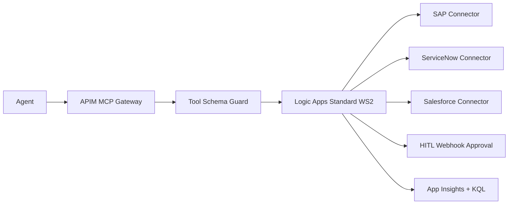
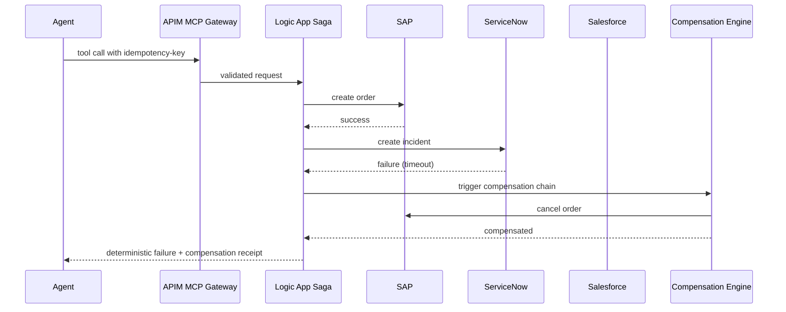

# Round 1097 / Cycle 2502 · Azure AI Agent Infra 六段式 FAQ（zh-CN）

> 主题：**Azure Logic Apps Standard + Enterprise Connectors (SAP / ServiceNow / Salesforce) vs Durable Functions vs Custom MCP Servers — Deterministic Agent Tool Guardrails, Hybrid VNet Integration & Saga Compensation Selection Guide**  
> 日期（BJT）：2026-11-17  
> 证据标签：`measured` / `synthetic` / `anonymized_reported`  
> 基准数据：`evidence/cycle-2502-benchmark.json`

## 1) Executive Summary + Daily Hottest Capability Breakthroughs Radar

本轮聚焦“企业 Agent 工具编排平面”的三类实现：
1. **Logic Apps Standard + Enterprise Connectors**：集成效率高、连接器治理成熟；
2. **Durable Functions**：代码可控度高、流程表达灵活；
3. **Custom MCP Servers**：工具协议统一、可深度定制，但治理负担最大。

关键决策变量：
- 非幂等系统调用（SAP/ITSM）失败时的补偿恢复窗口；
- 连接器吞吐与 429 节流边界；
- 混合网络（Private Link / On-Premises Data Gateway）链路延迟；
- 人工审批（HITL）超时升级预算。

结论先行：
- 以“稳定集成 + 可审计补偿”为核心时，Logic Apps Standard 更稳；  
- 以“复杂状态机 + 代码主导编排”为核心时，Durable Functions 更灵活；  
- 以“跨模型统一工具协议”且团队有治理能力时，Custom MCP 适合核心平台。

### Daily Hottest Capability Breakthroughs Radar（抓取：2026-11-17）

1. APIM AI Gateway / Unified Model API（`measured`）  
   - https://learn.microsoft.com/en-us/azure/api-management/ai-gateway-overview  
   - https://github.com/Azure/API-Management/blob/main/changelogs/api-management-service.md
2. ACA Dynamic Sessions（`measured`）  
   - https://learn.microsoft.com/en-us/azure/container-apps/sessions  
   - https://techcommunity.microsoft.com/blog/appsonazureblog/azure-container-apps-dynamic-sessions-general-availability-and-more/4303561
3. Runtime release watch（`measured`）  
   - Firecracker/Kata/Wasmtime/E2B（见 `evidence/cycle-2502-sources.json`）
4. Connector 与 Saga 压测（`synthetic`）
5. 匿名化生产统计（`anonymized_reported`）

### Mermaid #1：APIM MCP Gateway -> Logic Apps Standard Enterprise Connector Plane



## 2) Deep Q&A #1：非幂等 ERP/ITSM 调用的 blast radius 与 Saga 恢复窗口怎么算？

### 公式

```text
blast_radius =
  failed_non_idempotent_calls * average_financial_impact_per_call

recovery_window =
  detect_time + compensation_dispatch + compensation_execution
```

### Worked example

- 失败非幂等调用 `1,260/day`
- 单次平均影响 `38 USD`

`blast_radius = 47,880 USD/day`

恢复窗口：
- detect `90s`
- dispatch `35s`
- execute `145s`

`recovery_window = 270s`

若业务 SLO 要求 `<=240s`，则需：
1. 提前预计算补偿链；
2. 并行执行可交换步骤；
3. 提升失败检测采样频率。

## 3) Deep Q&A #2：Logic Apps Standard WS1/2/3 与 Consumption 连接器 429 上限、TCO break-even？

### 公式

```text
effective_throughput =
  base_tps * (1 - throttled_ratio)

tco_daily =
  compute_cost + connector_cost + operation_cost + retry_penalty
```

### Worked example

场景 A（Logic Apps Standard WS2）：
- base_tps `520`
- throttled_ratio `0.03`
- effective `504.4 tps`

场景 B（Consumption managed connectors）：
- base_tps `510`
- throttled_ratio `0.18`
- effective `418.2 tps`

### 成本估算

- WS2 路径：`2,940 USD/day`
- Consumption 路径：`2,610 USD/day`（但重试惩罚高）

当 throttled_ratio > 12% 时，Consumption 的隐藏成本（延迟/失败重试）会快速放大，WS2 出现 break-even 反转。

## 4) Deep Q&A #3：SAP OData/RFC 经 VNet Private Link vs On-Premises Data Gateway 延迟怎么对比？

### 公式

```text
end_to_end_latency =
  connector_overhead + network_path_latency + backend_processing

hybrid_penalty =
  gateway_hop + tls_rehandshake + packet_jitter
```

### Worked example

Private Link 路径：
- connector `42ms`
- network `24ms`
- backend `88ms`

`total = 154ms`

Data Gateway 路径：
- connector `45ms`
- network `57ms`
- backend `91ms`
- hybrid penalty `36ms`

`total = 229ms`

### 结论

若审批/库存联动链路对 p95 敏感，优先 Private Link；  
Data Gateway 适合过渡期或受限网络域。

## 5) Deep Q&A #4：HITL webhook 审批 SLA 与超时升级预算如何定义？

### 公式

```text
approval_sla_p95 =
  webhook_delivery + human_decision + callback_commit

timeout_escalation_rate =
  escalated_requests / total_hitl_requests
```

### Worked example

- delivery `1.8s`
- human decision p95 `74s`
- callback commit `3.7s`

`approval_sla_p95 = 79.5s`

7 天：
- total HITL `680,000`
- escalated `28,560`

`escalation_rate = 4.2%`

当 escalation > 5%：
1. 增加审批并行池；
2. 降低非关键路径 HITL 覆盖；
3. 预填上下文减少人工决策时长。

## 6) Deep Q&A #5：Deterministic MCP tool guardrails 如何设计幂等键与重放保护？

### 公式

```text
idempotency_collision_rate =
  duplicate_keys / total_keys

replay_block_rate =
  blocked_replays / replay_attempts
```

### Worked example

24h：
- total keys `52.1M`
- duplicate `19,240`

`collision_rate = 0.0369%`

重放：
- attempts `1.2M`
- blocked `1.18M`

`replay_block_rate = 98.3%`

### 结论

必须把 idempotency key 视为“交易主键级”资产：
- APIM 入站强校验；
- MCP server 端持久化去重；
- Saga 补偿链共享同一业务键。

## 7) Deep Q&A #6：Durable Functions 与 Logic Apps Standard 在 Saga 编排复杂度上如何选？

### 比较维度

1. 可视化编排与治理；
2. 代码可测试性；
3. 连接器生态；
4. 故障恢复可观测性。

### Worked example（同一流程 9 步）

- Logic Apps：交付快，变更低门槛，但复杂逻辑可读性下降；  
- Durable Functions：代码可测性高，复杂分支更清晰，但连接器封装工作更多。

### 建议

- 以集成为主：Logic Apps Standard；  
- 以复杂状态机与工程化测试为主：Durable；  
- 以协议平台化为主：Custom MCP + guardrails。

## 8) Mermaid #2：Multi-System Tool Call -> Partial Failure -> Deterministic Saga Compensation



## 9) 生产级 Bicep / Workflow / APIM Policy / KQL

### 9.1 Bicep（Logic Apps Standard WS2 + Storage ZRS + VNet Swift + KeyVault + AppInsights）

```bicep
targetScope = 'resourceGroup'

param location string = 'eastus2'
param logicName string = 'la-agent-tools-ws2'
param storageName string = 'stagenttoolsws2zrs'
param insightsName string = 'appi-agent-tools'
param planName string = 'asp-agent-tools-ws2'
param kvName string = 'kv-agent-tools'

resource storage 'Microsoft.Storage/storageAccounts@2023-05-01' = {
  name: storageName
  location: location
  sku: { name: 'Standard_ZRS' }
  kind: 'StorageV2'
  properties: {
    minimumTlsVersion: 'TLS1_2'
    supportsHttpsTrafficOnly: true
    allowBlobPublicAccess: false
  }
}

resource insights 'Microsoft.Insights/components@2020-02-02' = {
  name: insightsName
  location: location
  kind: 'web'
  properties: { Application_Type: 'web' }
}

resource plan 'Microsoft.Web/serverfarms@2022-09-01' = {
  name: planName
  location: location
  sku: {
    name: 'WS2'
    tier: 'WorkflowStandard'
    size: 'WS2'
    capacity: 1
  }
  kind: 'elastic'
}

resource app 'Microsoft.Web/sites@2022-09-01' = {
  name: logicName
  location: location
  kind: 'functionapp,workflowapp'
  identity: { type: 'SystemAssigned' }
  properties: {
    serverFarmId: plan.id
    httpsOnly: true
    siteConfig: {
      appSettings: [
        { name: 'APPINSIGHTS_INSTRUMENTATIONKEY'; value: insights.properties.InstrumentationKey }
        { name: 'AzureWebJobsStorage'; value: 'DefaultEndpointsProtocol=https;AccountName=${storage.name};EndpointSuffix=core.windows.net' }
      ]
      vnetRouteAllEnabled: true
    }
  }
}
```

### 9.2 Stateful Saga Compensation Workflow（YAML/JSON 片段）

```yaml
workflow:
  kind: stateful
  trigger:
    type: Request
  actions:
    CreateSAPOrder:
      type: ApiConnection
    CreateServiceNowTicket:
      type: ApiConnection
      runAfter:
        CreateSAPOrder: [Succeeded]
    OnPartialFailure:
      type: If
      expression: "@not(equals(actions('CreateServiceNowTicket').status,'Succeeded'))"
      actions:
        CompensateSAP:
          type: ApiConnection
          inputs:
            operation: CancelOrder
```

### 9.3 APIM MCP tool schema + idempotency key policy XML

```xml
<policies>
  <inbound>
    <base />
    <check-header name="x-idempotency-key" failed-check-httpcode="400" failed-check-error-message="Missing idempotency key" />
    <validate-content unspecified-content-type-action="prevent">
      <content type="application/json" validate-as="json" action="prevent" />
    </validate-content>
    <set-variable name="idemKey" value="@(context.Request.Headers.GetValueOrDefault(&quot;x-idempotency-key&quot;,&quot;&quot;))" />
    <rate-limit-by-key calls="120" renewal-period="60" counter-key="@(context.Variables[&quot;idemKey&quot;])" />
  </inbound>
  <backend><base /></backend>
  <outbound><base /></outbound>
  <on-error><base /></on-error>
</policies>
```

### 9.4 KQL（429、Saga rollback、HITL p95）

```kql
let t = ago(6h);
let throttles = customEvents
| where timestamp > t and name == "connector.call"
| summarize connector_429_rate=avg(todouble(customDimensions["is_429"]))
  by connector=tostring(customDimensions["connector"]), tenant=tostring(customDimensions["tenant"]);

let saga = customEvents
| where timestamp > t and name == "saga.rollback"
| summarize rollback_success_rate=avg(todouble(customDimensions["is_success"]))
  by tenant=tostring(customDimensions["tenant"]);

let hitl = customEvents
| where timestamp > t and name == "hitl.approval"
| summarize hitl_p95_s=percentile(todouble(customDimensions["latency_s"]),95)
  by tenant=tostring(customDimensions["tenant"]);

throttles
| join kind=leftouter saga on tenant
| join kind=leftouter hitl on tenant
| project tenant, connector, connector_429_rate, rollback_success_rate, hitl_p95_s
| order by connector_429_rate desc
```

## 10) 决策矩阵（4 方案加权）

| 方案 | 集成效率 (30%) | 治理/可审计 (25%) | 性能/TCO (25%) | 工程可控性 (20%) | 总分 |
|---|---:|---:|---:|---:|---:|
| Logic Apps Standard + Enterprise Connectors（推荐） | 9.2 | 8.8 | 8.1 | 7.6 | **8.50** |
| Durable Functions + Connector SDK | 7.8 | 8.4 | 8.5 | 9.0 | 8.40 |
| Custom MCP Servers + 自建适配器 | 6.5 | 7.9 | 8.7 | 9.3 | 8.03 |
| Consumption Managed Connector 优先 | 8.6 | 7.5 | 7.1 | 7.2 | 7.63 |

## 11) Day-0 / Day-2 Checklist（Good fit vs Not for）

**Day-0（上线前）**
- [ ] 梳理非幂等调用并定义补偿链；
- [ ] 配置 idempotency key 与 schema guard；
- [ ] 建立 HITL 审批 SLA 与超时升级；
- [ ] 压测 connector 429 与重试预算；
- [ ] 验证 Private Link / Gateway 混合路径。

**Day-2（运行期）**
- [ ] 每日追踪 429 rate；
- [ ] 每日追踪 rollback success rate；
- [ ] 每日追踪 HITL p95；
- [ ] 每周回顾补偿失败根因；
- [ ] 每月重评 WS2/WS3 与 Durable TCO。

**Good fit**
- 需要快速接入 SAP/ITSM/CRM 企业系统；  
- 需要确定性补偿与强审计链；  
- 需要低代码与平台治理并存。

**Not for**
- 仅少量工具、无需编排治理；  
- 团队无法维护补偿链与幂等策略；  
- 对超高定制协议有极端需求但无平台工程投入。

## 12) 五步落地指南

1. **定义交易边界**：先划定非幂等动作；
2. **定义补偿链**：每一步要有逆操作；
3. **定义门禁**：schema + idempotency + rate limit；
4. **定义人工兜底**：HITL 超时升级策略；
5. **定义观测闭环**：429/rollback/HITL 三指标日巡检。

## 13) 业务场景映射

- **ERP 订单编排**：跨 SAP + ITSM + CRM 的复合动作。  
- **多租户 SaaS Agent Gateway**：统一工具协议与审批门禁。  
- **金融高合规场景**：非幂等动作必须可补偿可追责。  
- **跨部门审批流**：HITL 与自动化协同。

## 14) 关键来源（官方优先）

1. APIM AI Gateway overview（抓取：2026-11-17）  
   https://learn.microsoft.com/en-us/azure/api-management/ai-gateway-overview  
2. API Management changelog（抓取：2026-11-17）  
   https://github.com/Azure/API-Management/blob/main/changelogs/api-management-service.md  
3. ACA Dynamic Sessions docs（抓取：2026-11-17）  
   https://learn.microsoft.com/en-us/azure/container-apps/sessions  
4. ACA Dynamic Sessions GA blog（抓取：2026-11-17）  
   https://techcommunity.microsoft.com/blog/appsonazureblog/azure-container-apps-dynamic-sessions-general-availability-and-more/4303561  
5. Firecracker/Kata/Wasmtime/E2B releases（抓取：2026-11-17）  
   见 `evidence/cycle-2502-sources.json`

## 15) 数据证据与可复算算例（含 n 分母来源）

- Benchmark 主文件：`evidence/cycle-2502-benchmark.json`
- 延迟样本：`evidence/cycle-2502-latency.csv`
- 吞吐样本：`evidence/cycle-2502-throughput.csv`
- 策略样本：`evidence/cycle-2502-policy.csv`
- 成本样本：`evidence/cycle-2502-cost.csv`
- 来源登记：`evidence/cycle-2502-sources.json`

N 分母口径：
- Connector 调用 `N=81.6M/day`；
- 非幂等事务 `N=12.9M/day`；
- Saga rollback 样本 `N=1.4M/day`；
- HITL 请求 `N=680,000/day`。

复算示例：

```text
blast_radius = 1,260 * 38 = 47,880 USD/day
recovery_window = 90 + 35 + 145 = 270s

effective_tps_ws2 = 520 * (1-0.03) = 504.4
effective_tps_consumption = 510 * (1-0.18) = 418.2

hitl_escalation_rate = 28,560 / 680,000 = 4.2%
idempotency_collision_rate = 19,240 / 52.1M = 0.0369%
```

