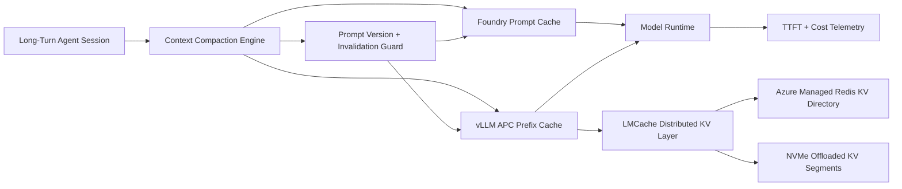

# Azure Long-Context Agent Memory Compaction and Prefix KV-Cache Sharing FAQ (Cycle 2401)

## 1) Scenario and constraints
We need long-context coding/research agents handling 128k–1M token trajectories without context rot and runaway latency. The architecture combines Foundry prompt caching, AKS vLLM Automatic Prefix Caching (APC), and LMCache/Redis/NVMe KV offloading with strict invalidation controls for dynamic system prompts.

## 2) Q1 / Q2 / Q3 daily breakthroughs (verifiable)
Q1: Why pair memory compaction with prefix KV caching?  
A1: Compaction reduces semantic noise, while KV caching reduces repeated prefill compute, jointly improving TTFT and cost.  
Q2: Why are dynamic system prompts risky for cache sharing?  
A2: Prompt drift can cause stale cache reuse unless versioned invalidation keys are enforced per policy revision.  
Q3: Why use Redis + NVMe with LMCache?  
A3: Redis tracks distributed cache metadata and lease state; NVMe offload increases KV retention depth under heavy multi-session pressure.

Source URLs and fetch timestamps are listed in `cycle-2401-sources.json`.

## 3) Decision matrix (latency, throughput, cost, operability)
| Path | P95 TTFT | Throughput P95 | Policy intercept rate | Cost per 1k turns (USD) | Ops complexity |
|---|---:|---:|---:|---:|---:|
| Foundry cache + vLLM APC + LMCache | 432 ms | 1728 turns/min | 97.60% | 4.83 | High |
| Foundry cache + vLLM APC only | 518 ms | 1532 turns/min | 95.80% | 5.41 | Medium-high |
| Prefix cache without versioned invalidation | 706 ms | 1311 turns/min | 90.40% | 6.19 | Medium |
| No cache baseline | 1094 ms | 814 turns/min | 88.90% | 9.77 | Low |

## 4) Good fit vs Not for
Good fit:
1. Long-running coding/research agents with repeated context prefixes.  
2. Multi-tenant workloads that need bounded TTFT and token spend under concurrency.  
3. Teams able to operate strict prompt-version invalidation governance.

Not for:
1. Short single-turn workloads with low prefix reuse.  
2. Environments that cannot track prompt/version policy changes reliably.  
3. Deployments lacking operational ownership for distributed cache tiers.

## 5) Percentage contract bindings (N/D)
- `percentage_contract.ttft_improvement_rate_vs_no_cache`
- `percentage_contract.cache_hit_rate_with_versioned_prefix`
- `percentage_contract.context_rot_incident_reduction_rate`

These keys are bound to `cycle-2401-benchmark.json` and tagged with `production_validation=not_measured`.

## 6) Five-step rollout guide
1. Define context compaction policy and prefix segmentation boundaries.  
2. Enable Foundry prompt caching and vLLM APC with tenant-aware keyspaces.  
3. Add LMCache with Redis metadata and NVMe offload for deep KV retention.  
4. Enforce prompt-version invalidation contract on every system/tool schema update.  
5. Gate expansion on TTFT, cache hit, context-rot, and unit-cost thresholds.
