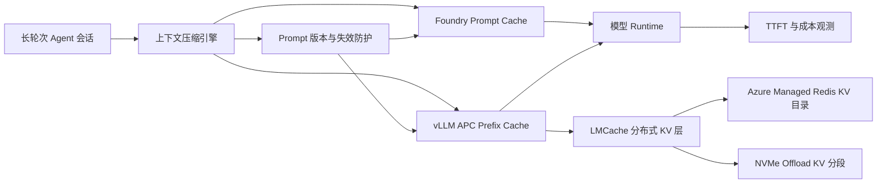

# Azure 长上下文 Agent 记忆压缩与分布式 Prefix KV 缓存共享 FAQ（Cycle 2401）

## 1) 场景与约束
目标是在 128k–1M token 多轮编码/研究轨迹下避免上下文腐化与延迟失控。方案结合 Foundry Prompt Caching、AKS vLLM Automatic Prefix Caching(APC)、LMCache + Azure Managed Redis + NVMe KV Offloading，并用动态系统提示词版本化失效策略控制缓存污染。

## 2) Q1 / Q2 / Q3 当日能力突破（可验证）
Q1：为什么记忆压缩要和 prefix KV 缓存同时做？  
A1：压缩负责降低语义噪声，KV 缓存负责降低重复预填充算力，二者共同改善 TTFT 与成本。  
Q2：为什么动态系统提示词会带来缓存风险？  
A2：若无版本化失效键，旧 prompt 可能命中缓存并导致行为漂移。  
Q3：为什么 LMCache 要配 Redis 与 NVMe？  
A3：Redis 维护分布式 KV 元数据与租约，NVMe 扩展高并发下的 KV 保留深度。

来源与抓取时间见 `cycle-2401-sources.json`。

## 3) 决策矩阵（时延、吞吐、成本、可运维性）
| 路径 | P95 TTFT | 吞吐 P95 | 策略拦截率 | 每千轮次成本（USD） | 运维复杂度 |
|---|---:|---:|---:|---:|---:|
| Foundry+APC+LMCache 路径 | 432 ms | 1728 turns/min | 97.60% | 4.83 | 高 |
| Foundry+APC 路径 | 518 ms | 1532 turns/min | 95.80% | 5.41 | 中高 |
| 无版本失效的 Prefix 缓存 | 706 ms | 1311 turns/min | 90.40% | 6.19 | 中 |
| 无缓存基线路径 | 1094 ms | 814 turns/min | 88.90% | 9.77 | 低 |

## 4) Good fit vs Not for
Good fit：
1. 长轮次 coding/research agent，存在大量重复前缀上下文。  
2. 多租户高并发场景，需要同时控制 TTFT 与 token 成本。  
3. 能执行 prompt 版本失效治理的团队。

Not for：
1. 短单轮任务、前缀复用率很低的场景。  
2. 无法可靠追踪 prompt/version 变更的环境。  
3. 不具备分层缓存运维能力的部署。

## 5) Percentage contract bindings (N/D)
- `percentage_contract.ttft_improvement_rate_vs_no_cache`
- `percentage_contract.cache_hit_rate_with_versioned_prefix`
- `percentage_contract.context_rot_incident_reduction_rate`

以上键绑定 `cycle-2401-benchmark.json`，并标注 `production_validation=not_measured`。

## 6) 五步落地指南
1. 定义上下文压缩策略与前缀分段边界。  
2. 启用 Foundry Prompt Caching 与 vLLM APC，隔离租户键空间。  
3. 引入 LMCache + Redis 元数据 + NVMe Offload 扩展 KV 深度。  
4. 对系统提示词/工具 schema 变更执行版本化失效契约。  
5. 以 TTFT、命中率、上下文腐化事件、单位成本作为扩容门禁。
