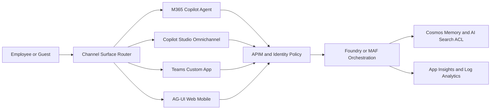
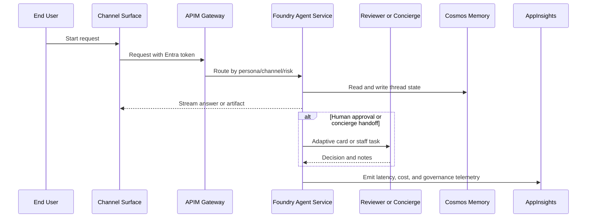

# Round 1125 · Cycle 2530
## M365 Copilot Agent vs Copilot Studio vs Teams Custom App vs AG-UI Web: Enterprise Agent Channel and UX Surface Selection FAQ

## 1) Executive summary for architecture boards
- This playbook focuses on enterprise application architecture, channel UX patterns, identity governance, and licensing TCO.
- The four patterns are complementary; the practical strategy is role-tiering plus channel-tiering plus cost-tiering.
- Internal knowledge work usually favors M365 in-flow experience, omnichannel customer reach favors Copilot Studio, process-heavy internal approvals favor Teams custom apps, and external interactive journeys favor AG-UI web/mobile.
- Identity pass-through and DLP inheritance are more important than visual polish when selecting the primary surface.
- Typical anti-pattern: copying internal productivity channels directly into B2C journeys without redesigning identity and economics.

## 2) Topic-aligned capability radar (official references, fetched 2026-11-18 UTC)
- Microsoft 365 Copilot extensibility: https://learn.microsoft.com/microsoft-365-copilot/extensibility/
- Declarative agent overview: https://learn.microsoft.com/microsoft-365-copilot/extensibility/overview-declarative-agent
- Custom engine agent: https://learn.microsoft.com/microsoft-365-copilot/extensibility/overview-custom-engine-agent
- Copilot Studio overview: https://learn.microsoft.com/microsoft-copilot-studio/fundamentals-what-is-copilot-studio
- Copilot Studio channels: https://learn.microsoft.com/microsoft-copilot-studio/publication-connect-bot-to-channels
- Teams platform and app model: https://learn.microsoft.com/microsoftteams/platform/
- Microsoft Graph overview: https://learn.microsoft.com/graph/overview
- Entra OBO flow: https://learn.microsoft.com/entra/identity-platform/v2-oauth2-on-behalf-of-flow
- APIM AI gateway: https://learn.microsoft.com/azure/api-management/ai-gateway-overview
- App Insights overview: https://learn.microsoft.com/azure/azure-monitor/app/app-insights-overview
- Azure AI Search ACL trimming: https://learn.microsoft.com/azure/search/search-security-trimming-for-azure-search
- Adaptive Cards schema explorer: https://adaptivecards.io/explorer/

## 3) Four channel patterns in enterprise terms
- **Option A — Microsoft 365 Copilot Agent (Declarative + Custom Engine)** for knowledge workers who already live in Office and Teams.
- **Option B — Copilot Studio Omnichannel Agent** for Teams/Web/SharePoint/WhatsApp multi-channel service reach.
- **Option C — Teams Custom App + M365 Agents SDK + Adaptive Cards** for internal approvals and process-centric orchestration.
- **Option D — Custom Web/Mobile AG-UI Workbench** for external customers, visual canvases, and streaming co-editing.
- Composition principle: map internal authoring, internal approval, external self-service, and concierge escalation to different surfaces.

## 4) 12-dimension head-to-head matrix (including When NOT to choose)
| Dimension | A M365 Copilot Agent | B Copilot Studio | C Teams Custom App | D AG-UI Web/Mobile |
|---|---|---|---|---|
| 1. Target persona | Internal knowledge worker | Mixed internal/external service | Internal process role | External B2B/B2C guest |
| 2. UI richness | In-flow Office + chat | Omnichannel chat + cards | Cards/Tab workflow UI | Split-screen generative canvas |
| 3. Office/Graph in-flow | Strongest | Medium | Strong (with engineering) | Low to medium (custom integration) |
| 4. SSO/OBO pass-through | Native strong | Strong | Strong | Strong only if self-built correctly |
| 5. Licensing economics | Seat-heavy | Credit + seat mix | Build-cost heavy | Consumption-heavy |
| 6. Channel reach | Medium | Broadest | Medium | Broad with custom investment |
| 7. Streaming and co-edit UX | Strong in Office docs | Medium | Medium | Strongest for visual collaboration |
| 8. Backend orchestration freedom | Medium | Medium-high | High | Highest |
| 9. Governance and DLP inheritance | Strongest | Strong | Strong | Must be designed explicitly |
| 10. Time to market | Fast | Very fast | Medium | Medium to slow |
| 11. Best-fit scenario | Partner/analyst drafting | Omnichannel operations | Approval-heavy operations | Customer journey workbench |
| 12. When NOT to choose | External primary channel | Deep bespoke UI requirements | No engineering capacity | No security engineering maturity |

## 5) Decision ladder and anti-patterns
- Step A: identify identity domain first (employee, partner, external customer).
- Step B: determine whether the work loop must remain in Office/Teams in-flow.
- Step C: determine omnichannel handoff requirements and concierge workflow depth.
- Step D: compare annual seat economics versus consumption economics with realistic concurrency.
- Anti-pattern 1: forcing external customer journeys into internal seat models.
- Anti-pattern 2: building Teams approval chains without OBO and accountable identity trace.
- Anti-pattern 3: exposing AG-UI endpoints without DLP, redaction, and policy checkpoints.
- Anti-pattern 4: overprovisioning licenses before validating role-level utilization.

## 6) Six worked seat-vs-consumption Q&As with formulas
### Q1: How to estimate seat versus consumption break-even?
- `Cost_seat = seats * monthly_seat_price`.
- `Cost_consumption = req_month/1000 * unit_api_price + token_cost`.
- If `Cost_seat <= Cost_consumption` and users stay mostly in Office, seat-led strategy is often justified.
- For bursty external populations, consumption-led channels usually dominate.

### Q2: How to control Copilot Studio credit overage?
- `Credit_month = avg_turns_per_session * sessions * credit_per_turn`.
- `Overage_ratio = overage_credits / total_credits`.
- If `Overage_ratio > 0.2` for two months, offload heavy tasks to specialized backend pipelines.

### Q3: How to size Teams custom app concurrency?
- `required_workers = ceil((QPS * p95_ms) / (1000 * target_util))`.
- Keep `target_util` around `0.55 - 0.70` for approval bursts and callback retries.
- Reserve at least 20% headroom for Adaptive Card callback spikes.

### Q4: How to estimate AG-UI streaming cost?
- `stream_cost = active_stream_minutes * unit_stream_price`.
- `artifact_cost = artifact_ops * unit_storage_transaction`.
- Visual co-edit scenarios require explicit split accounting for stream and persistence.

### Q5: What is the right mixed licensing strategy?
- `blended_tco = Σ(persona_share_i * channel_cost_i)`.
- Partner/consultant authoring can favor Option A, approvals can favor Option C, service channels can favor Option B, and guest canvases can favor Option D.

### Q6: How to quantify identity-governance operations overhead?
- `identity_ops_cost = (incident_count * mttr_hours * hourly_rate) + audit_hours * audit_rate`.
- Early OBO and least-privilege design usually produce measurable long-term operational savings.

## 7) Industry architecture #1: global consulting and M&A advisory dual-surface model
### Goals (Consulting)
- Consultants invoke custom engine agents directly inside Word/PowerPoint/Teams for drafting and synthesis.
- Compliance/legal reviewers without full Copilot seats approve redlines via Teams Adaptive Cards.
- The same Foundry agent backend powers both creation and approval surfaces for policy consistency.

### End-to-end flow (Consulting)
1. M365 Copilot Agent grounds responses through Graph + AI Search ACL filtering.
2. APIM enforces sensitivity tags and policy routing for high-risk document operations.
3. Draft artifacts enter approval queue; Teams custom app pushes actionable adaptive cards.
4. Reviewer decisions are written into the same thread memory as auditable decision events.
5. Release gate checks policy compliance and accountable sign-off before distribution.

### SLA and failure mitigation (Consulting)
- Draft response P95 < 3.0s and approval callback P95 < 8.0s.
- Failure A: Graph throttling -> read-most-recent cache fallback with warning banner.
- Failure B: approval queue saturation -> auto-escalation to duty reviewer pool.
- Failure C: OBO token drift -> immediate block + security alert pipeline.

## 8) Industry architecture #2: global hospitality itinerary canvas plus omnichannel concierge
### Goals (Hospitality)
- External guests co-edit multi-day itineraries on AG-UI web/mobile with streaming state sync.
- Special requests hand off seamlessly to WhatsApp/Teams concierge staff.
- Shared Foundry + Cosmos memory backbone preserves preference and context continuity.

### End-to-end flow (Hospitality)
1. AG-UI client receives streaming itinerary updates via SSE.
2. Copilot Studio handles standard inquiries and omnichannel channel dispatch.
3. APIM routes complex requests to Foundry/MAF backend tools.
4. Concierge staff in Teams continue from the same memory state and request timeline.
5. Full trace is persisted in Cosmos DB and App Insights for guest-experience forensics.

### SLA and failure mitigation (Hospitality)
- Canvas first-token P95 < 1.2s and cross-channel handoff P95 < 12s.
- Failure A: SSE interruption -> cursor-based replay resume.
- Failure B: channel outage -> fallback to email/SMS ticket reference.
- Failure C: multilingual quality drift -> escalate to human concierge review lane.

## 9) Mermaid topology flowchart


## 10) Mermaid runtime sequence for channel handoff


## 11) Production Bicep IaC block
```bicep
param location string = 'eastus2'
param apimName string
param appInsightsName string
param webAppName string

resource appi 'Microsoft.Insights/components@2022-06-15' = {
  name: appInsightsName
  location: location
  kind: 'web'
  properties: {
    Application_Type: 'web'
  }
}

resource apim 'Microsoft.ApiManagement/service@2023-05-01-preview' = {
  name: apimName
  location: location
  sku: {
    name: 'Premium'
    capacity: 2
  }
  properties: {
    publisherEmail: 'platform@contoso.com'
    publisherName: 'Contoso Platform'
  }
}

resource webapp 'Microsoft.Web/sites@2023-12-01' = {
  name: webAppName
  location: location
  kind: 'app'
  properties: {
    httpsOnly: true
  }
}
```

## 12) M365 agent manifest and APIM SSE policy snippets
```json
{
  "name": "hospitality-omnichannel-agent",
  "version": "1.0.0",
  "description": "M365/Teams/Web shared channel orchestration",
  "permissions": ["User.Read", "Files.Read.All", "Sites.Read.All"],
  "authorization": {"type": "entraOBO", "audience": "api://contoso-agent"}
}
```

```xml
<policies>
  <inbound>
    <base />
    <set-variable name="channel" value="@(context.Request.Headers.GetValueOrDefault("x-channel","web"))" />
    <set-variable name="persona" value="@(context.Request.Headers.GetValueOrDefault("x-persona","guest"))" />
    <set-header name="Accept" exists-action="override"><value>text/event-stream</value></set-header>
    <choose>
      <when condition="@(context.Variables.GetValueOrDefault<string>("persona") == "employee")">
        <set-backend-service base-url="https://foundry-employee.contoso.net" />
      </when>
      <otherwise>
        <set-backend-service base-url="https://foundry-guest.contoso.net" />
      </otherwise>
    </choose>
  </inbound>
  <backend><forward-request timeout="120" /></backend>
</policies>
```

## 13) Azure Monitor and App Insights KQL
```kql
let windowStart = ago(24h);
requests
| where timestamp >= windowStart
| summarize req=count(), p95=percentile(duration,95), p99=percentile(duration,99) by cloud_RoleName, operation_Name, bin(timestamp, 5m)
| order by timestamp desc
```

```kql
customEvents
| where timestamp >= ago(7d)
| where name in ("channel_route", "handoff_completed", "sse_reconnect")
| summarize events=count(), users=dcount(user_Id) by name, tostring(customDimensions.channel), bin(timestamp,1d)
| order by timestamp desc
```

## 14) Day-0 / Day-1 / Day-2 checklist
### Day-0 (design and admission)
- D0-01 Define persona segmentation and channel responsibility boundaries.
- D0-02 Define latency and handoff SLOs per channel.
- D0-03 Define identity and OBO scopes per route.
- D0-04 Build channel fallback map and service ownership.
- D0-05 Build seat versus consumption cost baseline.
- D0-06 Define route policy contract for persona/channel/risk.
- D0-07 Define failure-mode runbook for channel outages.
- D0-08 Define release gates for quality, cost, and compliance.

### Day-1 (go-live and canary)
- D1-01 Roll out APIM route policy via blue/green deployment.
- D1-02 Enable route-level dashboards for latency and cost.
- D1-03 Enable per-channel throttling and quota policies.
- D1-04 Enable sensitive-content redaction and audit tags.
- D1-05 Execute first handoff fault-injection drills.
- D1-06 Validate human takeover workflow and SLA.
- D1-07 Capture KPI and UX deltas by channel.
- D1-08 Freeze rollback point and complete launch review.

### Day-2 (operations and optimization)
- D2-01 Weekly review route-hit ratio and quality drift by channel.
- D2-02 Weekly review license utilization and credit overage ratio.
- D2-03 Biweekly simulate channel outage and recovery.
- D2-04 Monthly refresh policy templates and permission scopes.
- D2-05 Monthly recalibrate seat/consumption break-even thresholds.
- D2-06 Monthly audit replay completeness and accountability traces.
- D2-07 Quarterly update channel strategy by business seasonality.
- D2-08 Quarterly refresh on-call and support playbooks.

## 15) Extended Q&A, deliverables, and validation commands
### Five strategic extension Q&As
- QA-A When to prioritize M365 Copilot Agent? When users spend most time inside Office and need in-flow drafting.
- QA-B When to prioritize Copilot Studio? When omnichannel support and quick publication are top priorities.
- QA-C When to prioritize Teams custom app? When approval accountability and process governance are first-class requirements.
- QA-D When to prioritize AG-UI web/mobile? When external customer visual journey and collaborative planning dominate.
- QA-E How to prevent channel fragmentation? Standardize APIM policy, identity, memory, and telemetry contracts.

### 12 channel, identity, and licensing review checks
- RC-01: Confirm persona boundaries across M365 Copilot, Copilot Studio, Teams app, and AG-UI channels are explicit and non-overlapping.
- RC-02: Confirm Entra OBO identity is fully traceable across drafting, approval, and archival stages.
- RC-03: Confirm least-privilege Graph scopes are separated by surface (authoring, approval, concierge).
- RC-04: Confirm Adaptive Card callback signature validation and replay protection are enabled.
- RC-05: Confirm seat-based and consumption-based economics are attributed per persona cohort.
- RC-06: Confirm external guest AG-UI routes and internal employee routes use isolated policy packs and throttles.
- RC-07: Confirm cross-channel handoff (Web/WhatsApp/Teams) preserves shared context and unified audit IDs.
- RC-08: Confirm DLP and sensitive-content policies behave consistently across all four channels.
- RC-09: Confirm fallback SLO is defined when the primary channel is unavailable.
- RC-10: Confirm APIM route policy versions are coupled with agent-tool versions and rollback-ready.
- RC-11: Confirm App Insights captures first-token latency, handoff latency, human-takeover latency, and failure rates.
- RC-12: Confirm compliance sampling can replay full evidence from input to model output to approval action.

### Deliverables for this round
- Bilingual FAQ docs with 330+ lines and strict sections 1..15.
- Two Mermaid diagrams, one Bicep block, manifest/APIM SSE snippets, and two KQL examples.
- SVG visual: `assets/42-cycle-2530-daily-breakthroughs.svg`.
- H5 workbench: `workbench-cycle-2530.html` and selector `#2530`.
- 7-card outputs: `benchmark-cards.html` and `benchmark-cards.en.html`.
- Evidence package: `evidence/cycle-2530-*.json/csv`.

### Run and validate
```bash
python workshops/azure-agent-infra/simulator/cycle_1125_pipeline.py --write
python workshops/azure-agent-infra/simulator/cycle_1125_pipeline.py --check
pytest workshops/azure-agent-infra/simulator -q
```
- Acceptance criteria: `sections 1..15`, `max_suffix_repeat == 1`, workshops/docs byte parity, and full test pass.

