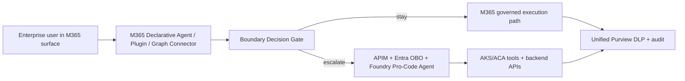

# Enterprise M365 Copilot Extensibility vs Custom Foundry Pro-Code Agents FAQ (Round 1034 / Cycle 2439)

## 1) Executive Summary
This cycle answers the most common enterprise scoping question: when should teams stay on M365 declarative extensibility and when should they escalate to custom Foundry pro-code agents.

## 2) Q1 / Q2 / Q3
Q1: Which hard boundaries force escalation from Declarative Agent to custom Foundry agent?  
A1: Five boundaries: custom/open model control, deterministic multi-minute DAG/code-sandbox loops, sub-300ms realtime voice constraints, non-M365 external channels, and advanced custom reranking retrieval.

Q2: How to keep identity and ACL parity across M365 and Foundry paths?  
A2: Keep a single Entra OBO chain from M365 Copilot to APIM to Foundry/backend APIs with audience + claim checks.

Q3: How to decide cost model between per-seat and consumption-heavy paths?  
A3: Evaluate user-band break-even curve (1k-25k users), combining per-seat, copilot credits, PTU/PAYG compute, and support overhead.

## 3) End-to-end architecture flow

## 4) 4-way decision matrix
| Option | Strength | Limitation | Cost profile | Best use |
|---|---|---|---|---|
| Graph Connector | Fast data grounding in M365 search | Limited procedural autonomy | Low | Knowledge retrieval |
| Declarative Agent + Plugin | Fastest enterprise rollout | Limited deep custom runtime control | Low-Medium | Internal productivity copilots |
| Copilot Studio autonomous trigger | Better process orchestration in M365 domain | Less runtime freedom than pro-code engines | Medium | Event-driven M365 workflows |
| Foundry Pro-Code Agent | Full custom model/runtime/tool control | Highest engineering and ops complexity | Medium-High | Long deterministic or external-channel workloads |

## 5) Hybrid governance checklist
- Define five boundary rules in architecture governance policy.
- Implement Entra OBO audience/claim validation in APIM once.
- Reuse Purview DLP, audit, and incident controls across both paths.
- Enforce no duplicate identity or policy stacks for declarative and custom planes.
- Track parity metrics: ACL behavior, completion quality, latency, and TCO.

## 6) Good fit vs Not for and percentage contract binding
Good fit: enterprise programs needing a governed declarative-first surface with controlled escalation to custom execution.  
Not for: single-surface workloads that never cross boundary conditions.

Percentage-contract keys (bound to `evidence/cycle-2439-benchmark.json`, `production_validation=not_measured`):
- `percentage_contract.time_to_production_gain_rate`
- `percentage_contract.complex_workflow_completion_accuracy_gain_rate`
- `percentage_contract.entra_obo_acl_enforcement_parity_rate`
- `percentage_contract.monthly_tco_break_even_coverage_rate`
