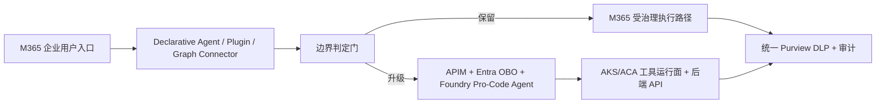

# 企业 M365 Copilot 可扩展 vs Foundry Pro-Code 自定义 Agent 选型 FAQ（Round 1034 / Cycle 2439）

## 1) 执行摘要
本轮回答企业客户最常见架构问题：何时采用 M365 Declarative Agent + Plugin + Graph Connector，何时升级到 Azure AI Foundry Pro-Code Agent，并如何统一治理与身份边界。

## 2) Q1 / Q2 / Q3
Q1：从 Declarative 升级到 Foundry Pro-Code 的硬边界是什么？  
A1：五条硬边界：模型/权重自由度、确定性长链路 DAG/代码沙箱、亚 300ms 实时语音、非 M365 外部渠道、检索重排深度定制。

Q2：如何保持 M365 与 Foundry 路径 ACL 与身份一致性？  
A2：建立单一 Entra OBO 链路（M365 -> APIM -> Foundry -> Backend API），并做 audience + claims 校验。

Q3：如何做 per-seat、Copilot Credits 与 Foundry PTU/PAYG 的 TCO 拐点判断？  
A3：按 1,000-25,000 用户规模绘制分段盈亏曲线，统一纳入算力、调用量与运维成本。

## 3) 端到端架构流程

## 4) 四向决策矩阵
| 方案 | 优势 | 限制 | 成本画像 | 适配场景 |
|---|---|---|---|---|
| Graph Connector | 语义检索接入快 | 流程自治能力有限 | 低 | 知识检索增强 |
| Declarative Agent + Plugin | 上线最快、企业治理即用 | 深度运行时定制受限 | 低-中 | 内部办公与协作 Copilot |
| Copilot Studio Autonomous Trigger | M365 流程编排能力更强 | 运行时自由度仍低于 Pro-Code | 中 | 事件驱动 M365 流程 |
| Foundry Pro-Code Agent | 模型/工具/运行时可深度定制 | 工程与运维复杂度最高 | 中-高 | 长链路确定性任务、外部渠道任务 |

## 5) 混合治理生产清单
- 把五条边界固化为架构评审规则。
- APIM 统一实现 OBO audience/claims 校验。
- Purview DLP 与审计策略跨两条执行路径复用。
- 禁止 Declarative 与 Pro-Code 各自复制一套身份/治理栈。
- 持续跟踪 ACL 一致性、质量、时延、TCO 拐点指标。

## 6) Good fit vs Not for 与百分比合约绑定
Good fit：需要“Declarative 优先 + 可控升级 Pro-Code”的企业级混合方案。  
Not for：永远只需要单一执行面且无边界切换诉求的场景。

百分比合约键（绑定 `evidence/cycle-2439-benchmark.json`，并声明 `production_validation=not_measured`）：
- `percentage_contract.time_to_production_gain_rate`
- `percentage_contract.complex_workflow_completion_accuracy_gain_rate`
- `percentage_contract.entra_obo_acl_enforcement_parity_rate`
- `percentage_contract.monthly_tco_break_even_coverage_rate`
