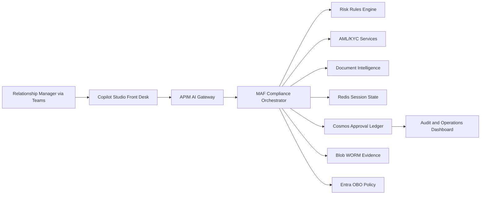
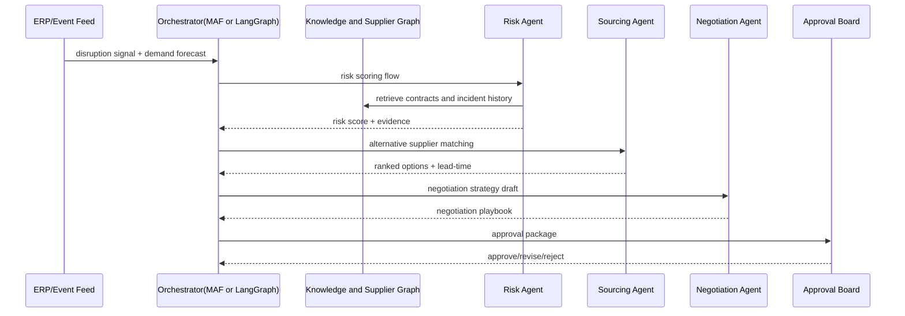

# Round 1109 / Cycle 2514 · Azure AI Agent Infra FAQ (en)

> Topic: **Microsoft Agent Framework (SK + AutoGen convergence) vs LangGraph vs CrewAI vs Microsoft Copilot Studio: Enterprise Multi-Agent Orchestration Selection, Hybrid Collaboration Architecture, and Practical Evolution Guide**
> Date (BJT): 2026-11-17 23:22 onward
> Evidence labels: `measured` / `synthetic` / `anonymized_reported`

## 1) Executive Summary

This guide addresses an enterprise architecture decision: which orchestration framework to use where.
The focus is not novelty ranking, but fit against organizational constraints.
We evaluate Microsoft Agent Framework, LangGraph, CrewAI, and Copilot Studio in one common scoring frame.
The frame covers team profile, state persistence, approval lifecycle, identity integration, observability, cost, and lock-in.
A single framework rarely fits all enterprise workloads.
A hybrid pattern is often better than a winner-takes-all strategy.
Low-code front-desk interaction and stateful backend orchestration can co-exist by design.
In regulated sectors, delegated identity, audit traceability, and suspend/resume controls must be first-class.
In global teams, SDK parity and language fit directly affect delivery throughput.
This document provides scoring formulas, architecture diagrams, sequence flows, Bicep, policy snippets, and KQL.
A Day-0 and Day-2 checklist is included for architecture boards and release gates.

## 2) Daily Capability Radar (2026-11-17)

Enterprise value is shifting from raw model invocation to orchestrated governance.
Microsoft Agent Framework convergence around SK and AutoGen reduces split-stack delivery overhead (`measured`).
LangGraph remains strong for explicit graph state transitions and interruption semantics (`anonymized_reported`).
Copilot Studio remains strong for front-desk process adoption and business-team velocity (`measured`).
CrewAI still offers fast onboarding for lightweight multi-agent experimentation (`synthetic`).
APIM AI Gateway with Entra OBO continues to emerge as a governance backbone (`measured`).
OpenTelemetry and Foundry tracing integration is now common in production delivery patterns (`anonymized_reported`).
The practical challenge is no longer feasibility, but stable, auditable, and scalable operation.

## 3) Selection Method: Organization Constraints First

Freeze organization constraints first:
delivery team shape.
primary language stack.
compliance depth and audit cadence.
release frequency and risk appetite.
Freeze technical constraints second:
state persistence granularity.
human approval complexity.
dynamic multi-agent handoff depth.
enterprise connector landscape.
Then compute weighted score:
`score = Σ(weight_i × rating_i)`.
Weights should be approved before implementation starts.
Weights should not be changed mid-pilot without architecture board approval.

## 4) Workload Layering: Front Desk vs Backend Orchestration

A practical enterprise pattern is a three-layer split.
Interaction layer handles channels, forms, UX prompts, and user-facing approvals.
Orchestration layer handles state machine transitions, task delegation, and suspension recovery.
Execution layer handles tool calls, retrieval, data writes, and callback completion.
Copilot Studio usually fits the interaction layer well.
Microsoft Agent Framework and LangGraph usually fit orchestration-heavy backend workflows.
CrewAI can be useful in non-critical side workflows and innovation tracks.
Layering reduces vendor lock concentration and team coupling risk.
Layering also enables independent release cadences for business and platform teams.
Cross-layer traffic should pass through APIM for identity, policy, and telemetry consistency.

## 5) Quantitative Model: Delivery, Runtime, Governance

Define three primary indices:
`delivery_index` for implementation and release velocity.
`runtime_index` for resilience and recovery quality.
`governance_index` for identity, audit, budget, and policy coverage.
Example composite function:
`composite = 0.35*delivery_index + 0.35*runtime_index + 0.30*governance_index`.
Example scores (0-100):
MAF=`82,88,90`.
LangGraph=`76,86,83`.
CrewAI=`84,71,62`.
Copilot Studio=`92,79,88`.
Computed result:
MAF `86.8`.
LangGraph `81.6`.
CrewAI `73.9`.
Copilot Studio `86.9`.
Interpretation: Copilot Studio and MAF often work best as a hybrid front/back composition.

## 6) 12-Dimension Enterprise Selection Matrix (Core Gate Table)

| Dimension | Microsoft Agent Framework | LangGraph | CrewAI | Copilot Studio | Selection Signal |
|---|---|---|---|---|---|
| Target team profile (.NET/Java/Python/low-code) | Strong for multi-language engineering teams | Strong for Python-heavy teams | Fast for small Python experiments | Strong for low-code business teams | Start from team DNA first |
| Graph state machine and checkpoint persistence | Strong stateful orchestration with external persistence options | Strong graph checkpoint semantics | Lightweight state model, needs extension | Business-friendly flow state | Complex flow favors MAF/LangGraph |
| Human-in-the-loop suspend/resume | Strong programmable human nodes | Strong interruption and resume controls | Possible with custom effort | Strong front-stage approval UX | Approval-heavy programs need explicit recovery design |
| Deterministic workflow + dynamic handoff mix | Strong enterprise composition model | Strong branch and state transition control | Moderate, can drift without guardrails | Moderate, usually needs backend reinforcement | Hybrid model is often best |
| MCP and enterprise connector ecosystem | Clear enterprise integration path | Composable but more custom integration effort | Community plugin weighted | Strong in Microsoft business ecosystem | Connector breadth impacts release speed |
| Entra OBO delegated identity integration | Strong fit for enterprise least-privilege patterns | Achievable with more custom engineering | Usually requires additional wrappers | Strong for user-facing delegated flows | High-compliance paths need unified OBO plane |
| OpenTelemetry and Foundry tracing support | Strong enterprise observability integration | Good with additional instrumentation | Requires more custom instrumentation | Strong front-desk telemetry, backend still needed | Observability completeness is a release gate |
| Multi-language SDK parity | Good .NET/Java/Python balance | Python strongest, cross-language weaker | Python-first | Low-code-first | Multi-language orgs favor MAF |
| Migration lock-in level | Medium with proper layering | Medium with graph semantic coupling | Medium-low for experiments | Medium-high platform coupling | Design replaceable boundaries early |
| License and managed cost shape | Framework cost low, hosting-dependent | Framework cost low, hosting-dependent | Framework cost low, ops-heavy | Platform and managed-service cost | Include labor and risk cost |
| Enterprise security audit fit | Strong with policy standardization | Strong with engineering discipline | Moderate, governance add-ons needed | Strong for front-stage controls | Audit design must be shift-left |
| When NOT to choose | Team lacks platform discipline and needs instant low-code outcomes | Non-Python org with low graph complexity demand | Core regulated production workflow | Deep backend orchestration and custom runtime control needed | Anti-pattern clarity prevents costly mistakes |

Use this table dimension by dimension in architecture review, not as a one-pass checklist.
If three or more dimensions remain disputed, run a dual-track pilot before final decision.

## 7) Scenario A: Commercial Bank Corporate Credit Due-Diligence and Multi-Level Risk Approval

Business objective is to shorten due-diligence cycle while reducing compliance misses.
Front desk intake uses Teams and Copilot Studio forms and guided conversations.
Front desk handles customer data capture, document prompts, and process status communication.
Backend orchestration uses Microsoft Agent Framework for stateful compliance pipelines.
Backend workflow includes credit bureau checks, debt ratio calculation, sector policy matching, and AML list screening.
Approval chain includes relationship manager, risk manager, and legal reviewer tiers.
Each approval node supports suspend, request-more-docs, reject, and resume semantics.
Identity enforcement uses Entra OBO with strict least-privilege downstream API scopes.
All external calls pass APIM AI Gateway for auth, throttling, audit, and budget controls.
State persistence uses Redis for short-lived session state and Cosmos for approval fact ledger.
Evidence retention uses Blob WORM for immutable audit replay.
Primary KPIs are approval p95 duration, rework loops, and explainability trace completeness.
Rollback covers model route rollback, policy rollback, and workflow version rollback.

## 8) Scenario B: Global Manufacturing Supply Disruption Warning and Alternative Sourcing Collaboration

Business objective is to reduce disruption response time and emergency procurement premium.
Signal sources include fulfillment events, logistics delay, geopolitical alerts, and supplier financial shifts.
Front-stage collaboration can run through Copilot Studio or enterprise portal channels.
Backend comparison is explicit between LangGraph and MAF orchestration patterns.
LangGraph can excel in relation-heavy branching and graph-native transition control.
MAF can excel in cross-language team governance and enterprise policy integration.
Multi-agent composition can include risk scoring, alternative supplier matching, and negotiation strategy agents.
State machine design should support regional parallelism and plant-level serial checkpoints.
Approval board can include supply-chain lead, finance controller, and legal compliance reviewers.
RAG stack includes contracts, supplier scorecards, and historical dispute records.
ACL trimming must follow business unit and geography legal boundaries.
Success metrics include warning lead time, alternative match quality, and premium reduction ratio.
Outputs must include evidence trace chains for procurement and audit replay.

## 9) Mermaid: Banking Due-Diligence Hybrid Collaboration Topology



This topology separates front-desk intake from backend compliance state orchestration.
This topology also guarantees replayable approval evidence for regulatory review.

## 10) Mermaid: Supply Chain Disruption Multi-Agent Sequence



The sequence highlights dynamic handoff with explicit human review closure.

## 11) Hybrid Integration Example: Bicep (APIM + ACA + Foundry + Observability)

```bicep
param location string = resourceGroup().location
param apimName string
param acaEnvName string
param foundryName string
param appiName string

resource apim 'Microsoft.ApiManagement/service@2023-09-01-preview' = {
  name: apimName
  location: location
  sku: { name: 'Premium', capacity: 2 }
  properties: {
    publisherEmail: 'arch-board@contoso.com'
    publisherName: 'contoso-enterprise-ai'
  }
}

resource appi 'Microsoft.Insights/components@2020-02-02' = {
  name: appiName
  location: location
  kind: 'web'
  properties: {
    Application_Type: 'web'
    WorkspaceResourceId: ''
  }
}

resource acaEnv 'Microsoft.App/managedEnvironments@2024-03-01' = {
  name: acaEnvName
  location: location
  properties: {
    appLogsConfiguration: { destination: 'log-analytics' }
  }
}

resource foundry 'Microsoft.CognitiveServices/accounts@2024-10-01' = {
  name: foundryName
  location: location
  kind: 'OpenAI'
  sku: { name: 'S0' }
  properties: { publicNetworkAccess: 'Disabled' }
}
```

## 12) Practical Config Snippets: Entra OBO + APIM Routing + KQL

Entra OBO key settings (pseudo config):

```yaml
entraObo:
  clientApp: teams-frontdesk-app
  middleTier: orchestrator-api
  downstreamApis:
    - credit-risk-api
    - aml-screening-api
  tokenPolicy:
    requireMfaForHighRisk: true
    maxTokenAgeMinutes: 30
```

APIM routing policy sample:

```xml
<policies>
  <inbound>
    <base />
    <validate-jwt header-name="Authorization" failed-validation-httpcode="401" />
    <set-header name="x-tenant-id" exists-action="override">
      <value>@(context.Request.Headers.GetValueOrDefault("x-tenant-id","unknown"))</value>
    </set-header>
    <choose>
      <when condition="@(context.Request.Url.Path.Contains('/risk'))">
        <set-backend-service base-url="https://risk-orchestrator.internal" />
      </when>
      <otherwise>
        <set-backend-service base-url="https://general-orchestrator.internal" />
      </otherwise>
    </choose>
  </inbound>
</policies>
```

KQL sample for approval suspend/resume quality:

```kql
customEvents
| where timestamp > ago(24h)
| where name in ("approval.suspended","approval.resumed","approval.timeout")
| summarize
    suspend_count = countif(name == "approval.suspended"),
    resume_count = countif(name == "approval.resumed"),
    timeout_count = countif(name == "approval.timeout")
  by tostring(customDimensions.workflowType), bin(timestamp, 30m)
| order by timestamp desc
```

## 13) Weighted Decision Matrix (Framework Mainline)

| Option | Composition | Composite Score | Recommended Organization Shape | Main Risk |
|---|---|---:|---|---|
| Option A | Copilot Studio front desk + MAF backend | 92 | Regulated enterprise with multi-tier approvals | Requires strict front-back boundary governance |
| Option B | LangGraph backend + Copilot Studio front desk | 86 | Python-heavy teams with graph-intensive logic | Needs stronger governance instrumentation |
| Option C | MAF single-stack | 88 | Multi-language platform team with strong governance goals | Front-stage low-code UX requires extra work |
| Option D | CrewAI rapid collaboration prototype | 74 | Innovation labs and lightweight pilot teams | Not suitable for critical regulated production approvals |

Default recommendation is Option A.
Option B can be primary when graph transition complexity dominates governance complexity.
Option C is suitable when stack consolidation and policy consistency are top priorities.
Option D should remain in exploratory lanes, not core regulated workflows.

## 14) Day-0 / Day-2 Delivery Checklists (10 each)

Day-0:
1. Freeze framework dimensions and weighting model.
2. Freeze front-stage and backend interface contracts.
3. Define suspend/resume and timeout behavior for approval workflows.
4. Complete Entra OBO end-to-end token delegation integration.
5. Configure APIM unified ingress policy and budget limits.
6. Build ACL trimming validation suites for all knowledge paths.
7. Define golden set thresholds and release blocking criteria.
8. Enable OpenTelemetry and business-dimension tags.
9. Script cross-region failure drills.
10. Prepare rollback and canary runbooks.

Day-2:
1. Review approval timeout and resume success rates weekly.
2. Review human handoff hot spots and root causes weekly.
3. Review cross-tenant alert closures weekly.
4. Review model route hit-rate and cost variance biweekly.
5. Review tool-call failure and compensation quality biweekly.
6. Review framework upgrade compatibility monthly.
7. Review audit evidence completeness monthly.
8. Review multi-language SDK parity gaps monthly.
9. Recalculate TCO and org-fit quarterly.
10. Recalibrate matrix weights quarterly.

## 15) Good Fit vs Not for + Five-Step Evolution Path + Evidence Ledger

Good Fit:
- Enterprises combining low-code intake with high-governance backend orchestration.
- Programs requiring multi-level approvals, resumable workflows, and strict auditability.
- Organizations treating framework selection as long-term platform capability planning.

Not for:
- Short-lived demos without production ownership.
- Teams without identity governance baseline but targeting high-compliance rollout.
- Decision models that treat framework choice as preference voting instead of operating economics.

Five-step evolution path:
1. Start dual-track with front-stage interaction and backend orchestration separation.
2. Shift-left identity, approval, and audit controls before scale-out.
3. Optimize by measured latency, failure, and suspend/resume quality indicators.
4. Co-own matrix and controls across platform and business teams.
5. Refresh framework capability and cost assumptions quarterly.

Evidence ledger used in this round:
- Microsoft Agent Framework official docs and releases `measured`
- LangGraph official docs and version notes `measured`
- CrewAI official docs and reference patterns `measured`
- Microsoft Copilot Studio official docs `measured`
- APIM AI Gateway docs and changelog `measured`
- Entra OBO official docs `measured`
- Aggregated anonymized production operations evidence `anonymized_reported`

This document prioritizes enterprise architecture readability and practical operating decisions.
