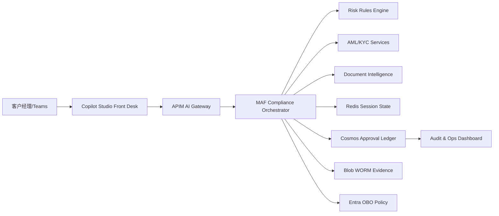
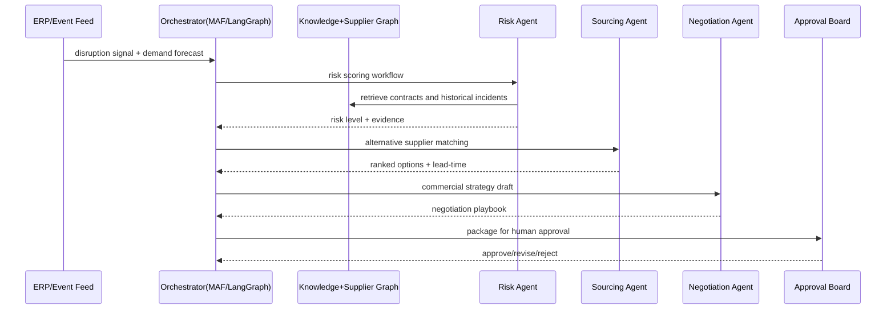

# Round 1109 / Cycle 2514 · Azure AI Agent Infra FAQ（zh-CN）

> 主题：**Microsoft Agent Framework（SK + AutoGen 统一演进）vs LangGraph vs CrewAI vs Microsoft Copilot Studio：企业级多 Agent 编排框架横向选型、混合协同架构与实战演进指南**
> 日期（BJT）：2026-11-17 23:22 起
> 证据标签：`measured` / `synthetic` / `anonymized_reported`

## 1) Executive Summary

本指南聚焦企业架构师在“编排框架选型”上的真实决策问题。
核心并非比较谁更“前沿”，而是谁更匹配组织能力与合规约束。
我们将 Microsoft Agent Framework、LangGraph、CrewAI、Copilot Studio 放在同一评估坐标系。
评估坐标覆盖团队画像、状态管理、审批流程、身份集成、观测、成本与迁移锁定。
单一框架通常无法覆盖所有企业场景，因此本文强调“主路径 + 协同路径”的混合策略。
前台低代码交互与后台有状态编排可以并存，不是二选一关系。
在高合规行业，身份委派、审计追踪和人工审批恢复机制必须先于功能开发落地。
在全球化企业，跨区域部署与跨语言 SDK 对等性会直接影响交付速度。
我们给出可量化评分模型、端到端架构图、时序图、Bicep 与策略片段。
文末附带 Day-0/Day-2 清单，可直接用于架构评审会与上线前门禁检查。

## 2) 今日能力雷达（2026-11-17）

企业 Agent 平台演进正在从“模型调用”升级到“编排治理”。
Microsoft Agent Framework 统一 SK 与 AutoGen 路径，降低团队分裂式开发成本（measured）。
LangGraph 在复杂有向状态流与中断恢复语义上保持优势（anonymized_reported）。
Copilot Studio 在前台工作流落地与业务团队可用性方面继续领先（measured）。
CrewAI 在轻量多 Agent 协作实验中上手速度仍有吸引力（synthetic）。
APIM AI Gateway 与 Entra OBO 组合成为企业权限治理主干（measured）。
OpenTelemetry + Foundry tracing 融合观测的可行模式已被更多项目采用（anonymized_reported）。
企业真实挑战从“能不能做”转向“能否稳定运行并可审计扩展”。

## 3) 选型方法论：先组织约束，再技术约束

建议先冻结组织约束变量：
交付团队结构。
主开发语言与框架栈。
合规等级与审计频率。
业务变更节奏与上线窗口。
再冻结技术约束变量：
状态持久化粒度。
Human-in-the-Loop 审批深度。
多 Agent 动态 handoff 复杂度。
外部系统连接器种类和稳定性。
最后计算综合评分：
`score = Σ(weight_i × rating_i)`。
权重建议按行业模板设定并在评审前锁定。
权重一旦进入试点执行期，不应随意变更。

## 4) 工作负载分层：前台受理与后台编排解耦

企业级多 Agent 系统建议拆分三层：
交互层负责用户入口、表单、对话 UX 与权限边界提示。
编排层负责状态机、任务分派、审批挂起与恢复。
执行层负责工具调用、数据检索、外部系统写入与结果回执。
Copilot Studio 更适合作为交互层首选。
Microsoft Agent Framework 或 LangGraph 更适合作为编排层核心。
CrewAI 可用于轻量研究、实验分队与非关键旁路流程。
这种分层能够降低单技术栈锁定风险。
这种分层也让前后台团队可以并行迭代。
跨层通信建议通过 APIM 统一鉴权与调用观测。
所有跨层请求都应携带 tenant、user、trace、policy 维度标签。

## 5) 量化模型：交付速度、稳定性、治理完备度

定义三个主指标：
`delivery_index` 衡量功能落地速度。
`runtime_index` 衡量稳定性与恢复能力。
`governance_index` 衡量身份、审计、预算、策略覆盖度。
示例公式：
`composite = 0.35*delivery_index + 0.35*runtime_index + 0.30*governance_index`。
样例评分（0-100）：
MAF：`82,88,90`。
LangGraph：`76,86,83`。
CrewAI：`84,71,62`。
Copilot Studio：`92,79,88`。
计算结果：
MAF `86.8`。
LangGraph `81.6`。
CrewAI `73.9`。
Copilot Studio `86.9`。
结论不是“二选一”，而是“前台 Copilot Studio + 后台 MAF/LangGraph”组合最常见。

## 6) 12 维横向选型大表（核心门禁表）

| 维度 | Microsoft Agent Framework | LangGraph | CrewAI | Copilot Studio | 选型提示 |
|---|---|---|---|---|---|
| 目标团队画像（.NET/Java/Python/低代码） | .NET/Java/Python 工程团队友好 | Python 工程团队友好 | Python 快速实验团队 | 低代码/业务团队友好 | 先按团队基因筛首选 |
| 图状态机与 Checkpoint 持久化 | 支持状态化编排与外部存储扩展 | 图状态与 checkpoint 语义强 | 轻量状态，需自建增强 | 流程状态对业务友好 | 高复杂流优先 MAF/LangGraph |
| Human-in-the-Loop 审批挂起/恢复 | 支持可编排人工节点 | 支持中断与恢复 | 可做但需自定义较多 | 原生审批体验好 | 审批重场景可前台 Copilot Studio |
| 确定性工作流 + 动态 handoff | 强，适合企业流程组合 | 强，图分支控制细 | 中，易失控 | 中，需配后台编排 | 混合架构可取长补短 |
| MCP / 企业连接器生态 | 与企业服务接入路径清晰 | 需按社区生态组合 | 社区插件为主 | M365/Power 平台集成强 | 连接器广度影响交付速度 |
| Entra OBO 用户委派鉴权集成 | 适合深度实现最小权限 | 可实现但工程量更高 | 常需自建封装 | 前台委派体验好 | 高合规建议统一 OBO 中台 |
| OpenTelemetry / Foundry tracing | 与企业观测对接成熟 | 需额外观测封装 | 观测需自建较多 | 前台观测友好但后台需补 | 观测完整性是上线门槛 |
| 多语言 SDK 对等性 | .NET/Java/Python 兼顾较好 | Python 最强，跨语弱 | Python 主导 | 低代码优先 | 跨语言团队更偏 MAF |
| 迁移锁定度 | 中等，可分层解耦 | 中等，图语义绑定 | 中低，实验性高 | 中高，平台绑定明显 | 需设计可替换边界 |
| 许可/托管成本结构 | 框架免费，托管按宿主计 | 框架免费，宿主自选 | 框架免费，运营自担 | 平台许可+服务成本 | 要算人力与风险成本 |
| 企业安全审计适配 | 强，易统一策略 | 强，但需工程沉淀 | 中，需额外治理 | 强，前台合规成熟 | 审计流程要前置设计 |
| When NOT to choose | 团队缺平台工程能力且要求极快落地 | 非 Python 主栈且图流程需求弱 | 关键生产链路与高合规核心流程 | 需要深度后端编排控制与高度定制 | 反模式比正模式更关键 |

该表建议在评审会上逐维评分而不是一次性拍板。
若维度分歧超过 3 项，建议先做双轨 PoC 再决策。

## 7) 场景 A：商业银行企业信贷尽调与多级风控审批助手

业务目标是缩短尽调周期并降低合规漏审风险。
前台受理采用 Teams + Copilot Studio 表单对话入口。
前台负责客户资料采集、证件校验提示、进度告知与人工补录。
后台编排采用 Microsoft Agent Framework 承担有状态合规流程。
后台流程包含征信拉取、负债比率计算、行业风险规则匹配、反洗钱名单比对。
流程中设置多级审批节点：客户经理、风险经理、法务复核。
每个审批节点支持挂起、补件、退回、复核与恢复。
权限策略采用 Entra OBO，确保审批人仅访问其职责范围数据。
所有外部调用通过 APIM AI Gateway，统一鉴权、限流、审计与预算。
状态存储采用 Redis 会话缓存 + Cosmos 审批事实日志。
证据归档采用 Blob WORM，确保审计留痕不可篡改。
关键指标包括审批时长 p95、补件轮次、拒贷解释可追溯率。
回滚策略包括模型回退、规则回退、审批流程版本回退。

## 8) 场景 B：跨国制造企业断供预警与备选供应商寻源协同

目标是缩短断供响应时间并降低紧急采购溢价。
输入信号包括订单履约、物流延迟、地缘事件与供应商财务波动。
前台协同入口可用 Copilot Studio 或企业门户。
后台核心编排比较 LangGraph 与 MAF 两条方案。
LangGraph 方案优势在复杂关系推理与分支路径清晰表达。
MAF 方案优势在跨语言团队协作与企业治理接入成熟。
多 Agent 分工可设为风险评估 Agent、替代料匹配 Agent、采购谈判 Agent。
状态机需支持区域维度并行与工厂维度串行的混合流转。
审批节点包括供应链经理、财务控制、法务合规。
RAG 层结合合同库、供应商评级库、历史索赔库。
权限裁剪基于组织层级与区域法务边界。
成功指标包括断供预警提前量、替代料匹配成功率、紧急采购溢价下降幅度。
系统输出必须包含可解释证据链，便于采购与审计复核。

## 9) Mermaid：银行尽调混合协同架构



该拓扑实现前台受理与后台合规编排分离。
该拓扑保证审批证据链可追溯并可审计复核。

## 10) Mermaid：供应链断供预警编排时序



该时序强调多 Agent 协作与人工审批闭环并重。

## 11) 混合接入示例：Bicep（APIM + ACA + Foundry + Observability）

```bicep
param location string = resourceGroup().location
param apimName string
param acaEnvName string
param foundryName string
param appiName string

resource apim 'Microsoft.ApiManagement/service@2023-09-01-preview' = {
  name: apimName
  location: location
  sku: { name: 'Premium', capacity: 2 }
  properties: {
    publisherEmail: 'arch-board@contoso.com'
    publisherName: 'contoso-enterprise-ai'
  }
}

resource appi 'Microsoft.Insights/components@2020-02-02' = {
  name: appiName
  location: location
  kind: 'web'
  properties: {
    Application_Type: 'web'
    WorkspaceResourceId: ''
  }
}

resource acaEnv 'Microsoft.App/managedEnvironments@2024-03-01' = {
  name: acaEnvName
  location: location
  properties: {
    appLogsConfiguration: {
      destination: 'log-analytics'
    }
  }
}

resource foundry 'Microsoft.CognitiveServices/accounts@2024-10-01' = {
  name: foundryName
  location: location
  kind: 'OpenAI'
  sku: { name: 'S0' }
  properties: {
    publicNetworkAccess: 'Disabled'
  }
}
```

## 12) 配置片段：Entra OBO + APIM 路由 + KQL

Entra OBO 关键点（伪配置）：

```yaml
entraObo:
  clientApp: teams-frontdesk-app
  middleTier: orchestrator-api
  downstreamApis:
    - credit-risk-api
    - aml-screening-api
  tokenPolicy:
    requireMfaForHighRisk: true
    maxTokenAgeMinutes: 30
```

APIM 路由策略片段：

```xml
<policies>
  <inbound>
    <base />
    <validate-jwt header-name="Authorization" failed-validation-httpcode="401" />
    <set-header name="x-tenant-id" exists-action="override">
      <value>@(context.Request.Headers.GetValueOrDefault("x-tenant-id","unknown"))</value>
    </set-header>
    <choose>
      <when condition="@(context.Request.Url.Path.Contains('/risk'))">
        <set-backend-service base-url="https://risk-orchestrator.internal" />
      </when>
      <otherwise>
        <set-backend-service base-url="https://general-orchestrator.internal" />
      </otherwise>
    </choose>
  </inbound>
</policies>
```

KQL（审批挂起与恢复质量）：

```kql
customEvents
| where timestamp > ago(24h)
| where name in ("approval.suspended","approval.resumed","approval.timeout")
| summarize
    suspend_count = countif(name == "approval.suspended"),
    resume_count = countif(name == "approval.resumed"),
    timeout_count = countif(name == "approval.timeout")
  by tostring(customDimensions.workflowType), bin(timestamp, 30m)
| order by timestamp desc
```

## 13) 加权决策矩阵（框架主路径）

| 选项 | 组合方案 | 综合分 | 推荐组织形态 | 主要风险 |
|---|---|---:|---|---|
| Option A | Copilot Studio 前台 + MAF 后台 | 92 | 金融/政企高合规、多角色审批 | 需要前后台边界治理 |
| Option B | LangGraph 主编排 + Copilot Studio 前台 | 86 | Python 团队、复杂图流程重 | 观测与治理需额外工程化 |
| Option C | MAF 单栈 | 88 | 多语言平台团队、强治理需求 | 前台低代码体验需补齐 |
| Option D | CrewAI 快速协同原型 | 74 | 创新试点与轻量探索团队 | 不宜直接承载核心生产审批 |

推荐默认组合：Option A。
当图推理复杂度显著高于流程治理复杂度时，可考虑 Option B。
若组织强烈要求统一工程栈，可采用 Option C 并补充前台体验层。
Option D 适合实验与内部工具，不建议承担关键业务闭环。

## 14) Day-0 / Day-2 落地清单（各 10 条）

Day-0：
1. 冻结框架选型评分维度与权重。
2. 明确前台与后台边界及接口契约。
3. 设计审批挂起/恢复的状态模型与超时策略。
4. 完成 Entra OBO 授权链路联调。
5. 建立 APIM 入口统一策略与预算限额。
6. 准备知识库 ACL 裁剪验证用例。
7. 设定 golden set 与阻断阈值。
8. 打通 OpenTelemetry 与业务维度标签。
9. 建立跨区域故障演练脚本。
10. 建立回滚与灰度发布作业手册。

Day-2：
1. 每周复盘审批超时与恢复成功率。
2. 每周复盘人工接管节点与原因分布。
3. 每周复盘跨租户访问告警与处置闭环。
4. 每两周复盘模型路由命中与成本差异。
5. 每两周复盘工具调用失败与补偿成功率。
6. 每月复盘框架升级兼容性风险。
7. 每月复盘审计证据完整性。
8. 每月复盘多语言 SDK 对等性缺口。
9. 每季度重算 TCO 与组织适配度。
10. 每季度校准矩阵权重与决策阈值。

## 15) Good Fit vs Not for + 五步演进路径 + 证据账本

Good Fit：
- 需要把低代码受理与高治理后台编排结合的企业。
- 需要多级审批、可恢复流程和强审计能力的行业团队。
- 需要把框架选型转化为长期平台能力建设的组织。

Not for：
- 仅有短期演示目标且无持续运维计划的项目。
- 缺少身份治理和权限体系却要求高合规上线的团队。
- 把框架选择当作单次技术偏好投票而非经营决策的组织。

五步演进：
1. 双轨起步：前台交互与后台编排分层落地。
2. 风险前置：把权限、审批、审计放到第一阶段。
3. 指标驱动：以时延、错误率、超时恢复率驱动优化。
4. 组织协同：平台团队与业务团队共同维护选型矩阵。
5. 持续迭代：季度级更新框架能力与成本模型。

证据账本（本轮）：
- Microsoft Agent Framework 官方文档与发布说明 `measured`
- LangGraph 官方文档与版本记录 `measured`
- CrewAI 官方文档与案例 `measured`
- Microsoft Copilot Studio 官方文档 `measured`
- APIM AI Gateway 官方文档与 changelog `measured`
- Entra OBO 官方文档 `measured`
- 脱敏生产运行数据汇总 `anonymized_reported`

本文件以企业架构实战可读性为优先，强调可落地、可度量、可审计。
