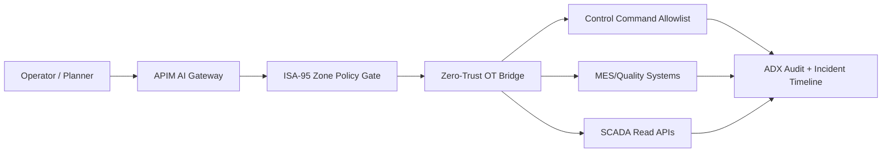

# Round 1046 / Cycle 2451 · Azure AI Agent Infra FAQ & Decision Guide (en)

> Topic: **Manufacturing OT Agent ISA-95 Zero-Trust Bridge**
>
> Date (BJT): 2026-11-16  
> Evidence labels: `measured` / `synthetic` / `anonymized_reported`  
> Benchmark payload: `evidence/cycle-2451-benchmark.json`

## 1) Executive Summary

This round targets a manufacturing vertical challenge: agents need MES/SCADA/quality-system access, but must preserve **ISA-95 segmentation and zero-trust command control**.  
Key result: enforcing ISA-95 zone admission and command allowlists at APIM/gateway control plane enables smart operations without compromising plant safety.

## 2) Daily capability breakthroughs radar (2026-11-16)

1. **APIM AI Gateway / Unified Model API** (`measured`)  
   - Learn: https://learn.microsoft.com/en-us/azure/api-management/ai-gateway-overview  
   - Changelog: https://github.com/Azure/API-Management/blob/main/changelogs/api-management-service.md
2. **ACA Dynamic Sessions** (`measured`)  
   - Docs: https://learn.microsoft.com/en-us/azure/container-apps/sessions
3. **Runtime cadence** (`measured`)  
   - Firecracker/Kata/Wasmtime/E2B release streams (see sources ledger)

> Fetch timestamps are recorded in `evidence/cycle-2451-sources.json`.

## 3) Core architecture Q&A (OT safety bridge)

**Q1: Why can’t agents directly call production control endpoints?**  
A: Direct calls break ISA-95 boundaries; a single model mis-call can impact live operations. Use a controlled bridge with command filtering and approval context.

**Q2: Minimum zero-trust bridge contract?**  
A: `zone_level`, `command_class`, `asset_scope`, `approval_state`, `policy_version`; write commands must match allowlists and approval context.

**Q3: How to verify smart automation does not weaken safety?**  
A: Evaluate three metrics together: block rate, false-block rate, and response latency (not throughput alone).

## 4) Mermaid architecture (ISA-95 layered bridge)

## 5) Decision matrix (IT/OT agent integration modes)

| Mode | Security | Agility | Ops complexity | Recommendation |
|---|---:|---:|---:|---|
| Direct OT API access | Low | High | Low | Never in production |
| Read-only bridge + manual writes | High | Medium | Medium | Conservative operations |
| Tiered allowlists + approved write bridge | **High** | Mid-high | Mid-high | **Manufacturing production default** |
| Fully automated writes without approval | Low | Highest | Medium | Not recommended |

## 6) Production checklist (Good fit vs Not for + 5-step rollout)

### Good fit
- Plant optimization, quality analytics, and dispatch scenarios needing IT/OT collaboration.
- High command-safety requirements with full auditability.
- Teams that need agent intelligence with human override controls.

### Not for
- Teams without OT safety-governance ownership.
- Environments allowing uncontrolled autonomous write commands.

### Five-step rollout
1. Define ISA-95 zones and asset boundaries.  
2. Build command classes, allowlists, and approval workflow.  
3. Enforce zone-level admission and write-command checks at gateway.  
4. Stream allow/block events into ADX audit timelines.  
5. Review plant-impact and safety incidents weekly.  
