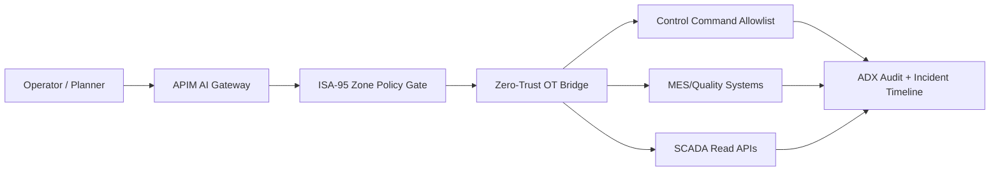

# Round 1046 / Cycle 2451 · Azure AI Agent Infra FAQ & 决策指南（zh-CN）

> Topic: **Manufacturing OT Agent ISA-95 Zero-Trust Bridge**
>
> Date (BJT): 2026-11-16  
> Evidence labels: `measured` / `synthetic` / `anonymized_reported`  
> Benchmark payload: `evidence/cycle-2451-benchmark.json`

## 1) Executive Summary

本轮聚焦制造业场景：在 IT/OT 融合中，Agent 需要访问 MES/SCADA/质量系统，但必须满足 **ISA-95 分层隔离 + 零信任桥接**。  
核心结论：以 APIM/Gateway 为统一控制面，按 ISA-95 区域执行策略准入与命令白名单，可在保证产线安全的前提下实现智能调度与告警闭环。

## 2) Daily capability breakthroughs radar（2026-11-16）

1. **APIM AI Gateway / Unified Model API**（`measured`）  
   - Learn: https://learn.microsoft.com/en-us/azure/api-management/ai-gateway-overview  
   - Changelog: https://github.com/Azure/API-Management/blob/main/changelogs/api-management-service.md
2. **ACA Dynamic Sessions**（`measured`）  
   - Docs: https://learn.microsoft.com/en-us/azure/container-apps/sessions
3. **Runtime cadence**（`measured`）  
   - Firecracker/Kata/Wasmtime/E2B release streams（见 sources ledger）

> 抓取时间见 `evidence/cycle-2451-sources.json`。

## 3) Core architecture Q&A（OT 安全桥接）

**Q1: 为什么制造 Agent 不能直接连产线控制系统？**  
A: 直接连接会打破 ISA-95 分层边界，任何模型误调用都可能触发生产风险。必须通过受控桥接层做命令过滤和审批。

**Q2: Zero-trust bridge 最小控制项？**  
A: `zone_level`, `command_class`, `asset_scope`, `approval_state`, `policy_version`。  
写命令必须匹配白名单并带审批上下文。

**Q3: 如何验证“智能化不破坏安全”？**  
A: 以阻断率、误阻断率、响应时延三项共同评估，禁止只看吞吐。

## 4) Mermaid architecture（ISA-95 分层桥接）

## 5) Decision matrix（IT/OT Agent 接入策略）

| 策略 | 安全性 | 业务敏捷性 | 运维复杂度 | 推荐 |
|---|---:|---:|---:|---|
| 直连 OT API | 低 | 高 | 低 | 禁止生产 |
| 只读桥接 + 人工写入 | 高 | 中 | 中 | 保守场景 |
| 分级白名单 + 审批写入桥接 | **高** | 中高 | 中高 | **制造业推荐** |
| 全自动写入（无审批） | 低 | 最高 | 中 | 不建议 |

## 6) Production checklist（Good fit vs Not for + 五步落地）

### Good fit
- 产线优化、质量分析、预警派工等需要 IT/OT 协同的场景。  
- 对控制命令安全要求高，需要完整审计链。  
- 需要把多系统数据引入 Agent 决策但保留人工兜底。

### Not for
- 无 OT 安全治理能力的团队。  
- 允许不受控自动写命令的试验环境。

### 五步落地
1. 定义 ISA-95 区域模型与资产边界。  
2. 建立命令分类白名单与审批流。  
3. 在网关执行 zone-level 准入与写命令校验。  
4. 将拒绝/放行事件落 ADX 审计。  
5. 按周复盘产线影响与安全事件。  
