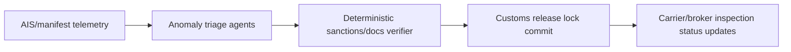

# Maritime Port, Customs Trade-Lane Risk & Release Agent Infra FAQ (Round 1038 / Cycle 2443)

## 1) Executive Summary
This cycle targets maritime port customs risk governance under burst vessel arrivals and strict compliance constraints. The reference architecture combines AIS/manifest ingestion, agentic anomaly triage, deterministic sanctions/document verification, release-lock commits, and inspection status fan-out observability.

## 2) Q1 / Q2 / Q3
Q1: Why does pure LLM advisory triage fail customs release production?  
A1: Sanctions, denied-party, and declaration consistency controls require deterministic auditable gates for release transitions; advisory-only flows are insufficient.

Q2: How is consistency preserved during broker and carrier burst declaration updates?  
A2: Optimistic concurrency and idempotent hold/release locks prevent conflicting customs state transitions under parallel updates.

Q3: How are docs-risk and inspection delays reduced without bypassing controls?  
A3: Event-driven triage plus deterministic sanctions/document verification shortens root-cause loops and drives synchronized carrier/broker notification.

## 3) End-to-end architecture flow

## 4) Decision matrix
| Option | Clearance speed | Compliance confidence | Burst resilience | Ops complexity | Best use |
|---|---:|---:|---:|---:|---|
| Legacy manual customs desk | Low | Medium | Low | Medium | Low-volume product lines |
| Pure LLM customs advisory | Medium | Low | Medium | Low | Pre-screening only |
| Hybrid agent + deterministic customs verifier | High | High | High | High | Production customs release and inspection governance |

## 5) Production checklist
- Ingest AIS, berth, manifest, and inspection events with replay-capable lineage.
- Enforce deterministic sanctions/docs/release-lock constraints as non-bypassable controls.
- Implement optimistic concurrency and idempotent lock keys for hold/release transitions.
- Validate bill-of-lading continuity before release or transshipment.
- Publish inspection/hold status via near-real-time notification channels with SLA dashboards.
- Track clearance-cycle, compliance pass, high-risk intercept, and manual-audit-cost KPIs continuously.

## 6) Good fit vs Not for and percentage contract binding
Good fit: regulated maritime customs operations requiring scalable and auditable release automation.  
Not for: advisory-only pipelines that cannot enforce deterministic sanctions/document boundaries.

Percentage-contract keys (bound to `evidence/cycle-2443-benchmark.json`, `production_validation=not_measured`):
- `percentage_contract.customs_clearance_cycle_time_reduction_rate`
- `percentage_contract.manifest_compliance_gate_pass_rate`
- `percentage_contract.highrisk_shipment_intercept_rate`
- `percentage_contract.manual_audit_cost_reduction_rate`
