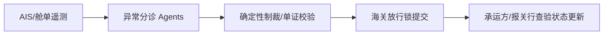

# 港航口岸海关、贸易航线风险与放行 Agent 基础设施 FAQ（Round 1038 / Cycle 2443）

## 1) 执行摘要
本轮聚焦港航口岸海关在船舶集中到港与强合规约束下的风险治理架构。方案通过 AIS/舱单接入、Agent 异常分诊、确定性制裁/单证校验、放行锁提交与查验状态联动通知，实现高吞吐与高可审计并存。

## 2) Q1 / Q2 / Q3
Q1：为什么纯 LLM 建议分诊不能直接承担海关放行生产？  
A1：制裁名单、拒绝方命中与申报一致性要求放行状态迁移必须可审计、可重放且具备确定性硬闸门，建议型流程不足以满足要求。

Q2：在报关行与承运方并发申报更新时如何保持一致性？  
A2：通过乐观并发与幂等 hold/release 锁，避免并行更新导致的清关状态冲突与双写问题。

Q3：如何在不绕过控制的前提下降低单证风险与查验时延？  
A3：采用事件驱动分诊 + 确定性制裁/单证校验，缩短根因闭环并同步承运方/报关行节点通知。

## 3) 端到端流程

## 4) 决策矩阵
| 方案 | 清关速度 | 合规可信度 | 突发韧性 | 运维复杂度 | 适配场景 |
|---|---:|---:|---:|---:|---|
| 传统人工海关审单台 | 低 | 中 | 低 | 中 | 低并发产品线 |
| 纯 LLM 海关建议分诊 | 中 | 低 | 中 | 低 | 仅预筛场景 |
| 混合 Agent + 确定性海关校验 | 高 | 高 | 高 | 高 | 生产级清关放行与查验治理 |

## 5) 生产清单
- AIS、泊位、舱单与查验事件必须可重放与可追溯。
- 制裁/单证/放行锁约束必须作为不可绕过硬控制。
- hold/release 状态迁移采用乐观并发与幂等锁键。
- 放行与中转前必须校验提单链路连续性。
- 查验与冻结状态通过近实时通知通道联动并纳入 SLA 观测。
- 持续监控清关周期、合规通过率、高风险拦截率、人工审计成本指标。

## 6) Good fit vs Not for 与百分比合约绑定
Good fit：需要规模化、可审计、强合规清关放行自动化的港航海关运营体系。  
Not for：无法强制执行确定性制裁/单证边界的建议型流程。

百分比合约键（绑定 `evidence/cycle-2443-benchmark.json`，并声明 `production_validation=not_measured`）：
- `percentage_contract.customs_clearance_cycle_time_reduction_rate`
- `percentage_contract.manifest_compliance_gate_pass_rate`
- `percentage_contract.highrisk_shipment_intercept_rate`
- `percentage_contract.manual_audit_cost_reduction_rate`
