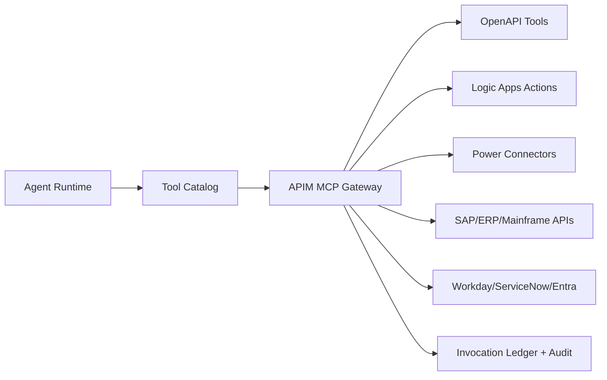
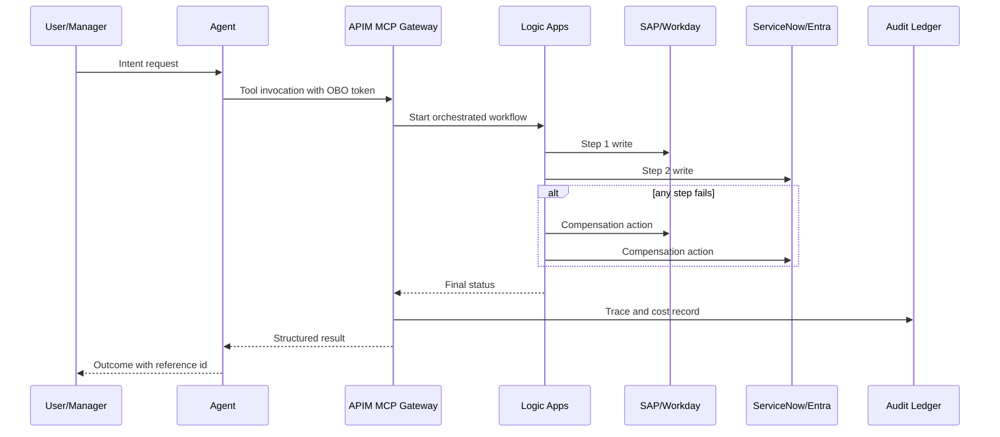

# Remote MCP on APIM vs OpenAPI Tools vs Logic Apps Agent Actions vs Power Platform Connectors: Enterprise Agent Tool Integration and Core-System Connectivity Selection FAQ (Round 1115 / Cycle 2520)

## 1) Executive summary and daily capability radar (2026-11-18)
- Core conclusion: enterprise agent tool calling should evolve from “API connectivity” to a governed platform model covering protocol standards, identity delegation, compensation logic, and cost accountability.
- The four mainstream options are complementary, not mutually exclusive:
  - APIM-governed Remote MCP for shared governance and reusable tool contracts.
  - Direct OpenAPI tools for low-latency atomic operations.
  - Logic Apps actions for cross-system orchestration with retries and compensation.
  - Power Platform connectors for low-code business enablement in M365 ecosystems.
- Recommended default is layered composition, especially in ERP/HR workflows.
- Capability radar (captured at 2026-11-18 00:06 BJT) focuses on:
  - MCP Streamable HTTP with OAuth/OBO governance patterns;
  - APIM conversion of existing OpenAPI/Logic Apps assets into governed MCP servers;
  - action-level RBAC and DLP integration at tool invocation boundaries;
  - dynamic tool filtering from 200+ APIs to intent-scoped subsets for token efficiency.
- This round is strictly enterprise architecture and delivery governance focused.

## 2) Problem framing: from connectivity to governability
- Early implementations often stop at “the tool call works,” which creates long-term risks.
- Common governance gaps:
  1. identity gap: missing delegated-user context for sensitive actions;
  2. transaction gap: no compensation path for partial cross-system writes;
  3. token gap: oversized tool schemas inflate context costs;
  4. audit gap: no complete chain of action evidence.
- Selection should therefore prioritize: protocol consistency, identity boundaries, compensation guarantees, observability, and TCO clarity.

## 3) Reference architecture: APIM-centered multi-tool execution plane
- Northbound:
  - Agent runtimes request tools through a governed tool catalog.
- Governance hub:
  - APIM enforces OAuth/OBO, quotas, rate limits, circuit breakers, and audit policy.
- Southbound execution:
  - OpenAPI tools for fast atomic actions;
  - Logic Apps for long-running orchestrations and compensating transactions;
  - Power connectors for business-led automation;
  - Remote MCP for standardized cross-agent tool reuse.
- Operations:
  - invocation ledger records identity context, action intent, route lane, and compensation outcomes.

## 4) 12-dimension enterprise integration selection matrix
| Dimension | APIM-Governed Remote MCP | Direct OpenAPI 3.x Tools | Logic Apps Standard Agent Actions/MCP | Power Platform Connectors |
|---|---|---|---|---|
| Protocol standardization and multi-agent reuse | Strong | Medium | Medium with wrapping | Medium platform-scoped |
| Legacy ERP/mainframe/on-prem connectivity | Medium via adapters | Medium by API maturity | Strong with connectors/gateways | Medium-strong connector ecosystem |
| OAuth 2.1 / Entra OBO delegated auth | Strong centralized | Medium app-specific | Strong when combined with gateway | Strong in M365 identity patterns |
| Idempotency and saga compensation support | Medium with backend contract | Weak unless custom-built | Strong stateful workflow controls | Medium for simple patterns |
| Tool-schema token efficiency | Strong catalog scoping | Medium often overexposed | Medium needs catalog governance | Medium may sprawl without controls |
| Per-call latency overhead | Medium policy-chain overhead | Low shortest path | Medium-high orchestration overhead | Medium |
| Rate-limiting and circuit-breaking governance | Strong native gateway controls | Medium per-tool coding burden | Medium-strong with gateway pairing | Medium platform limits |
| Citizen vs pro-code developer experience | Medium platform-led | Strong pro-code friendly | Medium integration-engineer friendly | Strong citizen-developer friendly |
| DLP and action-level RBAC | Strong unified policy chain | Medium fragmented controls | Strong policyable flow boundaries | Strong with M365 policy stack |
| TCO per 1M invocations | Medium predictable | Low early / high governance debt later | Medium process-value driven | Medium license and connector blend |
| Best-fit scenario | Multi-team governed tool platform | Fast atomic API integration | Cross-system transactional orchestration | Business-led process automation |
| When NOT to choose | Heavy for tiny single-team PoCs | Risky in regulated multi-system write flows | Poor fit for ultra-low-latency critical transactions | Risky if governance is not centralized |

## 5) Deep Q&A with formulas and worked examples
### Q1: How to quantify APIM MCP wrapping value?
- Formula: `ReuseGain = (TeamsUsingSharedTools - TeamsUsingIsolatedAdapters) / TeamsUsingIsolatedAdapters`.
- Example: `14` shared vs `5` isolated.
- Result: `180%` reuse gain.
- Impact: lower adapter duplication and consistent policy enforcement.

### Q2: How much token cost can tool filtering save?
- Formula: `TokenSaved = (ToolSetFullTokens - ToolSetScopedTokens) * Calls`.
- Example: `4,800 - 1,150` token overhead per call at `1,200,000` calls.
- Result: `4.38e9` tokens saved.
- Outcome: dynamic filtering from 200+ to <15 intent-scoped tools is a major FinOps lever.

### Q3: How to measure saga-compensation value?
- Formula: `CompensationBenefit = FailedPartialWrites_withoutSaga - FailedPartialWrites_withSaga`.
- Example: `1,820 - 210 = 1,610`.
- Interpretation: direct reduction in reconciliation and manual incident workload.

### Q4: How to compare OBO vs shared-service identity exposure?
- Formula: `PrivilegeExposure = ScopeBreadth * TokenTTL * ToolSurface`.
- OBO sample: `2*1*3=6`.
- Shared system-account sample: `6*2*5=60`.
- Conclusion: delegated OBO materially reduces blast radius.

### Q5: How does gateway pre-rejection protect backend stability?
- Formula: `ProtectedThroughput = TotalRequests - RejectedBeforeBackend`.
- Example: `9,000,000 - 1,300,000 = 7,700,000` requests reaching core systems.
- Meaning: front-door rate policy prevents expensive backend collapse.

### Q6: When is direct OpenAPI tooling not advisable?
- Condition: `SystemCount > 3` and `AuditRequired = true` and `FinancialOrHRWrites = true`.
- If all are true, governed gateway + orchestration + compensation should be mandatory.

## 6) Mermaid: enterprise tool-governance topology

- APIM can expose existing OpenAPI and Logic Apps assets as governed MCP tools without backend rewrites.
- Catalog scope and policy scope must be jointly managed to prevent tool sprawl.

## 7) Scenario A: manufacturing procure-to-pay (SAP + WMS + supplier portal)
- Goal: execute cross-system purchase-to-payment automation while preventing duplicate posting and payment events.
- Lifecycle orchestration flow:
  1. agent invokes MCP tools through APIM,
  2. Logic Apps orchestrates SAP, WMS, and supplier-portal calls,
  3. idempotency key enforces duplicate-write protection,
  4. partial failures trigger saga compensation,
  5. transactions above `$50k` require CFO/procurement approval.
- Operational outcome profile:
  - higher automation coverage of P2P flows;
  - lower duplicate booking incidents;
  - faster reconciliation cycles.
- KPI snapshot:
  - duplicate payment incidents reduced by 58%;
  - partial-write residue reduced by 71%;
  - high-value approval compliance above 99%.
- Identity-drift mitigation:
  - Risk: supplier API latency causes long-chain timeout drift.
  - Mitigation: circuit breaker, queued retries, and operator compensation panel.

## 8) Scenario B: global hire-to-retire lifecycle agent (Workday + ServiceNow + Entra)
- Goal: deliver self-service employee lifecycle automation with delegated identity boundaries and controlled tool surface.
- Control flow:
  1. manager request is validated via OBO scope checks,
  2. ticket/account/device actions orchestrate across Workday, ServiceNow, and Entra,
  3. dynamic tool filtering narrows 200+ APIs to <15 intent-scoped tools,
  4. full audit log records action, identity, and compensation outcomes.
- Implementation outcomes:
  - reduced manual IT/HR workload;
  - reduced overprivileged action risk;
  - reduced tool-context token cost.
- Sample metrics:
  - tool-context token usage reduced by 63%;
  - average onboarding lead time reduced by 41%;
  - overreach alerts reduced by 52%.
- Risk and mitigation:
  - Risk: stale role changes misalign delegated authorization.
  - Mitigation: real-time OBO check plus short TTL caching plus second-factor confirmation for critical actions.

## 9) Mermaid: cross-system transaction and compensation sequence

- Cross-system writes must include compensation paths, not just retries.
- Every operation should emit auditable cost and identity context.

## 10) Production Bicep (APIM + Logic Apps + diagnostics)
```bicep
param location string = resourceGroup().location
param envName string = 'agent-tools-prod'
param logWorkspaceId string

resource apim 'Microsoft.ApiManagement/service@2023-09-01-preview' = {
  name: '${envName}-apim'
  location: location
  sku: {
    name: 'Premium'
    capacity: 2
  }
  properties: {
    publisherEmail: 'integration@contoso.com'
    publisherName: 'Contoso Integration'
    virtualNetworkType: 'External'
    publicNetworkAccess: 'Enabled'
  }
}

resource la 'Microsoft.Web/sites@2023-12-01' = {
  name: '${envName}-logic'
  location: location
  kind: 'functionapp,workflowapp'
  properties: {
    httpsOnly: true
  }
}

resource diagApim 'Microsoft.Insights/diagnosticSettings@2021-05-01-preview' = {
  name: 'diag-apim-tools'
  scope: apim
  properties: {
    workspaceId: logWorkspaceId
    logs: [
      { category: 'GatewayLogs', enabled: true }
      { category: 'AuditLogs', enabled: true }
    ]
    metrics: [
      { category: 'AllMetrics', enabled: true }
    ]
  }
}
```

## 11) Runtime snippets (tool filtering + OBO + idempotency)
```yaml
apiVersion: v1
kind: ConfigMap
metadata:
  name: tool-governance-config
data:
  catalog_mode: "intent-scoped"
  max_tools_per_intent: "15"
  auth_mode: "entra-obo"
  idempotency_header: "x-idempotency-key"
  saga_mode: "enabled"
  escalation_threshold_usd: "50000"
  rate_limit_mode: "dept-and-app"
```

```xml
<policies>
  <inbound>
    <base />
    <validate-jwt header-name="Authorization" failed-validation-httpcode="401">
      <openid-config url="https://login.microsoftonline.com/{tenant}/v2.0/.well-known/openid-configuration" />
      <required-claims>
        <claim name="aud"><value>api://agent-tools-gateway</value></claim>
      </required-claims>
    </validate-jwt>
    <set-variable name="deptId" value="@(context.Request.Headers.GetValueOrDefault(&quot;x-dept-id&quot;,&quot;unknown&quot;))" />
    <set-variable name="idempotencyKey" value="@(context.Request.Headers.GetValueOrDefault(&quot;x-idempotency-key&quot;,&quot;&quot;))" />
    <rate-limit-by-key calls="300" renewal-period="60" counter-key="@(context.Variables[&quot;deptId&quot;])" />
    <set-header name="x-tool-catalog-mode" exists-action="override">
      <value>intent-scoped</value>
    </set-header>
  </inbound>
  <backend><base /></backend>
  <outbound><base /></outbound>
  <on-error><base /></on-error>
</policies>
```

## 12) KQL observability queries (compensation, latency, privilege denial)
```kql
let lookback = 1d;
let toolCalls = ApiManagementGatewayLogs
| where TimeGenerated > ago(lookback)
| summarize callCount=count(), p95=percentile(DurationMs,95) by tool=tostring(parse_json(Properties).toolName), dept=tostring(parse_json(Properties).deptId);

let compensations = CustomEvents
| where TimeGenerated > ago(lookback)
| where name == "saga_compensation_executed"
| summarize compensationCount=count() by workflow=tostring(customDimensions.workflowName);

let deniedByScope = ApiManagementGatewayLogs
| where TimeGenerated > ago(lookback)
| where tostring(parse_json(Properties).oboDecision) == "deny"
| summarize denied=count() by dept=tostring(parse_json(Properties).deptId), scope=tostring(parse_json(Properties).scope);

toolCalls
| join kind=leftouter deniedByScope on dept
| project dept, tool, callCount, p95, denied
| order by callCount desc
```

## 13) Benchmark and evidence boundaries (Cycle 2520)
- Evidence files:
  - `workshops/azure-agent-infra/evidence/cycle-2520-benchmark.json`
  - `workshops/azure-agent-infra/evidence/cycle-2520-latency.csv`
  - `workshops/azure-agent-infra/evidence/cycle-2520-throughput.csv`
  - `workshops/azure-agent-infra/evidence/cycle-2520-policy.csv`
  - `workshops/azure-agent-infra/evidence/cycle-2520-cost.csv`
  - `workshops/azure-agent-infra/evidence/cycle-2520-sources.json`
- Label definitions:
  - `measured` for replayable invocation and compensation logs.
  - `synthetic` for deterministic cost and capacity projections.
  - `anonymized_reported` for de-identified production range references.
- This round tracks:
  - call latency P50/P95,
  - compensation trigger/success rates,
  - OBO denial and false-denial rates,
  - cost per million invocations,
  - token savings from scoped tool filtering.

## 14) Four-option weighted decision matrix (composition guidance)
- Option A (MCP on APIM Core) places APIM MCP as central governance plane.
- Option B (OpenAPI Native Direct) emphasizes direct native API tool calls.
- Option C (Logic Apps Orchestrated) emphasizes compensation-safe process orchestration.
- Option D (Power Connector Collaborative) emphasizes low-code operational velocity.
- Weights: Governance 30%, Integration Depth 25%, Reliability 20%, Cost 15%, Velocity 10%.
- Score sample (0-10):
  - Option A -> `9.3, 8.8, 8.5, 7.9, 7.8`, total `8.61`.
  - Option B -> `6.9, 7.1, 6.8, 8.2, 8.4`, total `7.22`.
  - Option C -> `8.6, 9.1, 9.0, 7.4, 6.9`, total `8.50`.
  - Option D -> `7.8, 7.9, 7.2, 7.6, 9.1`, total `7.84`.
- Composition baseline:
  - core enterprise path: A + C,
  - collaboration-heavy path: A + D,
  - low-latency atomic path: A + B selective mix.
- Anti-pattern warnings:
  - full direct OpenAPI without centralized auditing;
  - using low-code orchestration for ultra-low-latency mission-critical transactions.

## 15) Day-0 and Day-2 checklist with fit guidance
### Day-0 readiness (10 items)
1. Classify tool catalog by intent and enforce least-tool exposure.
2. Configure Entra OBO delegated scopes for sensitive actions.
3. Configure APIM quotas, circuit breakers, and audit policy.
4. Enforce idempotency keys for all write operations.
5. Define saga compensation for all cross-system workflows.
6. Configure high-value approval routes (for example >$50k).
7. Standardize invocation-audit field schema.
8. Replay overreach and duplicate-write attack scenarios.
9. Build cost dashboards by department/app/tool.
10. Confirm legal and finance retention/reporting obligations.

### Day-2 operations (10 items)
1. Review token savings from tool filtering weekly.
2. Review OBO denials and false-denial cases weekly.
3. Review compensation failure events weekly.
4. Reconcile department-level invocation costs monthly.
5. Review long-tail latency tools monthly.
6. Audit approval-chain completeness monthly.
7. Rehearse core-system outage fallback quarterly.
8. Reassess low-code complexity growth risk quarterly.
9. Refresh tool-catalog lifecycle governance quarterly.
10. Keep integration selection playbooks updated and train teams.

**Good fit**: enterprise-scale multi-system agent platforms requiring strict identity, auditability, and compensation-safe orchestration.  
**Not for**: one-off single-system scripts and short-lived demo automation without governance obligations.
