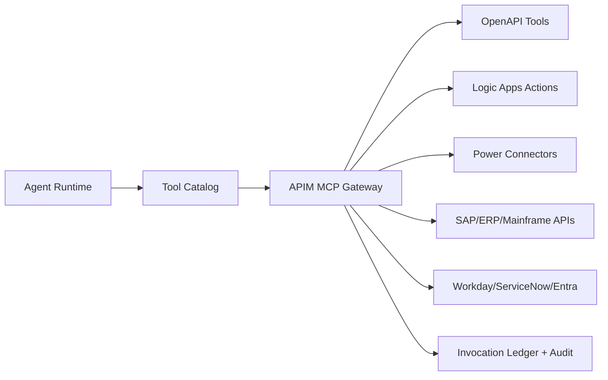
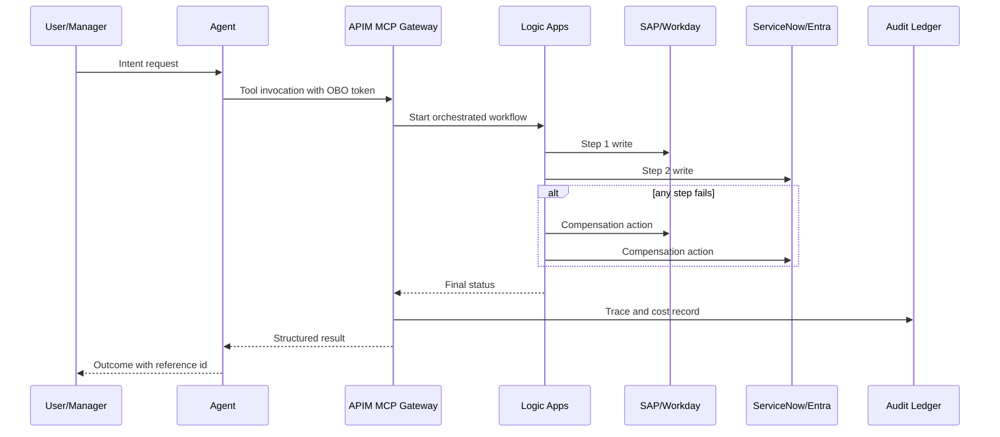

# Remote MCP on APIM vs OpenAPI Tools vs Logic Apps Agent Actions vs Power Platform Connectors：企业 Agent 工具集成与核心系统连接选型 FAQ（Round 1115 / Cycle 2520）

## 1) 执行摘要与当日能力雷达（2026-11-18）
- 本轮结论：企业 Agent 工具调用体系应从“单个 API 集成”升级为“协议标准化 + 身份治理 + 事务补偿 + 成本可控”的平台化能力。
- 四条主流路径并非互斥：
  - APIM 治理的 Remote MCP：适合跨团队复用、统一审计和策略控制；
  - 直接 OpenAPI Tool：适合快速接入明确边界的 REST 能力；
  - Logic Apps Agent Actions：适合跨系统流程编排、重试与补偿；
  - Power Platform Connectors：适合 M365 生态与业务团队低代码落地。
- 推荐实践是“分层组合”而非“单项替代”，尤其在 ERP/HR 等核心系统场景。
- 当日能力雷达（抓取时间：2026-11-18 00:06 BJT）聚焦：
  - MCP Streamable HTTP 与 OAuth/OBO 的企业治理落地；
  - APIM 把既有 OpenAPI / Logic Apps 封装成受控 MCP Tool Catalog；
  - 面向部门级 DLP 与 action-level RBAC 的统一策略需求；
  - 200+ 工具环境下意图级动态工具过滤对 token 成本的影响。
- 本轮严禁低层内核硬件话题，全部内容限定在企业应用架构与集成治理。

## 2) 问题建模：工具调用从“能连通”到“可治理”
- 早期 Agent 常见模式是“能调用即可”，后期会暴露四类治理缺口：
  1. 身份缺口：工具调用缺少用户委托上下文，越权风险高。
  2. 事务缺口：跨系统部分成功后缺乏补偿流程。
  3. 成本缺口：工具 schema 过大导致上下文 token 浪费。
  4. 审计缺口：无法追溯一次业务动作经过了哪些系统与审批。
- 因此选型应围绕：标准协议、身份委托、补偿机制、可观测性、成本模型。

## 3) 参考架构：APIM 中枢 + 多工具执行平面
- 北向入口：
  - Agent Runtime（Foundry Agent / MAF / Copilot Studio）通过受控工具目录请求能力。
- 中枢治理：
  - APIM 提供 OAuth/OBO 验证、限流、配额、审计、断路器和 DLP 策略。
- 南向执行：
  - 直接 OpenAPI 工具用于低延迟原子操作；
  - Logic Apps 用于跨系统长事务和补偿；
  - Power Connectors 用于业务自助编排；
  - Remote MCP 用于统一协议层和多 Agent 复用。
- 运营平面：
  - 以 invocation ledger 跟踪每次工具调用的身份、参数摘要、结果、补偿状态。

## 4) 12 维企业工具集成选型矩阵
| 维度 | APIM 治理 Remote MCP | 直接 OpenAPI 3.x Tools | Logic Apps Standard Agent Actions/MCP | Power Platform Connectors |
|---|---|---|---|---|
| 协议标准化与多 Agent 复用 | 强，MCP 原生多 Agent 复用 | 中，按 API 独立接入 | 中，需封装策略 | 中，偏平台内复用 |
| 旧 ERP/主机/本地连接能力 | 中，依赖后端适配 | 中，取决于 API 资产 | 强，连接器与网关成熟 | 中强，连接器丰富 |
| OAuth 2.1 / Entra OBO 委托 | 强，网关统一执行 | 中，常落到应用层 | 强，可结合 APIM | 强，M365 身份生态友好 |
| 幂等与 Saga 补偿支持 | 中，需后端配合 | 弱，需自行实现 | 强，状态流与重试补偿成熟 | 中，复杂补偿需扩展 |
| 工具 schema 上下文 token 效率 | 强，可做工具目录裁剪 | 中，常全量暴露 | 中，需额外目录治理 | 中，易膨胀需治理 |
| 单次调用延迟开销 | 中，策略链有开销 | 低，路径最短 | 中高，编排层开销 | 中 |
| 限流与断路治理 | 强，网关标准能力 | 中，需每工具实现 | 中强，配合网关更佳 | 中，平台能力受限 |
| Citizen vs Pro-code 体验 | 中，偏平台团队 | 强，偏开发者 | 中，偏集成工程师 | 强，业务低代码友好 |
| DLP 与 action 级 RBAC | 强，统一策略链 | 中，碎片化实现 | 强，可策略化 | 强，M365 DLP 生态成熟 |
| 每百万调用 TCO | 中，可控 | 中低（短期）/中高（长期治理债） | 中，流程型收益高 | 中，许可与连接器组合成本 |
| 最佳适配场景 | 统一治理、多团队共享工具 | 快速接入原子 REST 能力 | 跨系统事务编排与补偿 | 业务部门自助流程自动化 |
| When NOT to choose | 仅做单团队 PoC 可能过重 | 高合规多系统场景不宜长期直连 | 超低延迟原子调用不宜全量走编排 | 缺少平台治理时易工具扩张失控 |

## 5) 深度问答：公式与样例
### Q1：APIM 把 OpenAPI/Logic Apps 转成 MCP 的价值如何量化？
- 公式：`ReuseGain = (TeamsUsingSharedTools - TeamsUsingIsolatedAdapters) / TeamsUsingIsolatedAdapters`。
- 样例：`shared=14`，`isolated=5`。
- 计算：`180%` 复用增益。
- 意义：减少重复适配开发并统一策略执行面。

### Q2：工具目录裁剪对 token 成本影响如何估？
- 公式：`TokenSaved = (ToolSetFullTokens - ToolSetScopedTokens) * Calls`。
- 样例：`ToolSetFull=4,800`，`Scoped=1,150`，`Calls=1,200,000`。
- 计算：`4.38e9` tokens 节省。
- 结论：动态过滤 200+ API 到 <15 工具是大规模降本关键。

### Q3：Saga 补偿收益怎么衡量？
- 公式：`CompensationBenefit = FailedPartialWrites_withoutSaga - FailedPartialWrites_withSaga`。
- 样例：`without=1,820`，`with=210`。
- 结果：减少 `1,610` 起部分写失败残留。
- 用途：可直接映射业务对账修复工作量。

### Q4：OBO 授权边界如何比较？
- 公式：`PrivilegeExposure = ScopeBreadth * TokenTTL * ToolSurface`。
- 样例 OBO：`2*1*3=6`；共享系统账户：`6*2*5=60`。
- 结论：代用户 OBO 能显著降低横向越权面。

### Q5：限流与断路器如何防止雪崩？
- 公式：`ProtectedThroughput = TotalRequests - RejectedBeforeBackend`。
- 样例：`Total=9,000,000`，`RejectedBeforeBackend=1,300,000`。
- 结果：后端免受 130 万次无效压力冲击。
- 含义：网关前置拒绝是保护核心系统的关键。

### Q6：何时不建议直接 OpenAPI Tool 直连？
- 条件：`系统数>3` 且 `需要审计` 且 `涉及财务/人事写操作`。
- 若同时满足，应优先采用网关治理 + 编排补偿路径。

## 6) Mermaid：企业工具治理拓扑

- 拓扑要点：APIM 可把既有 OpenAPI 与 Logic Apps 能力统一暴露为受控 MCP 工具，而无需重写后端。
- 拓扑要点：工具目录和策略链必须协同治理，避免工具爆炸。

## 7) 场景 A：制造业 P2P（SAP S/4HANA + WMS + 供应商门户）Agent
- 目标：跨系统执行采购到付款流程，同时避免重复 PO/重复付款。
- 核心链路：
  1. Agent 通过 APIM MCP 调用采购工具；
  2. Logic Apps 调 SAP、WMS、供应商门户；
  3. 幂等键防止重复写入；
  4. 部分成功触发 saga 补偿；
  5. `>$50k` 自动进入 CFO/采购经理双人审批。
- 架构收益：
  - P2P 流程自动化覆盖率提升；
  - 重复记账事故显著下降；
  - 对账周期缩短。
- 样例指标：
  - 重复付款事件下降 58%；
  - 部分写失败残留下降 71%；
  - 大额审批合规通过率 99%+。
- 风险与对策：
  - 风险：供应商 API 慢响应造成长链超时；
  - 对策：断路器 + 队列化重试 + 人工补偿面板。

## 8) 场景 B：跨国企业 Hire-to-Retire（Workday + ServiceNow + Entra）Agent
- 目标：员工入转调离全流程自助办理，兼顾身份委托与工具收敛。
- 核心链路：
  1. 经理发起请求，Agent 使用 OBO 校验权限；
  2. 工单、账号、设备流程跨 Workday/ServiceNow/Entra 编排；
  3. 动态工具过滤从 200+ API 收敛到 <15 意图相关工具；
  4. 全流程审计记录动作、身份、结果与异常。
- 架构收益：
  - IT/HR 手工工单压力下降；
  - 身份越权风险下降；
  - 工具调用成本可控。
- 样例指标：
  - 工具上下文 token 消耗下降 63%；
  - 入职平均办理时长下降 41%；
  - 越权调用告警下降 52%。
- 风险与对策：
  - 风险：角色变更未及时同步导致权限判断偏差；
  - 对策：OBO 实时查询 + 缓存短 TTL + 关键动作二次验证。

## 9) Mermaid：跨系统事务与补偿时序

- 时序要点：跨系统写操作必须有补偿路径，不能只做重试。
- 时序要点：每次动作都应落审计账本，用于复盘和对账。

## 10) 生产级 Bicep（APIM + Logic Apps + 诊断）
```bicep
param location string = resourceGroup().location
param envName string = 'agent-tools-prod'
param logWorkspaceId string

resource apim 'Microsoft.ApiManagement/service@2023-09-01-preview' = {
  name: '${envName}-apim'
  location: location
  sku: {
    name: 'Premium'
    capacity: 2
  }
  properties: {
    publisherEmail: 'integration@contoso.com'
    publisherName: 'Contoso Integration'
    virtualNetworkType: 'External'
    publicNetworkAccess: 'Enabled'
  }
}

resource la 'Microsoft.Web/sites@2023-12-01' = {
  name: '${envName}-logic'
  location: location
  kind: 'functionapp,workflowapp'
  properties: {
    httpsOnly: true
  }
}

resource diagApim 'Microsoft.Insights/diagnosticSettings@2021-05-01-preview' = {
  name: 'diag-apim-tools'
  scope: apim
  properties: {
    workspaceId: logWorkspaceId
    logs: [
      { category: 'GatewayLogs', enabled: true }
      { category: 'AuditLogs', enabled: true }
    ]
    metrics: [
      { category: 'AllMetrics', enabled: true }
    ]
  }
}
```

## 11) 运行配置片段（工具过滤 + OBO + 幂等）
```yaml
apiVersion: v1
kind: ConfigMap
metadata:
  name: tool-governance-config
data:
  catalog_mode: "intent-scoped"
  max_tools_per_intent: "15"
  auth_mode: "entra-obo"
  idempotency_header: "x-idempotency-key"
  saga_mode: "enabled"
  escalation_threshold_usd: "50000"
  rate_limit_mode: "dept-and-app"
```

```xml
<policies>
  <inbound>
    <base />
    <validate-jwt header-name="Authorization" failed-validation-httpcode="401">
      <openid-config url="https://login.microsoftonline.com/{tenant}/v2.0/.well-known/openid-configuration" />
      <required-claims>
        <claim name="aud"><value>api://agent-tools-gateway</value></claim>
      </required-claims>
    </validate-jwt>
    <set-variable name="deptId" value="@(context.Request.Headers.GetValueOrDefault(&quot;x-dept-id&quot;,&quot;unknown&quot;))" />
    <set-variable name="idempotencyKey" value="@(context.Request.Headers.GetValueOrDefault(&quot;x-idempotency-key&quot;,&quot;&quot;))" />
    <rate-limit-by-key calls="300" renewal-period="60" counter-key="@(context.Variables[&quot;deptId&quot;])" />
    <set-header name="x-tool-catalog-mode" exists-action="override">
      <value>intent-scoped</value>
    </set-header>
  </inbound>
  <backend><base /></backend>
  <outbound><base /></outbound>
  <on-error><base /></on-error>
</policies>
```

## 12) KQL 观测查询（补偿、延迟、越权）
```kql
let lookback = 1d;
let toolCalls = ApiManagementGatewayLogs
| where TimeGenerated > ago(lookback)
| summarize callCount=count(), p95=percentile(DurationMs,95) by tool=tostring(parse_json(Properties).toolName), dept=tostring(parse_json(Properties).deptId);

let compensations = CustomEvents
| where TimeGenerated > ago(lookback)
| where name == "saga_compensation_executed"
| summarize compensationCount=count() by workflow=tostring(customDimensions.workflowName);

let deniedByScope = ApiManagementGatewayLogs
| where TimeGenerated > ago(lookback)
| where tostring(parse_json(Properties).oboDecision) == "deny"
| summarize denied=count() by dept=tostring(parse_json(Properties).deptId), scope=tostring(parse_json(Properties).scope);

toolCalls
| join kind=leftouter deniedByScope on dept
| project dept, tool, callCount, p95, denied
| order by callCount desc
```

## 13) 基准与证据（Cycle 2520）
- 证据文件：
  - `workshops/azure-agent-infra/evidence/cycle-2520-benchmark.json`
  - `workshops/azure-agent-infra/evidence/cycle-2520-latency.csv`
  - `workshops/azure-agent-infra/evidence/cycle-2520-throughput.csv`
  - `workshops/azure-agent-infra/evidence/cycle-2520-policy.csv`
  - `workshops/azure-agent-infra/evidence/cycle-2520-cost.csv`
  - `workshops/azure-agent-infra/evidence/cycle-2520-sources.json`
- 标签定义：
  - `measured`：调用链与补偿日志可重放；
  - `synthetic`：成本与容量确定性估算；
  - `anonymized_reported`：脱敏生产区间样本。
- 本轮重点：
  - 工具调用 P50/P95；
  - 补偿触发率与成功率；
  - OBO 拒绝率与误拒率；
  - 每百万调用成本；
  - 工具过滤后 token 节省比。

## 14) 四方案加权决策矩阵（组合建议）
- 方案 A（MCP on APIM Core）：以 APIM MCP 为治理核心。
- 方案 B（OpenAPI Native Direct）：以直接 OpenAPI tool 为主。
- 方案 C（Logic Apps Orchestrated）：以编排与补偿为主。
- 方案 D（Power Connector Collaborative）：以低代码协同为主。
- 权重：Governance 30%、Integration Depth 25%、Reliability 20%、Cost 15%、Velocity 10%。
- 样例评分（0-10）：
  - 方案 A：`9.3, 8.8, 8.5, 7.9, 7.8`，总分 `8.61`。
  - 方案 B：`6.9, 7.1, 6.8, 8.2, 8.4`，总分 `7.22`。
  - 方案 C：`8.6, 9.1, 9.0, 7.4, 6.9`，总分 `8.50`。
  - 方案 D：`7.8, 7.9, 7.2, 7.6, 9.1`，总分 `7.84`。
- 组合建议：
  - 大型企业核心链路：A + C；
  - M365 协同场景：A + D；
  - 原子低延迟能力：A + B 局部混用。
- 反模式：
  - 全量直连 OpenAPI 且无统一审计；
  - 用低代码流程承载超低延迟交易核心链路。

## 15) Day-0 / Day-2 清单与 Good Fit
### Day-0（上线前 10 项）
1. 梳理工具目录并按意图定义最小工具集。
2. 配置 Entra OBO 与最小权限 scope。
3. 配置 APIM 限流、断路、审计策略。
4. 为关键写操作接入幂等键校验。
5. 为跨系统流程定义 saga 补偿步骤。
6. 配置大额阈值审批流（如 >$50k）。
7. 建立工具调用审计字段标准。
8. 执行越权调用与重复写入回放测试。
9. 配置工具调用成本与部门分摊看板。
10. 与财务/法务确认审计保留策略。

### Day-2（运营期 10 项）
1. 每周复核工具过滤命中率与 token 节省。
2. 每周复核 OBO 拒绝日志与误拒样本。
3. 每周复核补偿触发与失败事件。
4. 每月复核各部门调用成本偏差。
5. 每月复核长尾高延迟工具并优化。
6. 每月抽检审批链完整性与合规性。
7. 每季度演练主系统不可用降级策略。
8. 每季度评估低代码流程复杂度膨胀风险。
9. 每季度更新工具目录生命周期管理规则。
10. 持续维护“工具选型决策树”并培训团队。

**Good fit**：跨系统、强审计、强身份治理且需长期运营的企业 Agent 平台。  
**Not for**：单系统一次性自动化脚本和短期演示原型。
