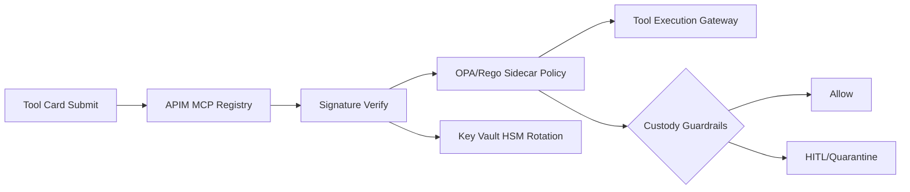

# Azure MCP Tool-Custody Attestation FAQ (Cycle 2382)

## 1) Scenario and constraints
The objective is enterprise zero-trust governance for MCP tool calls: APIM MCP Registry as onboarding plane, OPA/Rego sidecars as runtime policy plane, and Key Vault HSM as signing/rotation plane to control custody risk and latency tax.

## 2) Q1 / Q2 / Q3 Daily capability breakthroughs (verifiable)
Q1: Why require signed cards?  
A1: To prevent unauthorized tool injection into the onboarding registry.  
Q2: Why dual-layer gateway + sidecar policies?  
A2: It combines admission governance with least-privilege runtime enforcement.  
Q3: How do you rotate keys without disruption?  
A3: Use tenant rollout waves and rollback windows instead of global cutover.

Source links and fetch timestamp (UTC) are listed in `cycle-2382-sources.json`.

## 3) Decision matrix (security, latency, precision, cost)
| Path | P95 latency | Security governance strength | Denial precision | Cost/session | Ops complexity |
|---|---:|---:|---:|---:|---:|
| APIM registry attestation chain | 287 ms | high | high | 0.00614 | medium |
| OPA/Rego sidecar policy | 249 ms | high | high | 0.00573 | medium-high |
| HSM rotation lane | 319 ms | high | medium-high | 0.00689 | medium-high |
| Custody guard lane | 319 ms | high | high | 0.00602 | medium |

## 4) Good fit vs Not for
Good fit:
1. Coding Agent sandboxes enforcing signature checks before tool execution.
2. Browser/CUA clusters requiring replayable evidence for policy denials.
3. Multi-tenant SaaS with tenant-scoped policy bundles and rotation windows.
4. Regulated finance requiring zero-trust custody with HITL override closure.

Not for:
1. Unsigned tool cards in production.
2. No policy version pinning between gateway and sidecars.
3. Global key rotation without tenant rollout waves.

## 5) Percentage contract bindings (N/D)
- `percentage_contract.tool_custody_attestation_pass_rate`
- `percentage_contract.policy_denial_precision_rate`
- `percentage_contract.signed_card_rotation_gain_pts`

These keys bind to `cycle-2382-benchmark.json` with `production_validation=not_measured`.

## 6) Five-step rollout
1. Define card-signing standards and compatibility matrix.
2. Enforce admission verification and rejection audit in APIM registry.
3. Inject OPA/Rego least-privilege policies at runtime edge.
4. Run Key Vault HSM key rotation in tenant rollout waves.
5. Replay denial samples weekly to tune false-positive drift.
