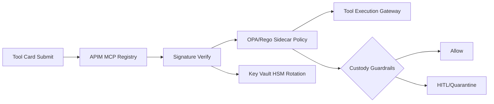

# Azure MCP 工具托管签名证明 FAQ（Cycle 2382）

## 1) 场景与约束
目标是为 MCP 工具调用建立企业级零信任托管：以 APIM MCP Registry 作为注册平面、OPA/Rego 侧车作为执行平面、Key Vault HSM 作为签名与轮换平面，控制托管风险与延迟税。

## 2) Q1 / Q2 / Q3 当日能力突破（可验证）
Q1：为什么必须签名卡片？  
A1：防止未授权工具注入注册平面。  
Q2：网关+侧车双层策略的价值？  
A2：同时保证准入治理与运行时最小权限控制。  
Q3：密钥轮换如何避免业务抖动？  
A3：采用租户波次灰度与回滚窗口，避免全局同时切换。

来源与抓取时间（UTC）写入 `cycle-2382-sources.json`。

## 3) 决策矩阵（安全、延迟、精度、成本）
| 路径 | P95 延迟 | 安全治理强度 | 拒绝精度 | 单会话成本 | 运维复杂度 |
|---|---:|---:|---:|---:|---:|
| APIM Registry 证明链 | 287 ms | 高 | 高 | 0.00614 | 中 |
| OPA/Rego 侧车策略 | 249 ms | 高 | 高 | 0.00573 | 中高 |
| HSM 轮换通道 | 319 ms | 高 | 中高 | 0.00689 | 中高 |
| 托管防护通道 | 319 ms | 高 | 高 | 0.00602 | 中 |

## 4) Good fit vs Not for
Good fit：
1. Coding Agent sandbox：工具调用前强制签名校验。  
2. Browser/CUA 集群：策略拒绝有可回放证据链。  
3. 多租户 SaaS：租户策略包与轮换窗口分层。  
4. 金融合规：零信任托管与审批越权回退闭环。

Not for：
1. 生产环境允许未签名工具卡。  
2. 无策略版本钉住机制，网关与侧车配置漂移。  
3. 无波次灰度策略直接全租户密钥轮换。

## 5) Percentage contract bindings (N/D)
- `percentage_contract.tool_custody_attestation_pass_rate`
- `percentage_contract.policy_denial_precision_rate`
- `percentage_contract.signed_card_rotation_gain_pts`

以上键绑定 `cycle-2382-benchmark.json`，并标注 `production_validation=not_measured`。

## 6) 五步落地指南
1. 定义工具卡签名规范与版本兼容矩阵。  
2. 在 APIM registry 执行准入验证与拒绝审计。  
3. 在执行平面注入 OPA/Rego 最小权限策略。  
4. 用 Key Vault HSM 实施租户波次密钥轮换。  
5. 周度回放拒绝样本并修正策略误报漂移。
