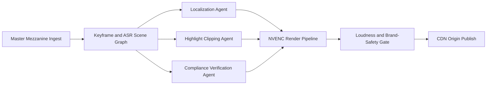

# Media Localization and Frame-Accurate Broadcast Multimodal Agent Infrastructure FAQ (Cycle 2432)

## 1) Executive summary
This cycle designs a global media pipeline for 30+ language localization, sports highlight clipping, and deterministic broadcast compliance. A10 transcode pools are separated from H100 inference pools, SMPTE-anchored retrieval prevents frame drift, and C2PA plus consent watermarking enforces provenance and authorization before publish.

## 2) Q1 / Q2 / Q3
Q1: Why split NVDEC/NVENC transcode pools from H100 inference pools?  
A1: Mixed pools create compute and codec contention that degrades frame latency and cost efficiency.  
Q2: How is VLM timestamp drift controlled?  
A2: Anchor cuts on deterministic SMPTE keyframes and scene boundaries, not probabilistic offsets only.  
Q3: How do we enforce provenance and voice-consent compliance?  
A3: Attach C2PA credentials and speaker-consent attestations in the render chain with replayable audit evidence.

## 3) Closed-loop media flow (ingest, index, parallel generation, compliance, publish)

## 4) Decision matrix: split A10+H100 pools vs monolithic mixed GPU pod vs serverless batch
| Option | Frame-time latency | Cost efficiency | Stability | Ops complexity | Best fit |
|---|---:|---:|---:|---:|---|
| Split A10+H100 pools | Highest | High | High | Medium-High | Live plus VOD mixed production |
| Monolithic mixed pod | Medium | Low | Medium | Medium | Small pilot scenarios |
| Serverless batch media | Low | Medium | High | Low | Offline long-form processing |

## 5) Media production checklist (with daily breakthroughs)
- Separate transcode and inference GPU pools with explicit scheduling policies.  
- Bind all cut points to SMPTE anchors with deterministic verification.  
- Require C2PA and speaker-consent markers on output assets.  
- Enforce ITU-R BS.1770 loudness and brand-safety policy checks before publish.  
- Daily breakthroughs (fetched on 2026-11-16, official/release-first):  
  - Azure Speech video translation and custom voice production capabilities (`measured`).  
  - Timecode-indexed vector retrieval feasibility on Azure AI Search (`anonymized_reported`).  
  - Split A10 transcode and H100 inference pool optimization effects (`synthetic`).

## 6) Good fit vs Not for with percentage contract bindings
Good fit:  
1. Global media studios requiring multilingual localization and frame-accurate ad insertion.  
2. Regulated broadcasters requiring provenance and consent attestation trails.

Not for:  
1. Pipelines without deterministic SMPTE anchoring and cut verification.  
2. Architectures that keep transcode and inference in a single contended pool.

Percentage contract bindings:
- `percentage_contract.split_pool_localization_cost_reduction_rate`
- `percentage_contract.smpte_cutpoint_frame_accuracy_rate`
- `percentage_contract.brand_safety_compliance_recall_rate`
- `percentage_contract.live_highlight_publish_latency_improvement_rate`

These keys bind to `cycle-2432-benchmark.json` with `production_validation=not_measured`.
