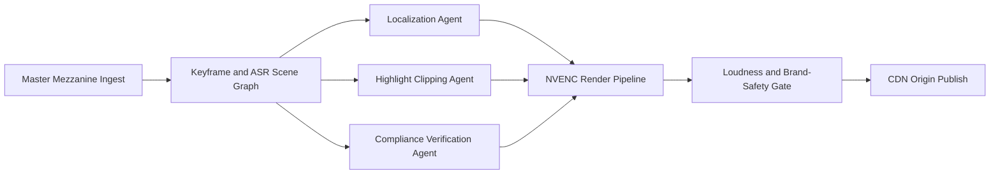

# 媒体本地化与帧级播控多模态 Agent 基础设施 FAQ（Cycle 2432）

## 1) 执行摘要
本轮聚焦全球流媒体工作室的“多语种本地化 + 体育高光 + 合规播控”流水线：通过 A10 转码池与 H100 推理池分离避免资源争抢，基于 SMPTE 时间码做帧级检索与剪辑锚定，引入 C2PA 证明与配音同意水印，再由确定性响度与品牌安全门控控制最终播出。

## 2) Q1 / Q2 / Q3
Q1：为什么必须拆分 NVDEC/NVENC 转码池与 H100 推理池？  
A1：若混用 GPU 池，转码与 VLM 推理会互抢 Tensor/Core 与编解码单元，导致时延抖动与成本上升。  
Q2：如何解决 VLM 场景识别的时间戳漂移？  
A2：用 SMPTE 时间码和关键帧/场切点做确定性锚定，禁止仅依赖概率时间戳定位。  
Q3：如何确保内容出处与配音授权可审计？  
A3：在渲染链加入 C2PA 凭证与配音同意标记，输出可验证工件并留存审计链。

## 3) 媒体多代理闭环（入湖→检索→并行生成→合规门控→分发）

## 4) 决策矩阵：A10+H100 分池 vs 单体混池 GPU Pod vs 无服务器批处理
| 方案 | 帧级时效 | 成本效率 | 稳定性 | 运维复杂度 | 适配场景 |
|---|---:|---:|---:|---:|---|
| A10+H100 分池 | 最高 | 高 | 高 | 中高 | 直播+点播混合生产 |
| 单体混池 Pod | 中 | 低 | 中 | 中 | 小规模快速试验 |
| 无服务器批处理 | 低 | 中 | 高 | 低 | 离线长视频批处理 |

## 5) 媒体多模态 Agent 上线清单（含当日热点）
- 转码与推理资源池必须拆分并设置容量上限与调度策略。  
- 所有剪辑点必须绑定 SMPTE 锚点与场切校验。  
- 输出媒体必须附 C2PA 与配音授权标记。  
- 播前必须通过 ITU-R BS.1770 响度与品牌安全校验。  
- 当日热点（抓取日：2026-11-16，官方/Release 优先）：  
  - Azure Speech 视频翻译与自定义语音在多语内容生产的能力（`measured`）。  
  - Azure AI Search 向量检索在时间码索引场景的可行路径（`anonymized_reported`）。  
  - A10 转码池 + H100 推理池分离对成本/时延的优化效果（`synthetic`）。

## 6) Good fit vs Not for 与百分比合约绑定
Good fit：  
1. 需要多语种高并发本地化与帧级广告插播的媒体平台。  
2. 对版权来源、配音授权、播出合规有强审计要求的机构。

Not for：  
1. 无法维护时间码锚定与确定性切点验证的流水线。  
2. 混用 GPU 资源池导致实时播控时延不可预测的系统。

百分比合约绑定：
- `percentage_contract.split_pool_localization_cost_reduction_rate`
- `percentage_contract.smpte_cutpoint_frame_accuracy_rate`
- `percentage_contract.brand_safety_compliance_recall_rate`
- `percentage_contract.live_highlight_publish_latency_improvement_rate`

以上键绑定 `cycle-2432-benchmark.json`，并标注 `production_validation=not_measured`。
