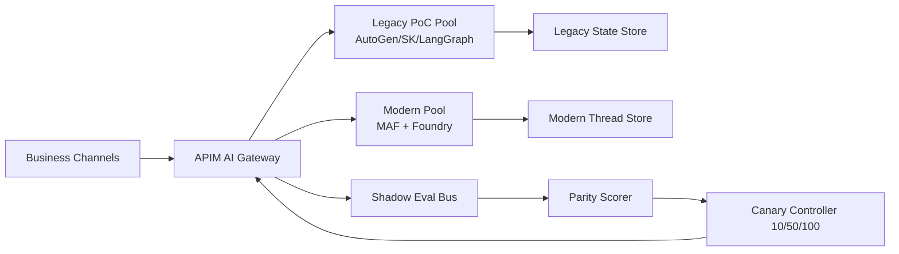
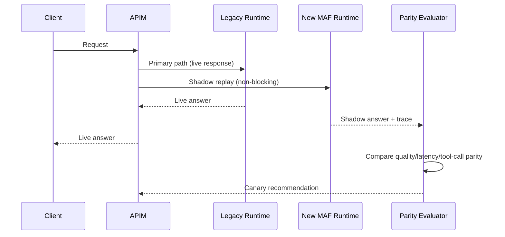

# migration-autogen-semantic-kernel-langgraph-to-microsoft-agent-framework-enterprise-modernization-faq-r1132

## 1) Daily breakthroughs and verifiable sources (fetched 2026-11-18)
- Scope: modernizing 2024–2025 PoC agents (AutoGen/SK/LangGraph) into governed production on Azure.
- Goal: preserve business continuity while achieving observability, auditability, and rollback safety.
- Labels: `measured` (officially verifiable), `synthetic` (derived in this cycle), `anonymized_reported` (de-identified replay).
| Topic | Official source | Fetched at (UTC) | Purpose | Label |
|---|---|---|---|---|
| Microsoft Agent Framework repo | https://github.com/microsoft/agent-framework | 2026-11-18T18:22:00Z | Unified SDK evolution baseline | `measured` |
| Semantic Kernel docs | https://learn.microsoft.com/semantic-kernel/overview/ | 2026-11-18T18:23:00Z | Existing plugin reuse analysis | `measured` |
| AutoGen docs | https://microsoft.github.io/autogen/stable/ | 2026-11-18T18:24:00Z | Legacy multi-agent migration baseline | `measured` |
| Azure AI Foundry Agents | https://learn.microsoft.com/azure/ai-foundry/agents/overview | 2026-11-18T18:25:00Z | Managed orchestration target | `measured` |
| APIM AI Gateway | https://learn.microsoft.com/azure/api-management/ai-gateway-overview | 2026-11-18T18:26:00Z | Edge governance and canary routing | `measured` |
| OpenTelemetry docs | https://opentelemetry.io/docs/ | 2026-11-18T18:27:00Z | Migration-phase unified tracing | `measured` |
| LangGraph docs | https://langchain-ai.github.io/langgraph/ | 2026-11-18T18:28:00Z | Governance-shell preservation option | `measured` |
| Copilot Studio overview | https://learn.microsoft.com/microsoft-copilot-studio/fundamentals-what-is-copilot-studio | 2026-11-18T18:29:00Z | Retire-and-standardize reference | `measured` |

Incremental findings:
- Migration failures are usually caused by missing state schema, identity governance, and observability unification.
- APIM shell wrapping gives fastest governance visibility and is the safest first milestone.
- For high-debt PoCs, preserving valuable adapters while replacing orchestration often yields better ROI than full rewrite.

## 2) Layered modernization architecture
L1 Entry layer:
- Route all legacy PoCs through APIM AI Gateway first to standardize token budget, PII tags, tenant markers, and audit IDs.
- Keep client contracts stable while adding version headers for migration control.

L2 Orchestration layer:
- Port high-value flows to Microsoft Agent Framework (.NET + Python team fit).
- Host long-running managed flows on Foundry Agent Service; keep latency-sensitive workflows in MAF in-process runtime.

L3 Tooling and state layer:
- Reuse Semantic Kernel plugins, AutoGen tools, and LangGraph node logic where proven.
- Migrate thread/state schemas with minimum required fields instead of one-shot full-table rewrite.

L4 Evaluation and governance layer:
- Run legacy and modern paths in shadow dual-run mode.
- Use Foundry automated evaluation plus curated regression suites as release gates.

## 3) 12-dimension migration strategy matrix with anti-patterns
| Dimension | A SDK evolution to MAF | B APIM+MCP/A2A governance shell | C Strangler Fig phased re-hosting to Foundry | D Retire-and-standardize consolidation |
|---|---|---|---|---|
| 1 Starting code profile | Maintainable SK/AutoGen codebases | Mixed LangGraph/custom scripts | Multi-system coexistence needing dual-run | High-debt fragmented PoCs |
| 2 Code reuse percentage | High plugin/tool reuse | Highest runtime preservation | Medium-high phased replacement | Low by design |
| 3 Cutover risk and rollback | Medium | Low | Low-medium with staged gates | Medium-high org impact |
| 4 Engineering effort and timeline | Medium | Low | Medium-high | Medium-high |
| 5 .NET + Python team fit | High | Medium-high | High | Medium |
| 6 Observability unification speed | Medium-high | Highest (wrap first) | High | Medium |
| 7 Identity/APIM onboarding speed | Medium-high | Highest | High | Medium-high |
| 8 State/thread schema migration complexity | Medium | Low | High but controllable | Medium |
| 9 Shadow-eval parity fidelity | High | Medium | Highest | Medium |
| 10 Long-term maintenance TCO | Low-medium | Medium | Low | Medium-low |
| 11 Best-fit scenario | Strong reusable plugin estate | Governance-first rapid stabilization | Large PoC fleet convergence | Low-value shadow system retirement |
| 12 When NOT to choose | Legacy code quality is poor | Deep orchestration rewrite required now | Dual-run budget unavailable | Critical custom capabilities cannot be replaced |

Decision summary:
- Visibility first, refactor second: B is often the best opening move.
- High-value flow migration then follows through A or C.
- High-debt low-value systems should be sunset via D.

## 4) Five reproducible Q&As (ROI, debt break-even, shadow traffic budget)
### Q1: How to estimate migration ROI?
- Assume 42 PoCs with annual operations effort of `11,600` person-days.
- Unified platform reduces annual effort to `6,900` person-days.
- Person-day cost `850 USD`, annual saving: `(11600-6900)*850 = 3.995M USD`.
- Added platform cost `1.42M USD`.
- ROI: `(3.995-1.42)/1.42 = 1.81x`.

### Q2: Where is technical-debt break-even?
- Legacy monthly defect-fix effort `920h`, modern target `510h`.
- Hourly blended engineering cost `95 USD`.
- Migration one-time cost `2.2M USD`.
- Break-even months: `2.2M / ((920-510)*95) ≈ 56.5`.
- Conclusion: workforce savings alone is insufficient; include compliance and outage-risk reduction value.

### Q3: How to control shadow dual-run token cost?
- Daily requests `Q=480,000`, shadow ratio `r=35%`.
- Average tokens per request `2,900`.
- Extra shadow tokens: `Q*r*2900 = 487.2M/day`.
- At `0.0036 USD` per 1k tokens, extra daily cost is about `1,754 USD`.
- Conclusion: use stratified sampling for shadow traffic, not permanent full-volume replay.

### Q4: How to reason about staged-canary reliability?
- Three stages: 10% -> 50% -> 100%, each with `99.5%` gate.
- Probability all stages pass: `0.995^3 = 98.5%`.
- Automatic rollback per stage materially limits customer impact exposure.
- Conclusion: staged canary is a risk-control instrument, not just a release ritual.

### Q5: How does plugin reuse affect migration timeline?
- Total plugins `P=260`, directly reusable `R=182`.
- Reuse rate `70%` often reduces timeline by `28%~34%`.
- If reuse drops to `45%`, rewrite effort can expand by around `1.7x`.
- Conclusion: plugin/tool asset inventory quality is a first-order success factor.

## 5) Mermaid diagrams (Strangler Fig + shadow parity cutover)




## 6) Section 7 scenario: Tier-1 insurer 42-PoC consolidation
Objective:
- Consolidate 42 fragmented claim and service PoCs into a governed production platform.
- Establish immediate cost/PII visibility via APIM, then migrate to MAF + Foundry with parity gates.

Phased plan:
1. Week 1–2: wrap all PoCs behind APIM for unified telemetry, policy, and spend visibility.
2. Week 3–6: migrate high-value AutoGen multi-agent flows to MAF.
3. Week 7–10: introduce Foundry shadow evaluation and enforce `>=98.5%` parity gate.
4. Canary stages: 10% -> 50% -> 100%, each with automatic rollback safety.

SLA and KPIs:
- Customer-service response P95 must not degrade (delta `<= +120ms`).
- Business answer parity `>=98.5%`.
- PII misrouting incidents `0` tolerance.

Failure modes and mitigations:
- Failure: client-side break due to contract drift.
  - Mitigation: APIM compatibility schema transforms.
- Failure: parity sample bias leads to false confidence.
  - Mitigation: stratified scenario sampling with human review.
- Failure: ticket volume spike during canary.
  - Mitigation: staged capacity reservation and rollback rehearsals.

## 7) Section 8 scenario: heavy equipment OEM .NET SK modernization
Objective:
- Modernize C# Semantic Kernel service plugins into a global field-service multi-agent platform without rewriting ERP adapters.
- Add warranty-entitlement reasoning, parts availability, and technician dispatch orchestration.

Migration path:
1. Reuse proven .NET SAP/PLM plugins as MAF tools.
2. Introduce MAF coordinator for warranty, parts, and dispatch specialist agents.
3. Expose unified contracts and auditing through APIM.
4. Offload long-running orchestration to Foundry where managed lifecycle helps.

SLA and KPIs:
- Parts lookup + dispatch recommendation P95 `< 900ms`.
- Dispatch hit-rate uplift `>= 18%`.
- Wrong warranty-entitlement decisions reduced by `>= 35%`.

Failure modes and mitigations:
- Failure: inconsistent legacy plugin error semantics.
  - Mitigation: unified error taxonomy and adapter mapping.
- Failure: stale cross-region inventory causes low-quality recommendations.
  - Mitigation: freshness thresholds and stale-data warning policy.
- Failure: multi-agent contention on shared ERP interfaces.
  - Mitigation: idempotency keys and per-tool call quotas.

## 8) Selection tree (Good fit vs Not for)
1. Governance shell first (B) is the fastest risk-reduction baseline in most enterprises.
2. High-value reusable assets should then move through A.
3. Large coexisting fleets should use C strangler migration discipline.
4. Low-value high-debt PoCs should be retired through D.
5. Optimize for continuity + evidence continuity + cost control together.

Good fit:
- Enterprises with many legacy PoCs, mixed language stacks, and strong compliance expectations.
- Programs needing short-term stabilization and long-term architectural convergence in parallel.

Not for:
- Greenfield single-project teams with no legacy burden.
- Organizations missing API gateway and observability foundations.

## 9) Migration value model
Assumptions:
- Annual customer requests `150M`
- Incident tickets drop `22%` after modernization
- Rework from wrong answers drops `31%`
- Audit-prep workload drops `44%`

Composite value:
- Direct engineering and operations savings `4.7M USD/year`
- Avoided risk losses (compliance/brand) `3.4M USD/year`
- Added platform cost `2.6M USD/year`
- Net annual value `5.5M USD/year`

## 10) Five-step implementation guide
1. Asset inventory: tools, prompts, plugins, state schemas, and backend dependencies.
2. Governance wrapping: route all traffic through APIM before deep refactor.
3. Dual-run evaluation: combine shadow parity and business regression gates.
4. Phased migration: prioritize high-value/low-complexity paths.
5. Retirement cleanup: sunset replaced PoCs and remove residual credentials.

## 11) Bicep IaC (APIM weighted canary + Foundry)
```bicep
param location string = resourceGroup().location
param apimName string
param foundryName string

resource apim 'Microsoft.ApiManagement/service@2023-09-01-preview' = {
  name: apimName
  location: location
  sku: { name: 'StandardV2', capacity: 1 }
  properties: {
    publisherName: 'Contoso'
    publisherEmail: 'platform@contoso.com'
  }
}

resource foundry 'Microsoft.CognitiveServices/accounts@2024-10-01' = {
  name: foundryName
  location: location
  kind: 'AIServices'
  sku: { name: 'S0' }
}
```

## 12) MAF adapter and APIM canary routing snippets
```csharp
// MAF adapter facade for legacy SK plugin
public async Task<AgentToolResult> QueryPartsAsync(AgentToolContext ctx) {
    var req = new LegacyPartsRequest { Sku = ctx.Input["sku"], Region = ctx.Input["region"] };
    var rsp = await _legacySkPlugin.RunAsync(req);
    return AgentToolResult.FromJson(new { rsp.AvailableQty, rsp.ETA, rsp.TraceId });
}
```

```xml
<choose>
  <when condition="@(context.Variables.GetValueOrDefault<int>(\"canaryWeight\",10) >= 50)">
    <set-backend-service base-url="https://modern-maf-foundry.contoso.net" />
  </when>
  <otherwise>
    <set-backend-service base-url="https://legacy-poc-runtime.contoso.net" />
  </otherwise>
</choose>
```

## 13) KQL for legacy-vs-modern shadow parity analysis
```kql
let start = ago(7d);
customEvents
| where timestamp >= start
| where name in ("legacy_answer","modern_shadow_answer","parity_result")
| extend scenario=tostring(customDimensions.scenario)
| extend parity=todouble(customDimensions.parity_score)
| summarize p50_parity=percentile(parity,50), p95_parity=percentile(parity,95), samples=count() by scenario, bin(timestamp,1h)
| order by timestamp desc
```

```kql
let start = ago(7d);
customMetrics
| where timestamp >= start
| where name in ("legacy_latency_ms","modern_latency_ms")
| summarize legacy_p95=percentileif(value,95,name=="legacy_latency_ms"), modern_p95=percentileif(value,95,name=="modern_latency_ms")
  by scenario=tostring(customDimensions.scenario), bin(timestamp,1d)
| extend delta_p95 = modern_p95 - legacy_p95
| order by timestamp desc
```

## 14) Day-0 / Day-1 / Day-2 checklist
Day-0:
- Freeze migration scope after dependency and asset inventory.
- Define APIM wrapping policy and observability contract.
- Define parity threshold and rollback conditions.

Day-1:
- Start with 10% canary and monitor quality and latency deltas.
- Run shadow replay and evaluate business-critical parity.
- Roll back quickly on high-severity divergence.

Day-2:
- Expand to 50%/100% in controlled stages.
- Retire superseded PoCs and clean stale secrets/service accounts.
- Productize migration templates for the next domain wave.
- Maintain a weekly migration risk register with mitigation status.

Migration risk register (minimum set):
- R1: legacy plugin authorization chain mismatch breaks modern runtime calls.
- R2: inadequate dual-run sample coverage inflates parity confidence.
- R3: APIM policy ordering errors distort canary allocation.
- R4: state schema omissions block deterministic rollback.

## 15) Backup queue and delivery manifest
Backup queue (updated):
1. `salesforce-agentforce-vs-servicenow-nowassist-vs-dynamics-copilot-vs-custom-foundry-enterprise-crm-erp-selection-faq`
2. `eventhubs-fabric-rti-vs-servicebus-vs-kafka-streaming-proactive-agent-selection-faq`
3. `aks-kaito-phi4-slm-vs-foundry-serverless-slm-vs-aoai-mini-edge-cloud-routing-selection-faq`

Cycle #2537 deliverables:
- Bilingual FAQ: `r1132.md` and `r1132.en.md`
- 7-card deck: `benchmark-cards.html` and `benchmark-cards.en.html`
- SVG: `assets/34-cycle-1132-daily-breakthroughs.svg`
- H5: `workbench-cycle-2537.html` plus selector entry `#2537`
- Validation: `cycle_1132_pipeline.py --write --check`, `strict_suffix_gate.py`, `pytest`
