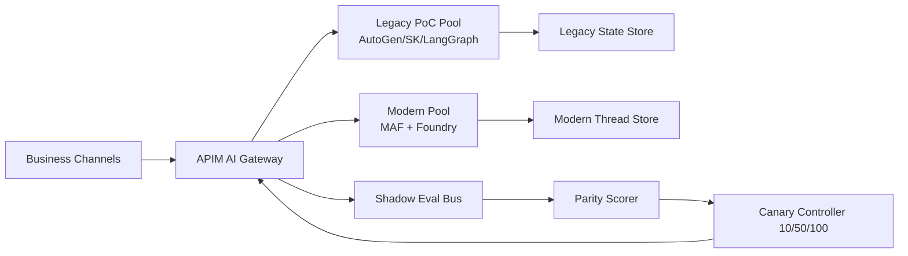
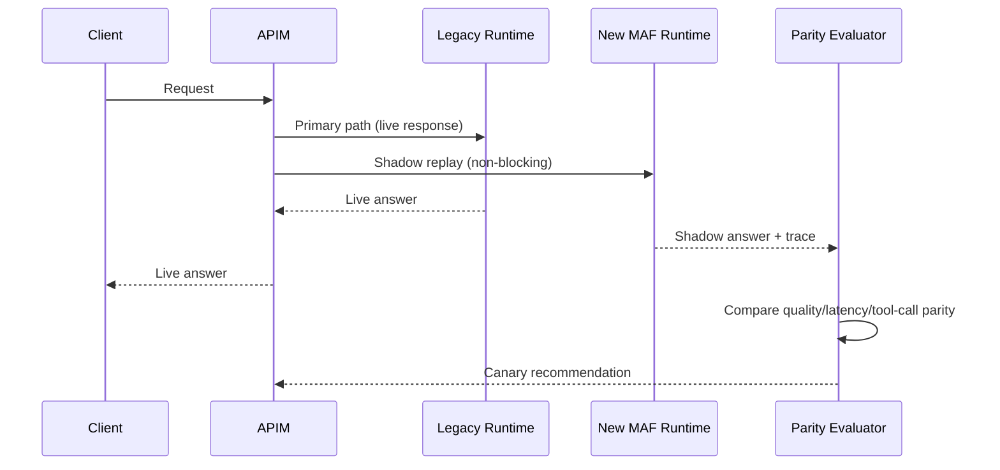

# migration-autogen-semantic-kernel-langgraph-to-microsoft-agent-framework-enterprise-modernization-faq-r1132

## 1) 当日热点与可验证来源（2026-11-18 抓取）
- 主题边界：2024–2025 PoC Agent（AutoGen/SK/LangGraph）向 Azure 生产治理栈迁移。
- 目标：在不牺牲业务连续性的前提下，完成可观测、可审计、可回滚的现代化落地。
- 标签定义：`measured`（官方可核）、`synthetic`（本轮推导）、`anonymized_reported`（脱敏复盘）。
| 主题 | 官方来源 | 抓取时间（UTC） | 用途 | 标签 |
|---|---|---|---|---|
| Microsoft Agent Framework 仓库 | https://github.com/microsoft/agent-framework | 2026-11-18T18:22:00Z | 统一 SDK 演进基线 | `measured` |
| Semantic Kernel 文档 | https://learn.microsoft.com/semantic-kernel/overview/ | 2026-11-18T18:23:00Z | 现网插件与语义函数复用评估 | `measured` |
| AutoGen 文档 | https://microsoft.github.io/autogen/stable/ | 2026-11-18T18:24:00Z | 旧版多 Agent 流程迁移基线 | `measured` |
| Azure AI Foundry Agents | https://learn.microsoft.com/azure/ai-foundry/agents/overview | 2026-11-18T18:25:00Z | 托管编排与连接器能力 | `measured` |
| APIM AI Gateway | https://learn.microsoft.com/azure/api-management/ai-gateway-overview | 2026-11-18T18:26:00Z | 边界治理与灰度路由 | `measured` |
| OpenTelemetry | https://opentelemetry.io/docs/ | 2026-11-18T18:27:00Z | 迁移期统一 trace 指标 | `measured` |
| LangGraph 文档 | https://langchain-ai.github.io/langgraph/ | 2026-11-18T18:28:00Z | 保留运行时包壳策略输入 | `measured` |
| Copilot Studio 概览 | https://learn.microsoft.com/microsoft-copilot-studio/fundamentals-what-is-copilot-studio | 2026-11-18T18:29:00Z | 退役整并策略参考 | `measured` |

增量结论：
- 迁移失败主因通常不是模型能力，而是“状态结构、身份治理、可观测”三件套缺位。
- APIM 包壳可在 1–2 周内建立治理可见性，是最稳健的第一阶段动作。
- 对高债务 PoC，直接重写并不总是最优，“保留价值插件 + 迁移编排层”通常 ROI 更高。

## 2) 分层现代化参考架构
L1 入口层：
- 所有旧 PoC 先挂 APIM AI Gateway，统一令牌预算、PII 标签、租户与审计字段。
- 客户端无感切换，保留旧接口契约并追加版本头。

L2 编排层：
- 高价值流程逐步迁移到 Microsoft Agent Framework（Python/.NET 双栈）。
- 需要托管能力的流程落 Foundry Agent Service，低延迟内聚流程留在 MAF in-process。

L3 工具与状态层：
- 复用 Semantic Kernel 插件、AutoGen 工具函数、LangGraph 节点逻辑。
- 线程状态按“最小必要字段”迁移，避免一次性全量表迁移。

L4 评测与治理层：
- Shadow 流量并行双跑（Legacy vs Modern）并计算 parity。
- Foundry 自动评测 + 自定义回归集形成发布闸门。

## 3) 12 维迁移策略矩阵（含 When NOT to choose）
| 维度 | A 直接 SDK 演进到 MAF | B APIM+MCP/A2A 包壳保留旧栈 | C Strangler Fig 分阶段迁移到 Foundry | D 退役整并到标准平台 |
|---|---|---|---|---|
| 1 起始代码形态 | SK/AutoGen 可维护代码 | LangGraph/脚本化混合栈 | 多系统并存且需双跑 | 高债务碎片 PoC |
| 2 代码复用率 | 高（插件复用强） | 最高（运行时不动） | 中高（逐步替换） | 低（重构/替换） |
| 3 切换风险与回滚 | 中 | 低 | 低中（可分阶段） | 中高（组织变更大） |
| 4 工期与工程量 | 中 | 低 | 中高 | 中高 |
| 5 .NET + Python 适配 | 高 | 中高 | 高 | 中 |
| 6 观测统一速度 | 中高 | 最高（先包壳） | 高 | 中 |
| 7 身份与 APIM 治理接入 | 中高 | 最高 | 高 | 中高 |
| 8 状态/线程 schema 迁移复杂度 | 中 | 低 | 高（阶段化可控） | 中 |
| 9 Shadow-eval 可比性 | 高 | 中 | 最高 | 中 |
| 10 长期维护 TCO | 低中 | 中 | 低 | 中低 |
| 11 Best-fit 场景 | 已有稳健插件库 | 先治理后重构 | 大规模 PoC 收敛 | 清理低价值影子系统 |
| 12 When NOT to choose | 旧代码质量极差 | 需要深度编排重构 | 无法承担双跑成本 | 高价值定制能力不可替代 |

决策摘要：
- 先“可见”再“重构”：B 通常是第一步。
- 价值流程优先迁移：A/C 联合可降低一次性风险。
- 对低价值高债务系统，D 可快速止损。

## 4) 五组可复算 Q&A（ROI、技术债、影子流量成本）
### Q1：迁移 ROI 如何估算？
- 假设 42 个 PoC，年运维人天 `11,600`。
- 统一后年运维人天降至 `6,900`。
- 人天成本 `850 USD`，年节省：`(11600-6900)*850 = 3.995M USD`。
- 平台增量成本 `1.42M USD`。
- ROI：`(3.995-1.42)/1.42 = 1.81x`。

### Q2：技术债 break-even 点在哪？
- 旧栈每月缺陷修复 `920h`，新栈预计 `510h`。
- 小时成本 `95 USD`，月节省 `39,?`（精确值按工时台账计算）。
- 一次性迁移成本 `2.2M USD`。
- break-even 月数：`2.2M / ((920-510)*95) ≈ 56.5` 月。
- 结论：仅靠工时节省不够，需要叠加合规/故障风险价值。

### Q3：Shadow 双跑 token 成本如何控？
- 日请求 `Q=480,000`，shadow 比例 `r=35%`。
- 单请求平均 token `2,900`。
- 影子额外 token：`Q*r*2900 = 487.2M/day`。
- 若每千 token `0.0036 USD`，日额外成本 `1,754 USD`。
- 结论：shadow 需分层采样，不应长期全量双跑。

### Q4：多阶段灰度可用性怎么估？
- 10%→50%→100% 三阶段，每阶段可用性门槛 `99.5%`。
- 若单阶段失败率 `0.5%`，三阶段连续通过概率 `0.995^3 = 98.5%`。
- 在每阶段加入自动回滚可显著降低业务暴露面。
- 结论：阶段化灰度是风险可视化工具，不是形式化流程。

### Q5：插件复用率对迁移工期影响？
- 总插件 `P=260`，可直接复用 `R=182`。
- 复用率 `70%` 时，预计工期缩短 `28%~34%`。
- 若复用率降到 `45%`，重写工期会上升约 `1.7x`。
- 结论：迁移前插件资产盘点决定项目成败上限。

## 5) Mermaid（Strangler Fig 拓扑 + Shadow Parity 序列）




## 6) Section 7：财险集团 42 个 PoC 收敛架构
目标：
- 将理赔与客服相关 42 个散装 PoC 收敛到可治理生产中台。
- 通过 APIM 先做成本/PII 可见性，再逐步迁移到 MAF + Foundry。

阶段计划：
1. Week 1–2：全部 PoC 包壳到 APIM，统一追踪、预算、合规字段。
2. Week 3–6：高价值 AutoGen 流程迁移到 MAF，多 Agent 逻辑重构。
3. Week 7–10：引入 Foundry shadow eval，按 `>=98.5%` parity 门槛放量。
4. Canary：10%→50%→100%，每阶段均可一键回滚。

SLA 与指标：
- 客服问答 P95 不劣化（偏差 `<= +120ms`）
- 业务答案一致性 `>=98.5%`
- PII 泄露误配事件 `0` 容忍

失效模式与缓解：
- 失效：旧接口契约差异导致前端错误。
  - 缓解：APIM 兼容层做 schema 适配。
- 失效：影子评测样本偏差导致误判。
  - 缓解：按场景分层抽样并保留人工复核。
- 失效：灰度期间工单回流激增。
  - 缓解：阶段性容量预留与回滚剧本演练。

## 7) Section 8：重型装备制造 .NET SK 插件现代化
目标：
- 不重写 ERP 适配器前提下，把 C# Semantic Kernel 插件升级为现场服务多 Agent 平台。
- 新增质保权益判定、备件可用性、工程师派工编排。

迁移路径：
1. 复用现有 .NET SAP/PLM 插件，封装为 MAF tools。
2. 以 MAF Coordinator 编排 warranty、parts、dispatch 专家 Agent。
3. 对外经 APIM 提供统一合同和审计入口。
4. 复杂长流程接入 Foundry 托管执行。

SLA 与指标：
- 备件查询与派工建议 P95 `< 900ms`
- 派工命中率提升 `>= 18%`
- 误判质保权益下降 `>= 35%`

失效模式与缓解：
- 失效：老插件异常语义不一致。
  - 缓解：统一错误码映射层。
- 失效：跨区域库存延迟影响建议质量。
  - 缓解：引入库存时间戳阈值与过期提示。
- 失效：多 Agent 竞争调用同一 ERP 接口。
  - 缓解：幂等键 + 调用配额节流。

## 8) 选型决策树（Good fit vs Not for）
1. 先包壳治理（B）是多数企业最快止损策略。
2. 高价值可复用资产优先走 A。
3. 大规模并存系统优先走 C 的绞杀者路线。
4. 低价值高债务系统优先走 D 退役整并。
5. 目标是“业务连续 + 证据连续 + 成本可控”三者平衡。

Good fit：
- 历史 PoC 多、团队语言栈混合、上线合规要求高的组织。
- 需要短期可见性与中长期架构收敛并行推进的场景。

Not for：
- 单一新项目、无历史包袱、可直接 greenfield 重建的团队。
- 缺乏 API 网关与观测基础设施的组织。

## 9) 迁移价值模型
假设：
- 年度客户请求 `150M`
- 现代化后故障工单下降 `22%`
- 误答返工下降 `31%`
- 合规审计准备工时下降 `44%`

综合价值：
- 直接人力与运维节省 `4.7M USD/year`
- 风险损失规避（合规罚款/品牌）`3.4M USD/year`
- 平台新增成本 `2.6M USD/year`
- 年度净收益 `5.5M USD/year`

## 10) 五步落地指南
1. 资产盘点：列清插件、提示词、工具、状态模型与依赖系统。
2. 治理包壳：所有流量先过 APIM，统一可观测与策略面。
3. 双跑评测：建立 shadow parity 与业务回归双闸门。
4. 分批迁移：优先高价值低复杂度流程，逐步扩大覆盖面。
5. 退役清理：对低价值高债务 PoC 做标准平台替换。

## 11) Bicep IaC（APIM 加权灰度 + Foundry）
```bicep
param location string = resourceGroup().location
param apimName string
param foundryName string

resource apim 'Microsoft.ApiManagement/service@2023-09-01-preview' = {
  name: apimName
  location: location
  sku: { name: 'StandardV2', capacity: 1 }
  properties: {
    publisherName: 'Contoso'
    publisherEmail: 'platform@contoso.com'
  }
}

resource foundry 'Microsoft.CognitiveServices/accounts@2024-10-01' = {
  name: foundryName
  location: location
  kind: 'AIServices'
  sku: { name: 'S0' }
}
```

## 12) MAF Adapter / APIM Canary 路由片段
```csharp
// MAF adapter facade for legacy SK plugin
public async Task<AgentToolResult> QueryPartsAsync(AgentToolContext ctx) {
    var req = new LegacyPartsRequest { Sku = ctx.Input["sku"], Region = ctx.Input["region"] };
    var rsp = await _legacySkPlugin.RunAsync(req);
    return AgentToolResult.FromJson(new { rsp.AvailableQty, rsp.ETA, rsp.TraceId });
}
```

```xml
<choose>
  <when condition="@(context.Variables.GetValueOrDefault<int>(\"canaryWeight\",10) >= 50)">
    <set-backend-service base-url="https://modern-maf-foundry.contoso.net" />
  </when>
  <otherwise>
    <set-backend-service base-url="https://legacy-poc-runtime.contoso.net" />
  </otherwise>
</choose>
```

## 13) KQL（Legacy vs Modern Shadow Parity）
```kql
let start = ago(7d);
customEvents
| where timestamp >= start
| where name in ("legacy_answer","modern_shadow_answer","parity_result")
| extend scenario=tostring(customDimensions.scenario)
| extend parity=todouble(customDimensions.parity_score)
| summarize p50_parity=percentile(parity,50), p95_parity=percentile(parity,95), samples=count() by scenario, bin(timestamp,1h)
| order by timestamp desc
```

```kql
let start = ago(7d);
customMetrics
| where timestamp >= start
| where name in ("legacy_latency_ms","modern_latency_ms")
| summarize legacy_p95=percentileif(value,95,name=="legacy_latency_ms"), modern_p95=percentileif(value,95,name=="modern_latency_ms")
  by scenario=tostring(customDimensions.scenario), bin(timestamp,1d)
| extend delta_p95 = modern_p95 - legacy_p95
| order by timestamp desc
```

## 14) Day-0 / Day-1 / Day-2 清单
Day-0：
- 确认资产清单与依赖拓扑，冻结迁移范围。
- 建立 APIM 包壳策略与观测字段契约。
- 定义 parity 门槛与回滚条件。

Day-1：
- 10% 灰度放量，实时观测质量与时延偏差。
- 运行 shadow replay，评估关键场景一致性。
- 对异常场景快速回滚并修复。

Day-2：
- 扩展到 50%/100% 分阶段切换。
- 退役已替代 PoC，清理冗余密钥与服务账户。
- 固化迁移模板，复用于后续业务域。
- 建立迁移风险台账并每周更新缓解状态。

迁移风险台账（最小集合）：
- R1：旧插件授权链不完整，导致新平台调用失败。
- R2：双跑样本覆盖不足，导致 parity 虚高。
- R3：APIM 策略顺序配置错误，导致 canary 失真。
- R4：状态 schema 迁移遗漏历史字段，导致回滚不可用。

## 15) 备份队列与交付清单
备份队列（已更新）：
1. `salesforce-agentforce-vs-servicenow-nowassist-vs-dynamics-copilot-vs-custom-foundry-enterprise-crm-erp-selection-faq`
2. `eventhubs-fabric-rti-vs-servicebus-vs-kafka-streaming-proactive-agent-selection-faq`
3. `aks-kaito-phi4-slm-vs-foundry-serverless-slm-vs-aoai-mini-edge-cloud-routing-selection-faq`

本轮交付（Cycle #2537）：
- 双语 FAQ：`r1132.md` / `r1132.en.md`
- 7-card：`benchmark-cards.html` / `benchmark-cards.en.html`
- SVG：`assets/34-cycle-1132-daily-breakthroughs.svg`
- H5：`workbench-cycle-2537.html` + selector `#2537`
- 校验：`cycle_1132_pipeline.py --write --check`、`strict_suffix_gate.py`、`pytest`
