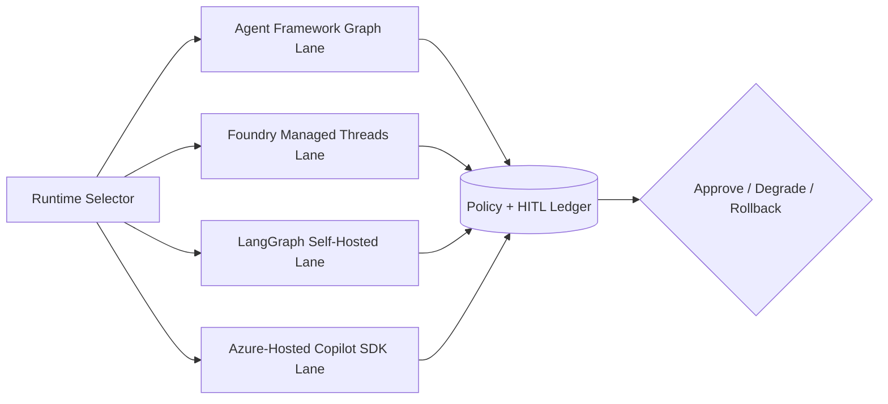

# Azure Multi-Agent Orchestration Runtime Selection FAQ: Agent Framework vs Foundry Threads vs LangGraph vs Azure-Hosted Copilot SDK (Cycle 2377)

## 1) Scenario and constraints
The goal is to satisfy control-flow determinism, HITL approval latency, enterprise governance, and ops TCO for production agent systems. We compare Microsoft Agent Framework, Foundry Agent Service managed threads, self-hosted LangGraph (ACA/AKS), and Azure-hosted GitHub Copilot SDK.

## 2) Q1 / Q2 / Q3 Daily capability breakthroughs (verifiable)
Q1: Why not one runtime for everything?  
A1: Workloads differ materially in determinism, latency, and governance requirements; tiered runtime strategy is more robust.  
Q2: What is the key value of Foundry managed threads?  
A2: Lower orchestration operations overhead for standardized business workflows.  
Q3: When is self-hosted LangGraph justified?  
A3: When deep control-flow customization is required and the team can own ops and governance.

Sources with fetch timestamp (UTC) are listed in `cycle-2377-sources.json`.

## 3) Decision matrix (determinism, approval latency, governance, TCO)
| Path | Control-flow determinism | HITL P95 | Governance auditability | Cost/session | Ops complexity |
|---|---|---:|---:|---:|---:|
| Agent Framework | high | 309 ms | high | 0.00689 | medium |
| Foundry Threads | medium-high | 262 ms | high | 0.00561 | low-medium |
| Self-hosted LangGraph | high | 354 ms | medium-high | 0.00893 | high |
| Azure-hosted Copilot SDK | medium-high | 281 ms | high | 0.00621 | medium |

## 4) Good fit vs Not for
Good fit:
1. Coding Agent sandboxes requiring deterministic graph execution and approval checkpoints.
2. Browser/CUA clusters requiring lower-ops orchestration.
3. Multi-tenant SaaS requiring tenant governance attributes and policy traceability.
4. Regulated workloads requiring auditable approval and rollback custody.

Not for:
1. Runtime selection by convenience without determinism metrics.
2. No HITL SLA or timeout downgrade policy.
3. Teams unable to own self-hosted orchestration operations.

## 5) Percentage contract bindings (N/D)
- `percentage_contract.unfenced_controlflow_determinism_drift_rate`
- `percentage_contract.hitl_approval_latency_sla_rate`
- `percentage_contract.runtime_governance_tco_gain_pts`

These keys bind to `cycle-2377-benchmark.json` with `production_validation=not_measured`.

## 6) Five-step rollout
1. Define runtime-tier criteria (determinism, approval latency, governance level).
2. Standardize HITL contract and timeout policy across critical lanes.
3. Propagate tenant/policy attributes through orchestration events and audit logs.
4. Build runtime fallback routes (managed ↔ self-hosted).
5. Recompute determinism drift, HITL SLA, and cost/session weekly.
