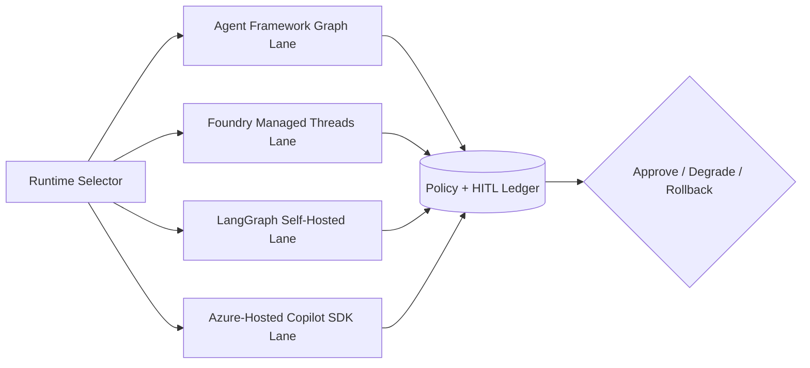

# Azure 多 Agent 编排运行时选型 FAQ：Agent Framework vs Foundry Threads vs LangGraph vs Azure-Hosted Copilot SDK（Cycle 2377）

## 1) 场景与约束
目标是在企业级 Agent 系统中同时满足“控制流确定性、HITL 审批时延、治理可审计、运维 TCO 可控”：比较 Microsoft Agent Framework、Foundry Agent Service Managed Threads、自托管 LangGraph（ACA/AKS）、以及 Azure-Hosted GitHub Copilot SDK 的适用边界。

## 2) Q1 / Q2 / Q3 当日能力突破（可验证）
Q1：为什么不是单一运行时？  
A1：不同业务链路对确定性、时延和治理要求差异大，分层运行时更稳健。  
Q2：Foundry Managed Threads 的核心价值？  
A2：降低编排运维负担，适合标准化业务流程。  
Q3：自托管 LangGraph 何时值得？  
A3：当需要深度自定义控制流和插件生态，但团队能承担运维治理时。

来源与抓取时间（UTC）写入 `cycle-2377-sources.json`。

## 3) 决策矩阵（确定性、审批时延、治理、TCO）
| 路径 | 控制流确定性 | HITL P95 | 治理可审计性 | 单会话成本 | 运维复杂度 |
|---|---|---:|---:|---:|---:|
| Agent Framework | 高 | 309 ms | 高 | 0.00689 | 中 |
| Foundry Threads | 中高 | 262 ms | 高 | 0.00561 | 低中 |
| LangGraph 自托管 | 高 | 354 ms | 中高 | 0.00893 | 高 |
| Azure-Hosted Copilot SDK | 中高 | 281 ms | 高 | 0.00621 | 中 |

## 4) Good fit vs Not for
Good fit：
1. Coding Agent sandbox：需要确定性图执行与审批检查点。  
2. Browser/CUA 集群：需要低运维编排能力。  
3. 多租户 SaaS：需要租户治理属性和可追踪策略。  
4. 金融合规：需要审批链闭环和回滚可审计。

Not for：
1. 只按开发偏好选型，不定义控制流确定性指标。  
2. 无 HITL SLO 与超时降级策略。  
3. 无法维护自托管编排运维责任的团队。

## 5) Percentage contract bindings (N/D)
- `percentage_contract.unfenced_controlflow_determinism_drift_rate`
- `percentage_contract.hitl_approval_latency_sla_rate`
- `percentage_contract.runtime_governance_tco_gain_pts`

以上键绑定 `cycle-2377-benchmark.json`，并标注 `production_validation=not_measured`。

## 6) 五步落地指南
1. 定义运行时分层标准（确定性、审批时延、治理级别）。  
2. 为关键链路建立统一 HITL 契约与超时策略。  
3. 把租户/策略属性贯穿到编排事件与审计日志。  
4. 建立运行时回退路径（Managed ↔ Self-hosted）。  
5. 周度复盘 determinism drift、HITL SLA、cost/session。
