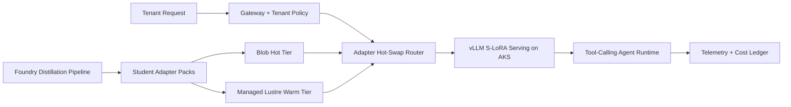

# Azure Multi-LoRA Hot-Swapping and Domain-Distilled SLM Agent Fleet FAQ (Cycle 2397)

## 1) Scenario and constraints
We need a shared Azure fleet serving 50+ tenant and vertical adapters with predictable tool-calling quality. The architecture combines Foundry teacher-student distillation, AKS vLLM S-LoRA serving, and Blob/Managed Lustre adapter tiering, while keeping latency and unit economics bounded.

## 2) Q1 / Q2 / Q3 daily breakthroughs (verifiable)
Q1: Why combine distillation and Multi-LoRA hot-swapping?  
A1: Distilled SLM adapters lower per-task cost while preserving domain tool-calling behavior for each tenant.  
Q2: Why use Blob + Managed Lustre tiering for adapters?  
A2: Hot adapters stay in Blob hot tier, while colder adapters are prewarmed from Lustre to reduce load spikes.  
Q3: What is the practical break-even trigger versus frontier prompting only?  
A3: If adapter cache hit and hot-swap success remain above threshold, shared GPU pools outperform pure frontier prompting on cost per 1k tasks.

Source URLs and fetch timestamps are listed in `cycle-2397-sources.json`.

## 3) Decision matrix (latency, throughput, cost, operability)
| Path | P95 Latency | Throughput P95 | Policy intercept rate | Cost per 1k resolved tasks (USD) | Ops complexity |
|---|---:|---:|---:|---:|---:|
| Shared S-LoRA hot-swap | 226 ms | 1368 rps | 97.14% | 5.84 | Medium |
| Lustre-assisted warm mount | 298 ms | 1212 rps | 95.71% | 6.73 | Medium-high |
| Prompt-only frontier baseline | 351 ms | 988 rps | 93.57% | 9.91 | Low |
| Dedicated model-per-tenant baseline | 910 ms | 542 rps | 97.50% | 16.84 | High |

## 4) Good fit vs Not for
Good fit:
1. Multi-tenant agent platforms with many vertical adapters and stable policy contracts.  
2. Teams requiring adapter-level chargeback and measurable ROI gates.  
3. Workloads benefiting from hot-swap and high adapter cache reuse.

Not for:
1. Low-scale single-tenant systems with no adapter reuse.  
2. Environments unable to govern adapter signing, provenance, and rollback.  
3. Scenarios where ultra-low-latency local execution is mandatory without cluster buffering.

## 5) Percentage contract bindings (N/D)
- `percentage_contract.hotswap_success_rate_gain_vs_prompt_only`
- `percentage_contract.adapter_cache_hit_rate`
- `percentage_contract.tenant_specialization_roi_improvement_rate`

These keys are bound to `cycle-2397-benchmark.json` and tagged with `production_validation=not_measured`.

## 6) Five-step rollout guide
1. Define tenant adapter signing, versioning, and rollback policy.  
2. Build Foundry teacher-student distillation for domain adapter packs.  
3. Deploy AKS vLLM S-LoRA with adapter-aware autoscaling and warm pools.  
4. Add Blob/Lustre tiering and prewarm rules for top adapters.  
5. Enforce break-even and quality gates before scaling tenant concurrency.
